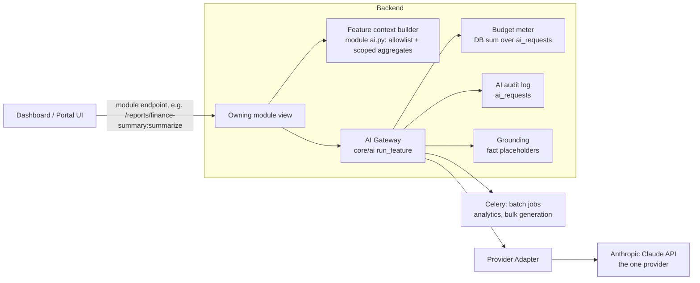

# AI Architecture

> **Agent Context**
> **Summary:** Defines how AI is built into the platform: a single server-side **AI Gateway** in the backend that all AI features call, provider selection and fallback, per-tenant token/cost budgets, permission-scoped data access, human-approval gates, and monitoring. Feature-level definitions live in [`../04-ai/ai-features.md`](../04-ai/ai-features.md); policy in [`../04-ai/ai-governance.md`](../04-ai/ai-governance.md).
> **Co-load with:** `../04-ai/ai-features.md` · `../04-ai/ai-governance.md` · `auth-and-rbac.md`

## 1. Principles

1. **AI is a layer, not a bolt-on** — every AI feature is a first-class module capability (documented in that module doc's §14) that routes through one shared gateway.
2. **Server-side only** — browsers and mobile apps never talk to an LLM provider directly; no provider keys leave the backend.
3. **The user's permissions bound the AI** — an AI request executes data access with the *initiating user's* RBAC context and the tenant's RLS. The assistant can never reveal data the user couldn't open in the UI.
4. **Human approval for anything outward or destructive** — AI drafts; humans publish (announcements, report-card remarks, notices, grades). Enforced by workflow, not convention.
5. **Predictable cost** — per-tenant budgets, per-feature model tiers, caching.

## 2. Components

- **AI Gateway:** one internal Django app, `core/ai/`, with one entry point, `run_feature()`. **Feature endpoints live in the module that owns the data** (`POST /api/v1/reports/finance-summary:summarize` in `fees_finance`), because core may not import an app ([ADR-0013](../decisions/0013-cross-app-dependencies.md)); `core/ai` serves only `GET /api/v1/ai/usage` and `POST /api/v1/ai/requests/{id}:feedback` ([ADR-0035](../decisions/0035-ai-gateway-shape.md)). Features self-register from each app's `ai.py`. No free-form proxy endpoint.
- **Context Builder:** each feature's `ai.py` assembles the prompt context via scoped queries (aggregates, never raw table dumps), keeps only the fields its per-kind allowlist names, pseudonymizes identities and fences record text as untrusted, per `ai-governance.md`.
- **Tool Registry:** for agentic features (NL search, assistants), the model may call only whitelisted read functions; each tool re-checks the caller's permission key. Write-tools are draft-only.
- **Provider Adapter:** provider-agnostic interface (`core/ai/providers/`); `anthropic.py` is the only module that imports a provider SDK, and no SDK type crosses it. One provider at launch, Anthropic Claude; a secondary provider is deferred (ADR-0035). Per-feature model tiers: `fast` for classification & summarization, `standard` for assistants & generation, each pinned in settings (`AI_MODEL_FAST`, `AI_MODEL_STANDARD`).
- **Budgets:** per-tenant monthly token quota (`AI_MONTHLY_TOKEN_BUDGET_DEFAULT`, overridable per tenant in `TenantSettings.ai`, which only the platform writes) + per-user daily caps (`AI_USER_DAILY_TOKEN_CAP`); soft warning at 80% (`meta.budget_warning`), hard stop at 100% with `429 ai_quota_exceeded`. The meter is a database sum over `ai_requests` in the tenant's timezone, all four token counts included; concurrent calls may overshoot by at most concurrency × (context + `max_output_tokens`), bounded by the per-user `ai` throttle. A Redis reservation is deferred until load justifies it (ADR-0035).

## 3. Feature Execution Patterns

| Pattern | Used by | Behavior |
| ------- | ------- | -------- |
| **Synchronous ask** | assistants, NL search, summarization | 30 s cap; one JSON response for now (AI-FEE-02), SSE streaming deferred (`deferred-work.md`) |
| **Draft-for-approval** | announcements, notices, lesson plans, quizzes, exam questions, parent messages | Output saved as `draft` on the owning module's entity; publishing requires that module's `publish`/`approve` permission |
| **Batch analytics** | at-risk detection, attendance anomalies, fee-payment prediction, performance insights | Nightly Celery jobs writing *scored suggestions* tables; surfaced in dashboards with explanations; never auto-acts |
| **Document intake** | OCR/extraction (admissions documents, imports) | Async job + human verification screen before data is committed |

## 4. Reliability & Fallback

- Provider error or timeout → one retry, only if it fits inside the 30 s overall deadline (`AI_REQUEST_DEADLINE_SECONDS`; the SDK's own retries are off) → explicit `503 ai_unavailable` and feature-specific graceful degradation (assistant apologizes; batch job reschedules; UI hides AI panel if the flag is off). A non-`end_turn` stop or an answer the feature's validator refuses is also a `503`. No secondary provider at launch ([ADR-0035](../decisions/0035-ai-gateway-shape.md)).
- The provider is called with **no database transaction open**; the gates run in one short tenant transaction before it, and the audit row is committed in its own transaction before any error is returned, so a refusal still leaves exactly one row.
- All AI features sit behind feature flags — see [`multi-tenancy.md`](multi-tenancy.md) §5. `ai.gateway` is the platform-wide kill switch (on by default; a tenant override or ops can only turn it off) and each feature has its own default-off flag, the per-tenant opt-in (`ai.fee-report-summary`).
- Prompt templates are versioned in the repo; every response logs `feature, prompt_version, model, tokens, latency, tenant, user` to the AI audit log (no raw student PII in logs).

## 5. Quality & Monitoring

- **Evaluation harness:** golden-set prompts per feature (`apps/<module>/tests/evals/`) scored on the real provider by `manage.py run_ai_evals` in the `ai-evals` workflow on prompt, model or gateway changes and weekly for drift; a score below the committed baseline's tolerance, an adversarial leak or a missing baseline fails it.
- **Runtime monitoring:** error rate, latency, token spend per tenant/feature, refusal rate; alerting on spend anomalies.
- **Feedback loop:** thumbs up/down + comment on every AI output, reviewed for prompt iteration.

## 6. Data Protection Summary (detail in `ai-governance.md`)

- Minimum-necessary context; identifiers pseudonymized where the feature allows.
- Provider contracts must guarantee no training on submitted data (API-tier terms).
- Children's data: assistants for students use age-appropriate system prompts and hard topic guardrails; parent/student assistants can only access `own`-scoped records.
