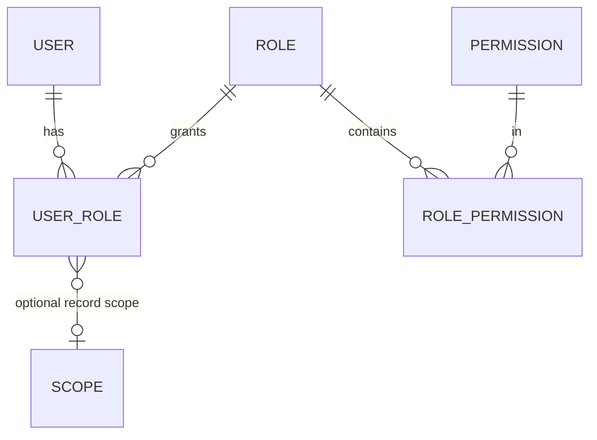

# Authentication & RBAC

> **Agent Context**
> **Summary:** Defines authentication (JWT, sessions, MFA-readiness) and the full RBAC model: permission keys (`module.resource.action`), roles as permission sets, module/feature/record-level checks, approval permissions, tenant isolation interplay, and audit logging. Module docs' §4 tables use the permission-key format defined here.
> **Co-load with:** `../00-overview/users-and-roles.md` · `multi-tenancy.md` · `../05-database/entities/tenancy.md`

## 1. Authentication

- **Credentials:** email or phone + password (Argon2id hashing). Student accounts may alternatively use school-issued usernames (`{tenant-slug}\{admission-no}` style) since young students often lack email.
- **Tokens:** JWT access (15 min) + rotating refresh (30 days) with server-side revocation list; refresh rotation invalidates the family on reuse (theft detection). Web keeps refresh in an HttpOnly SameSite cookie; future mobile uses secure storage — same endpoints, mobile-ready by design.
- **Sessions:** users can list and revoke active sessions/devices. Admin-forced logout supported.
- **Password policy:** min 10 chars + breach-list check; rate-limited login (per-account and per-IP); lockout with exponential backoff; secure reset via one-time token (email/SMS).
- **Account activation and password reset (built, [ADR-0033](../decisions/0033-account-invitations-and-auth-email.md)):** nobody chooses a password at sign-up. A school invites a person (`POST /staff/{id}:invite`, `/guardians/{id}:invite`, `/students/{id}:invite`, the last two under `students.portal-account.invite`), which creates an inactive account and emails a single-use link valid 72 hours; only `POST /auth/invitations:accept` sets the password and activates it. `POST /auth/password-reset` emails a one-hour link to an active member of the named school and answers 204 whatever the email; `POST /auth/password-reset:confirm` sets the password and revokes every refresh token. All four `/auth/` endpoints are unauthenticated, name the school in the body (`school`), run their lookups inside that tenant's context, answer every unusable link with the same 400 `invalid_link`, and have their own throttles (never `AuthEndpointThrottle`, so they cannot lock a school out of login). The dashboard pages are `/accept-invite`, `/forgot-password` and `/reset-password`; the link's values travel in the URL fragment, which the page reads once and clears, and the three pages set a `no-referrer` referrer policy (`<meta name="referrer">`). A guardian's or student's account is deactivated, and its tokens and pending invitations revoked, when they stop being eligible (no portal-enabled link to an enrolled child; no longer enrolled); a staff member's on exit.
- **MFA/2FA-ready:** TOTP enrollment shipped for platform roles and tenant owners/admins at launch; optional per-tenant enforcement policy for all staff. Architecture keeps a `second_factor` step in the login state machine so SMS-OTP/WebAuthn can be added without contract changes.
- **TOTP MFA, as built (platform users; `core/rbac/mfa.py`, RFC 6238 via `pyotp`):** tenant owners/admins and per-tenant enforcement are deferred (`docs/deferred-work.md`).
  - **Login is two steps for a user with `mfa_enabled`.** `POST /auth/login` checks the password and answers `200 {"mfa_required": true, "mfa_token"}` with no token and no cookie. `mfa_token` is a `django.core.signing` token valid `MFA_CHALLENGE_TTL_SECONDS` (300). `POST /auth/mfa:verify {mfa_token, code | recovery_code}` is the `second_factor` step: it issues the normal pair and refresh cookie. A wrong code is 400 `invalid_mfa_code`. Each redemption counts against the challenge before the code is checked; after `MFA_CHALLENGE_MAX_ATTEMPTS` (5) attempts, or one success, it is spent, and an expired, tampered or spent challenge is 400 `mfa_challenge_invalid` (sign in again).
  - **Per-account limit (NIST SP 800-63B §5.2.2):** a password holder mints a fresh challenge per login, so the account is the bound. Every TOTP or recovery-code check, on `:verify` and `:confirm`, runs under the user's row lock. The attempt is counted (`users.mfa_failed_attempts`) before the code is checked, and only a success resets the count. Every `MFA_MAX_FAILED_ATTEMPTS` (10) consecutive failures lock the second factor (`users.mfa_locked_until`): for `MFA_LOCKOUT_SECONDS` (900) the first time, twice as long each time after. At `MFA_PERMANENT_LOCKOUT_ATTEMPTS` (100, §5.2.2's ceiling) consecutive failures it stays locked until an operator runs `manage.py create_platform_admin --email … --unlock-mfa`, which keeps the enrolled factor (`--reset-mfa` also lifts it, by removing the factor). While locked, even a right code is 429 `mfa_locked`, with `Retry-After` giving the seconds left; the operator-only lock has no `Retry-After`. The count is kept on the row, not in the cache, because production Redis evicts keys (`allkeys-lru`).
  - **Every token carries `amr` (RFC 8176):** `["pwd"]` after the password alone, `["pwd", "otp"]` after `:verify` or `:confirm`. SimpleJWT copies refresh-token claims into every access token it derives, so refresh and rotation keep `amr`. The platform console requires `"otp"` (403 `mfa_required`, [ADR-0036](../decisions/0036-platform-scope-and-cross-tenant-access.md)).
  - **Enrolment:** `POST /auth/mfa:enroll` (platform user, any `amr`) returns `{secret, otpauth_uri}` from `pyotp.random_base32()`, stored encrypted with `core.integrations.crypto` and not yet enabled; it is 409 `mfa_already_enabled` once MFA is on, so a password-only token never replaces an enrolled factor. `POST /auth/mfa:confirm {code}` turns MFA on and returns ten single-use recovery codes (SHA-256 hashes stored, shown once) with a fresh `["pwd", "otp"]` pair. A tenant principal gets 404 on all three enrolment routes.
  - **Replay:** a code is checked with `verify_and_get_timecode(code, valid_window=1)` and accepted only if its time step is later than `users.mfa_last_timecode`, stored under a row lock. A recovery code is spent by a conditional update.
  - **No self-service disable:** `POST /auth/mfa:disable` is 403 for a platform user. An operator who lost both factors is reset with `manage.py create_platform_admin --email … --reset-mfa`, which clears the secret and codes and revokes every refresh token. Access tokens issued before the reset still say `otp` in `amr` until they expire, so the console gate (`IsPlatformPrincipal`) also requires the row's `mfa_enabled`, and they stop working at once.
  - **Also:** every `/auth/mfa:*` route uses `AuthEndpointThrottle`; MFA changes are security events (`auth.mfa.*`, SEC-06); `rotate_integration_credentials` re-encrypts the secrets once per run (`users` has no RLS, so a global rotator rather than a per-tenant one).
- **Impersonation:** platform support may impersonate a tenant user only with an elevation grant — time-boxed (≤ 1 h), reason required, banner shown, every action audit-tagged `impersonated_by`.
- **Impersonation, as built ([ADR-0037](../decisions/0037-impersonation-grants.md)):**
  - **Grant.** `POST /platform/tenants/{id}:impersonate {user_id, reason, duration_minutes}` (`platform.tenant.impersonate`) creates an `impersonation_grants` row and answers `{grant_id, expires_at, handoff_url}`. The target is an active, non-platform user of an operational school; the duration is 1 to `PLATFORM_IMPERSONATION_MAX_MINUTES` (else 422). A new grant by the same holder for the same person releases the previous one.
  - **Handoff.** `handoff_url` is the school's `/impersonate` page with a single-use code in the fragment, stored only as its SHA-256 and valid `PLATFORM_HANDOFF_CODE_TTL_SECONDS`. `POST /auth/impersonation:exchange {code}` (anonymous, `AuthEndpointThrottle`) answers `{access, expires_in}`; an unusable code is 400 `invalid_link`.
  - **Token.** An access token only, never a refresh token or cookie: `sub` the target, `tenant_id`, `is_platform=false`, `act={"sub": operator}`, `grant_id`, `amr=["impersonation"]`, `exp` the grant's `expires_at`.
  - **Every request** goes through `core.rbac.authentication.ImpersonationAwareJWTAuthentication` (`DEFAULT_AUTHENTICATION_CLASSES`). A token with `grant_id` is accepted only while the grant is live and its holder is active, a platform user with MFA on and still holding `platform.tenant.impersonate`; otherwise 401 `impersonation_ended`, also when no checker is registered. The target's permissions apply; `request.impersonated_by` tags every audit row and security event; `/auth/me` adds `impersonation: {by_name, expires_at} | null`.
  - **Refused under impersonation:** `change-password` and `/auth/mfa:enroll|confirm|disable`, 403 `impersonation_forbidden`. The console's routes 404 the token.
  - **Ending:** `POST /auth/impersonation:end`, logout (which releases the grant and leaves the refresh cookie alone), `DELETE /platform/impersonation-grants/{id}` (the holder, or a `platform_super_admin`), and the five-minute expiry sweep.
  - **The dashboard's client flow** ([ADR-0037](../decisions/0037-impersonation-grants.md), platform-admin §7.3). The console opens `handoff_url` in a new tab. `/impersonate` is a public link path, like `/accept-invite`: it reads the code from the fragment once, clears it with `replaceState`, drops the tab's in-memory token (so the exchange is anonymous; the host's own cookie session is left alone) and exchanges the code. The access token is kept in memory as for any session, and the proxy's session marker gets `max-age` equal to `expires_in`. An impersonated session never refreshes: the client's refresh hook returns "session over" when the token's `amr` says `impersonation`, or, once there is no token (a reload, a 401, the end), when a per-tab `sessionStorage` flag says the tab held one, because a refresh cookie on that host belongs to another session. The flag lasts until the tab closes or a normal sign-in in it clears it, so a 401 still in flight after the first never refreshes either. Its 401, or any `impersonation_ended`, drops the session and opens `/impersonate?ended=1`, never `/login`. A banner names the user, the operator and the time left, with End session (`:end`); sign-out ends the grant the same way. The password and second-factor screens show a refusal instead of their form.

## 2. RBAC Model

### 2.1 Permissions
- A **permission** is a static, code-defined key: **`module.resource.action`** — e.g. `attendance.student-attendance.mark`, `fees.invoice.create`, `exams.result.approve`, `library.book.issue`.
- **Actions vocabulary (locked):** `view`, `create`, `update`, `delete`, `export`, `import`, `approve`, `publish`, plus rare module-specific verbs (`mark`, `issue`, `collect`, `refund`) declared in that module doc §4.
- Permissions ship with the code (migration-seeded); tenants can never invent permission keys — only combine them into roles.
- Every key has a **scope**: `tenant` (held by a school's roles) or `platform` (held by the platform roles only, never by a school). The scope, not the module name, decides who may hold a key ([ADR-0036](../decisions/0036-platform-scope-and-cross-tenant-access.md)).

### 2.2 Roles
- A **role** = named set of permissions, either **default** (platform-seeded per `users-and-roles.md`, updatable by releases) or **custom** (tenant-created, tenant-scoped).
- Every default role, tenant and platform, is one shared `tenant=None` row, created and granted its registry keys on every migrate (`core.rbac.sync.sync_default_roles`, additive only). A platform role (`is_platform`) holds platform-scope keys and is held by platform users only.
- Users get roles via `user_role` rows; effective permissions = union of all roles. No direct user→permission grants. No role inheritance hierarchy — composition over inheritance (a custom role is built by cloning + editing; simpler to audit than inheritance chains). *This is a deliberate simplification recommendation.*

### 2.3 Check Levels
1. **Module-level:** is the module enabled for the tenant (plan/feature flag) — checked before any permission.
2. **Feature-level (endpoint):** does the user hold the endpoint's permission key.
3. **Record-level (scope):** optional constraint attached to a `user_role`, evaluated as queryset filters:
   - `own` — only records the user owns (student → self, guardian → own children, driver → own route);
   - `assigned` — teacher → assigned classes/sections/subjects;
   - `campus:<id>` — staff restricted to one campus;
   - `all` — whole tenant (default for admin-type roles).

   **Scope is evaluated per role assignment** ([ADR-0031](../decisions/0031-record-scope-per-role-assignment.md)).
   Effective *keys* are the union of every role (§2.2), but a scope narrows only the keys its own
   role grants. A user with `students.student.view` at `campus:A` and an unrelated role at `all`
   reads campus A's students, not the whole tenant. The rules, in `core/rbac/permissions.py`:
   - **A check reads only the assignments whose role grants the route's key.**
     `scope_grants(user)` maps each held key to the scopes of the live assignments that grant
     it, from one query and one cache entry; `effective_permission_keys` is its key set.
     `scopes_for(user, declared)` reads that map for one declaration. No assignment granting the
     key means no scope, and the read fails closed (`.none()`, `False`, 404).
   - **An `AnyOf` route unions the assignments of every key it names**, so the answer does not
     depend on the order the keys are listed in.
   - **A key held at several scope types reads their union.** A campus-A role and an `assigned`
     role for the same key reach campus A's rows *and* the sections the user is assigned, not
     the first type in some precedence. `all`, or a type that passes through (a `campus` scope
     over a table with no campus column), reads the whole tenant. A type that can reach nothing
     (a `campus` role with no campus) adds nothing and never falls through to another type.
   - **Every scoped read names its key.** `scope_queryset(queryset, user, permission=...)` takes
     the declaration as a required keyword, with no default. The viewset mixin passes the route's
     own declaration (`required_declaration`); a direct caller names the key that governs it.
   - **A route that acts on a row must reach it under the read key and its own key.**
     `TenantScopedViewSetMixin.get_queryset` scopes the queryset twice whenever the route's
     declaration differs from the viewset's read key: first by the read key, then by the
     declaration. PATCH, PUT, DELETE and every colon action resolved through `get_object()` or
     `get_queryset()` get this; a route declaring the read key itself gets one call. The read key
     is `required_permission`, or `scope_read_permission` where the class names another (the
     correction queue reads under `AnyOf(correction.create, correction.approve)`); an action in
     `scope_read_exempt_actions` is scoped by its own key alone (the marks `:lock-marks` and
     `:unlock-marks`, which act on an exam subject and which `school_admin` makes without
     `exams.marks.create`). A target resolved outside
     the mixin chains the same two calls itself, with the target's view key:
     `attendance.student-attendance.view` or `attendance.staff-attendance.view` for a
     correction's row, `students.student.view` or `staff.staff.view` for a nested route's parent,
     `school.section.view` for timetable `:validate` and `:publish`. A target outside either
     scope is a 404, and neither key's roles widen the other.
   - **A privilege applied to one row is checked against that row.** "Does the user hold this key
     at all" is the wrong question for a capacity override, a clearance waiver or an approver's
     cancel. `holds_key_for(user, permission, row, **SomeViewSet.scope_kwargs())` is
     `scope_queryset` over that one row, under the scope settings of the viewset that serves it.
   - **A background job reads under the key its request was admitted on.** An export job's
     payload carries the enqueuing request's declaration as `scope_permission`
     (`core/exports/scope.py`). A job without one fails and asks the user to export again.
4. **Tenant-level:** RLS underneath everything (see `multi-tenancy.md`) — RBAC narrows *within* a tenant, never across.

### 2.4 Approval & Financial Permissions
- Approval steps in configurable workflows (leave, result publishing, refunds, certificate issuance, admission acceptance) each name a required permission (e.g. `hr.leave-request.approve`) and optionally a role; a user cannot approve a step they initiated (segregation of duties).
- Financial mutations (`fees.*.collect|refund|waive`, `payroll.*.approve`) are always audited with before/after amounts and require `record-level ≠ own`.

## 3. Enforcement Points

| Layer | Mechanism |
| ----- | --------- |
| API | Permission key per endpoint, declared on the view (`required_permission` / `required_permission_map`, `AnyOf(...)` where two kinds of caller share a route), not checked ad hoc — the endpoint-contract tests read every declaration; the OpenAPI spec does not publish them |
| Query | Scope filters applied in the base queryset, not in view code |
| Frontend | UI hides/disables by permission, but this is UX only — server checks are authoritative |
| Jobs/AI | Background jobs and AI tools run with the *initiating user's* permission context, never a superuser context |

## 4. Audit Logging

- Every mutation writes an `audit_log` row: `tenant_id, actor_id, impersonated_by, action, resource_type, resource_id, before/after (JSONB, PII-minimized), request_id, ip, user_agent, created_at`.
- Security events additionally logged: logins (success/fail), password/MFA changes, role/permission changes, exports, impersonation grants.
- Immutable (append-only table, no update/delete grants for the app role), tenant-visible to `school_owner`/`it_admin` with filters, retained per data-retention policy (`../07-quality/non-functional.md`).

## 5. Seed Matrix

The default role→permission matrix ships as versioned seed data; each module doc §4 defines its module's rows. Release upgrades may add permissions to default roles but never silently remove tenant-granted ones (migration reports required).
