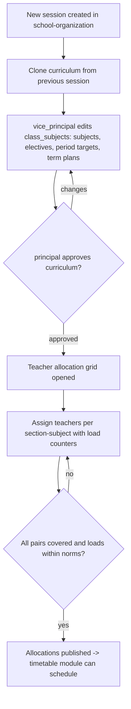
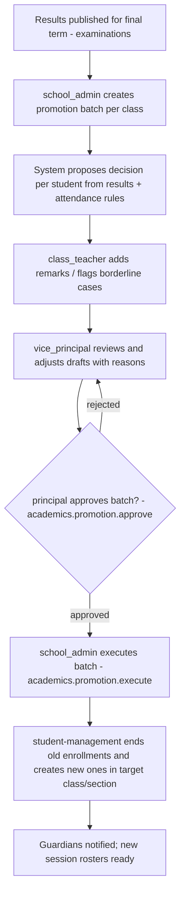

# Module: Academic Management

> **Agent Context** — Load this block first.
> **Summary:** Operates the academic engine on top of the structure owned by school-organization: curriculum mapping (which subjects each class studies per session), subject and teacher allocation to sections, term-wise academic planning, and the student promotion workflow (decide/approve here, execute in student-management). Primary users: principal, vice principal, school admin, teachers.
> **Co-load with:** `../02-architecture/auth-and-rbac.md` · `../05-database/entities/academics.md` · `school-organization.md` · `student-management.md`
> **Owns entities:** class_subjects, teacher_subject_allocations, student_promotions
> **Depends on modules:** school-organization (classes/sections/subjects/sessions), staff-management (teachers), student-management (enrollments), examinations (results for promotion), timetable (scheduling of allocations)

## 1. Purpose

Academic Management turns static structure into a running academic program. For each academic session it defines the **curriculum** — the class↔subject map with electives, weekly period targets, syllabus references, and term-wise plans; assigns **teachers** to (section, subject) pairs with load visibility; and runs the **promotion workflow** at session end — proposing, reviewing, approving, and handing over promotion/retention decisions for every enrolled student.

Classes, sections, subjects, and sessions are owned structurally by [`school-organization.md`](school-organization.md); students and enrollments by [`student-management.md`](student-management.md). This module owns the *relationships and decisions* between them, so that timetable, attendance, and examinations always know which teacher teaches which subject to which section, and what each class is supposed to cover when.

## 2. Business Objective

- Every section fully covered: 100% of curriculum (section, subject) pairs have an allocated teacher before the session starts — the gating metric for timetable generation.
- Transparent, defensible promotions: promotion decisions backed by result data and an approval trail, executed in bulk in minutes instead of days of manual register work.
- Balanced teaching loads (reduce burnout/attrition): allocation screens expose per-teacher weekly load against tenant-configured norms.
- Curriculum consistency across campuses of the same tenant, with per-campus flexibility where configured.

## 3. Target Users

| Role | How they use this module |
| ---- | ------------------------ |
| `principal` | Owns curriculum sign-off, approves promotions, monitors coverage/load dashboards |
| `vice_principal` | Drafts allocations, resolves load conflicts, prepares promotion proposals |
| `school_admin` | Maintains curriculum records, runs bulk allocation and promotion execution handoff |
| `teacher` | Views own allocations and syllabus/term plans; class teachers input promotion remarks |
| `class_teacher` | Provides per-student promotion inputs (remarks, borderline recommendations) |
| `exam_staff` | Consumes curriculum (exam subjects) and supplies result aggregates to promotion |
| `student` / `guardian` | Read-only view of class curriculum and (once executed) promotion outcome via parent-portal |

## 4. Permissions

Permissions follow the RBAC model in [`auth-and-rbac.md`](../02-architecture/auth-and-rbac.md). Permission keys use `<module>.<resource>.<action>`. Module-specific verb declared here: `execute` (promotion batches).

| Permission key | Description | Default roles |
| -------------- | ----------- | ------------- |
| `academics.curriculum.view` | View class↔subject curriculum & plans | all staff; `student`/`guardian` (own class subset) |
| `academics.curriculum.create` / `.update` / `.delete` | Maintain curriculum mappings, electives, period targets, term plans | `school_admin`, `principal`, `vice_principal` |
| `academics.curriculum.approve` | Sign off session curriculum before activation *(recommendation)* | `principal` |
| `academics.teacher-allocation.view` | View allocations (scope `own` for teachers) | all staff |
| `academics.teacher-allocation.create` / `.update` / `.delete` | Assign/reassign teachers to (section, subject) | `school_admin`, `vice_principal`, `principal` |
| `academics.promotion.view` | View promotion batches & decisions | `principal`, `vice_principal`, `school_admin`, `class_teacher` (own section) |
| `academics.promotion.create` / `.update` | Create batches, edit draft decisions | `school_admin`, `vice_principal` |
| `academics.promotion.approve` | Approve a promotion batch (approver ≠ preparer) | `principal`, `school_owner` |
| `academics.promotion.execute` | Execute approved batch (creates enrollments via student-management) | `school_admin` |
| `academics.curriculum.export` / `.import` | Bulk curriculum/allocation import & export | `school_admin`, `it_admin` |

## 5. Main Features

1. **Curriculum management** — per session, map each class to its subjects (`class_subjects`): core vs. elective, weekly period targets, syllabus document, term-wise plan (topics per term). Cloneable from the previous session.
2. **Subject allocation** — maintain which subjects are actually offered per class/campus per session, including elective pools and minimum/maximum elective counts per student *(recommendation: elective choice capture at enrollment)*.
3. **Teacher allocation** — assign teachers to (session, section, subject) with co-teacher support, load counters (allocated weekly periods vs. norm), qualification hints from staff-management, and conflict warnings.
4. **Academic planning** — term plans per class-subject (topics, sequence, planned assessment points) giving teachers and the principal a shared coverage view; feeds AI lesson planning.
5. **Student promotion workflow** — session-end batches per class: propose (auto-suggest from results + attendance thresholds), review with class-teacher input, approve (gated), then execute — handing enrollment transitions to student-management. Supports promoted / retained / promoted-on-trial / graduated outcomes.
6. **Coverage & load dashboards** — unallocated (section, subject) pairs, per-teacher load, curriculum completeness per campus.

## 6. Sub-features

- **Curriculum:** per-campus overrides of the class curriculum where tenant-enabled; syllabus file attachment per class-subject; change history via audit log; lock on session activation with controlled amendments.
- **Electives:** elective groups within a class ("choose 1 of 3"); student elective selections recorded against enrollment *(recommendation)*.
- **Teacher allocation:** bulk allocation grid (class × subject × section); copy-from-previous-session; substitute/temporary reallocation deferred to [`timetable.md`](timetable.md) (`teacher_substitutions`); reassignment mid-session preserves history (old allocation end-dated, not deleted).
- **Promotion:** rule template per tenant (pass criteria referencing grading scales in [`examinations.md`](examinations.md), attendance minimum); per-student override with mandatory reason; graduating class handled as `graduated` (no target class); retained students re-enroll in the same class next session; batch revert allowed before any downstream activity exists (audited).
- **Planning:** term-plan progress ticks by teachers (topic covered) enabling coverage reports *(recommendation)*.

## 7. Workflows

### 7.1 Session curriculum & allocation setup

### 7.2 Student promotion

Batch states: `draft → pending_approval → approved → executed` (plus `reverted` before downstream data exists). Approver must differ from preparer (RBAC §2.4). Execution is idempotent and runs as a background job with a per-student result report.

## 8. User Journeys

- **`vice_principal` (pre-session):** clones last year's curriculum → adds Computer Science to Grades 7–8 → opens the allocation grid → drags teachers onto sections, watching load counters → resolves two over-load warnings → publishes.
- **`principal`:** reviews the curriculum diff vs. last session → approves → at session end, opens the Grade 8 promotion batch, scans 12 borderline cases with class-teacher remarks and AI summaries → retains 2 with reasons → approves.
- **`class_teacher`:** receives the promotion-input task → enters remarks for 30 students → flags one student for retention discussion → later sees final outcomes.
- **`teacher`:** checks "My Allocations" → opens the Grade 6 Science term plan → ticks covered topics → uses the AI lesson-plan generator seeded from the plan.

## 9. Inputs

- Forms: curriculum editor (class-subject grid), elective-group editor, term-plan editor, teacher-allocation grid, promotion batch review screens.
- Bulk import: curriculum and allocations CSV/Excel (background jobs with row-level errors).
- Cross-module data in: result aggregates and grading outcomes (examinations), attendance percentages (attendance), teacher qualifications/load (staff-management, timetable), enrollments (student-management).
- Syllabus file uploads (two-step flow per [`api-architecture.md`](../02-architecture/api-architecture.md) §2.8).

## 10. Outputs

- `class_subjects` and `teacher_subject_allocations` records consumed by timetable (scheduling), attendance (subject-wise marking), examinations (exam subjects), and dashboards.
- Approved `student_promotions` batches handed to student-management for enrollment execution.
- Events emitted: `curriculum.updated`, `allocation.published`, `promotion.approved`, `promotion.executed` (webhooks per API doc §2.6).
- Exports: curriculum book (PDF), allocation matrix (Excel), promotion outcome report (PDF/CSV).

## 11. Validations

- `class_subjects` unique per (session, class, subject) — per campus where overrides are enabled; subjects/classes must be active tenant records.
- Weekly period targets ≥ 1; elective groups require ≥ 2 options; term plans must reference terms of the same session.
- Teacher allocation: teacher must be active teaching staff; duplicate (session, section, subject, teacher) rejected; load warnings at tenant-configured norm, hard cap optional; allocation to a section requires the subject to exist in that class's curriculum.
- Promotion: batch only for the active session with published final results (cross-check with examinations); one decision per enrolled student per batch; target class must be the next `level`, and a decision or target class that differs from the proposal recorded at batch creation needs an override reason, checked when the batch is submitted (a skipped level, a cleared target and a flip between graduated and promoted all count; `retained` and `promoted_on_trial` always do — see the implementation notes in §16); execution only from `approved`; approver ≠ preparer; re-execution attempts are no-ops (idempotent).
- Session lock: curriculum and allocations in closed sessions are read-only.

## 12. Notifications

| Event | Recipients | Channels | Template ref |
| ----- | ---------- | -------- | ------------ |
| Allocation assigned/changed | Affected teacher; department head | in-app, email | `academics.allocation-changed` |
| Curriculum approved for session | All teaching staff | in-app | `academics.curriculum-approved` |
| Promotion input requested | `class_teacher` of each section | in-app, email | `academics.promotion-input-request` |
| Promotion batch pending approval | `principal` | in-app, email | `academics.promotion-pending` |
| Promotion executed (per student outcome) | Guardians; student (if account) | email, SMS, in-app | `academics.promotion-outcome` |
| Coverage gap (unallocated pairs at T-7 before session start) | `vice_principal`, `school_admin` | in-app | `academics.coverage-gap` |

Channels and delivery behavior follow [`notifications.md`](../02-architecture/notifications.md).

## 13. Reports

- **Curriculum coverage:** class × subject matrix per session/campus, with syllabus/plan completeness (export PDF/Excel).
- **Teacher load report:** weekly periods per teacher vs. norm, by department/campus (visibility: `principal`, `vice_principal`, `hr_staff`).
- **Allocation matrix:** section × subject → teacher, gaps highlighted.
- **Promotion outcome report:** per class — promoted/retained/on-trial/graduated counts, override reasons, approver trail (visibility: `principal`, `school_owner`, `school_admin`).
- **Syllabus progress:** topic coverage per class-subject per term *(recommendation, depends on progress ticks)*.

## 14. AI Capabilities

Cross-referenced to [`ai-features.md`](../04-ai/ai-features.md). All generation is draft-only; a named human approves before anything reaches students or records.

- `AI-ACA-01` **Lesson & term-plan generation** — drafts lesson plans and term topic sequences from the class-subject curriculum, session calendar, and grading scheme; teacher edits/approves. Also seeds assignment and quiz drafts (delivery of quizzes/questions lives in examinations, `AI-EXM-*`).
- `AI-ACA-02` **Promotion recommendations** — explains each auto-proposed promotion decision (results, attendance, trend) and flags borderline students with reasoning for the review meeting; never auto-approves.
- `AI-ACA-03` **Teacher allocation recommendations** — proposes an allocation plan optimizing qualification match, load balance, and continuity with prior years; presented as a diff the `vice_principal` can apply per row.
- `AI-ACA-04` **Academic performance insights** — natural-language Q&A and narrative insights over class/subject performance ("which Grade 7 subjects declined vs. last term?"), permission-scoped to the caller.

## 15. Database Entities

Full column-level specs live in [`../05-database/entities/academics.md`](../05-database/entities/academics.md). All tenant-scoped under RLS.

| Table | Purpose |
| ----- | ------- |
| `class_subjects` | Session-scoped class↔subject curriculum with electives, period targets, term plans |
| `teacher_subject_allocations` | Teacher assignment to (session, section, subject) with load data |
| `student_promotions` | Per-student promotion decisions in approvable batches |

Referenced (owned elsewhere): `classes`, `sections`, `subjects`, `academic_sessions`, `terms` (school-organization); `student_enrollments`, `students` (student-management); `staff` (staff-management).

## 16. API Requirements

Conventions per [`api-architecture.md`](../02-architecture/api-architecture.md).

> **Implementation notes** (as shipped — read alongside the contract below).
>
> - **`class_subjects` is owned by this module's API but its model lives in
>   `apps/school_organization`.** That app shipped the table first and its
>   session-clone wizard writes it directly; moving a model between apps is
>   migration risk with no runtime payoff, since the table name is unchanged.
>   The endpoint previously sat there too, borrowing `school.subject.*` keys
>   because §4 declared none for it — it now serves from `apps/academics` under
>   `academics.curriculum.*` and `module.academics`, which is what
>   [`school-organization.md`](school-organization.md) §6 ("curriculum mapping
>   to classes lives in academics.md") always intended. Creation delegates to
>   `school_organization.services.map_subject_to_class`, so the API, the wizard
>   and the importer share one set of rules.
> - **Edits honour the same rules.** `PATCH` and `DELETE` refuse a closed
>   session (§11 session lock), as a plain non-field `422`. A `PATCH` that
>   changes the session, class, subject or campus re-runs the identity checks
>   through `school_organization.services.assert_class_subject_mapping_valid` —
>   the one function create runs too — whose `422` errors are keyed by field
>   (`class_id` / `subject_id`) so a form can place them; a duplicate is a
>   `409`. A `PATCH` that leaves those four fields alone skips the identity
>   checks, so an inactive class never blocks editing a row's periods or notes.
>   Rows also carry read-only `academic_session_name`, `class_name`,
>   `subject_name` and `campus_name`, so a list renders with no lookup per row,
>   and `:clone` answers a typed `{created, skipped}` (`CloneCurriculumResult`
>   in the contract) rather than a `200` with no schema. None of this is a `v2`
>   event under [`api-architecture.md`](../02-architecture/api-architecture.md)
>   §2.1: the name fields and the typed result are additive, and the lock and
>   identity checks tighten rules this section and §11 already declared, which
>   the endpoint used to accept writes against; a client that followed the
>   contract is unaffected, and the dashboard in this repo (regenerated in the
>   same commit) is its only consumer.
> - **`:clone` is synchronous, not a background job.** A clone is one
>   `bulk_create` over a single session's rows — hundreds, not thousands. It
>   honours `Idempotency-Key`, and the service skips rows the target already
>   has, so it converges on a retry either way.
> - **`:execute` returns `202` + a job**, as the contract below always said.
>   It shipped synchronous on the argument that a class-sized batch completes
>   inline; what that missed is that `execute_batch` commits each student
>   separately on purpose, and `ATOMIC_REQUESTS` turns each of those commits
>   into a savepoint — so an inline run held every row lock it took for the
>   whole request and showed the caller nothing until it finished. The work is
>   `apps.academics.tasks.execute_promotion_batch_task`; whether the batch is
>   executable at all is still decided synchronously, so a draft batch is a
>   `409` rather than a job that fails out of band. `Idempotency-Key` replays
>   the job id, and re-execution stays a per-row no-op beyond the 24h window.
>   A student who fails is reported with the server's plain message in the
>   report's `error` (the API error's own text, joined; an unexpected exception
>   is logged and reported as a generic line, so database text never reaches the
>   job result).
> - **Not built yet:** `POST /curriculum-imports`.
> - **The promotion proposal is level-based only.** §7.2 has it read published
>   final results and attendance percentages; the `examinations` and `attendance` modules
>   have since shipped, but nothing reads them yet, so `decision_basis` records
>   `results_available: false` and `attendance_available: false` rather than implying a
>   judgement that was never made. Reviewers adjusting drafts is the step the workflow gates
>   on, so the flow is usable — but the rule engine is a genuine gap, not a shortcut.
> - **The override reason follows a proposal recorded at creation.**
>   `create_promotion_batch` writes `proposed_decision` and `proposed_to_class_id` into each
>   row's `decision_basis`; the class key is always present and is null for a graduating
>   proposal, so a graduating proposal is not mistaken for a row from before the keys existed.
>   `:submit` requires an `override_reason` when either the decision or the target class
>   differs from that record: a skipped level, a cleared target and a flip between graduated and
>   promoted all need one, and `retained` and `promoted_on_trial` always deviate, so they always
>   do. The check used to compare only the decision, against a proposal re-derived from the
>   row's own editable target class, so an edit defined the proposal it was checked against and
>   the rule never fired. The record freezes the ladder at creation: for every batch created
>   from now on, a class deactivated or re-levelled afterwards no longer changes what counts as
>   a skip. A draft created before the keys existed has no record and falls back to
>   `next_class_for(from_class)` on today's ladder, cached per from-class (two queries per
>   distinct class); its only consequence is at most one extra "reason required" prompt on a
>   batch that is still open. `:submit` does not check that the recorded target class is still
>   active, which is listed in `deferred-work.md` with `next_class_for` stepping over a
>   deactivated level. The `422` text changed with the rule ("…the decision or the target class
>   differs from the proposal. Missing for N student(s)."), and the dashboard shows it verbatim.
>   There is **no section-required-at-submit rule**: a batch starts without sections, the
>   proposal names a class and not a section, the review screen shows an advisory count of the
>   students without one, and `:execute` reports each of them as failed, by name. Not a `v2`
>   event under [`api-architecture.md`](../02-architecture/api-architecture.md) §2.1: the
>   reason requirement tightens a §11 rule the contract already declared ("a skip needs a
>   reason") whose check never fired; `decision_basis` gains two keys, read-only through the API
>   and additive; and the in-repo consumers (the dashboard's decision editor, the e2e seed, which
>   now sends an `override_reason` with its explicit target class) changed in the same PR.
> - **The promotion endpoints now have typed responses.** `GET /student-promotions/{id}` is
>   `PromotionBatchDetail` (the batch plus its `decisions`), `POST /student-promotions` answers
>   `PromotionBatchCreated` (`{batch_id, students}`) and the four transitions answer
>   `PromotionTransitionResult` (`{updated}`), where they were untyped bodies. The rows carry
>   read-only names so a screen never resolves an id: a batch has `from_class_name`,
>   `from_academic_session_name` and `to_academic_session_name`; a decision has
>   `from_class_name`, `to_class_name` and `to_section_name`, the last two null until a reviewer
>   picks them. A batch's `status` is a typed enum, `PromotionStatusEnum` (it was an untyped
>   string on `PromotionBatch`, and the decision rows' own enum had been auto-named
>   `PromotionDecisionStatusEnum`, a name with two promotion usage sites; one
>   `ENUM_NAME_OVERRIDES` entry now names the one choice set). All of this is additive, so the
>   §2.1 argument above covers it. **Only `:execute` honours `Idempotency-Key`**: `:submit`,
>   `:approve`, `:reject` and `:revert` ignore it, so a transition retried after a lost response
>   runs against the state machine again and answers `409`, and the dashboard reloads the batch
>   to show its real status instead of treating that as a failure.
> - **Two §12 notifications are deferred**, and say so in
>   `apps/academics/notifications.py`: `promotion-input-request` needs a
>   task/inbox surface for class teachers, and `coverage-gap` is a scheduled T-7
>   sweep that belongs with the coverage report.

- `GET/POST /api/v1/class-subjects` · `GET/PATCH/DELETE /api/v1/class-subjects/{id}` — filters: `academic_session_id`, `class_id`, `campus_id`, `subject_id`, `is_elective`.
- `POST /api/v1/class-subjects:clone` — clone curriculum between sessions: synchronous `200` with `{created, skipped}`, `Idempotency-Key` supported (see the implementation notes above).
- `GET/POST /api/v1/teacher-subject-allocations` · `PATCH/DELETE /api/v1/teacher-subject-allocations/{id}` — filters: `academic_session_id`, `class_id`, `campus_id`, `section_id`, `subject_id`, `staff_id`, `current` (`true`: no end date, `false`: ended, absent: both); `search` over the teacher's first and last name, the subject's name and the section's name. POST and PATCH answer `{data, meta: {warnings}}` (the over-norm warning rides in `meta`, never a `422`). `effective_to` is the UTC date: the server runs on UTC, so the dashboard sends the UTC date. The rules behind PATCH, End and Reinstate are in §20.
- `GET /api/v1/teacher-subject-allocations/load-summary` — per-teacher aggregates; `academic_session_id` is required and returns typed rows `{staff_id, name, weekly_periods, allocations, norm, over_norm}`.
- `GET/POST /api/v1/student-promotions` (batches) · `GET /api/v1/student-promotions/{id}` (batch with per-student decisions, unpaginated) · `PATCH /api/v1/student-promotions/{id}/decisions/{student_id}` — the list is page-number paginated, newest batch first, with filters `status`, `decision`, `batch_id`, `student_id`, `from_academic_session_id`, `to_academic_session_id` and `from_class_id` and ordering by `status`, `students` or `started_at`. `GET …/{id}` ignores them: a batch is returned whole, or is a `404`. Typed responses: `PromotionBatch` (a list row), `PromotionBatchDetail`, `PromotionBatchCreated` (`201`) and the decision row's `PromotionDecision`, with the name fields and the `PromotionStatusEnum` status described in the implementation notes above.
- `POST /api/v1/student-promotions/{id}:submit` · `:approve` · `:reject` · `:revert` (colon-actions answering `PromotionTransitionResult` `{updated}`; they ignore `Idempotency-Key`, so a retry is a `409`) · `:execute` (`202` + job; the one that honours `Idempotency-Key`). `:submit`, `:approve` and `:execute` answer `422` when the target session is closed or archived (`:reject` and `:revert` only release or undo rows, so they do not); the job reports a student whose source enrollment ended after approval as failed, by name, and does not enrol them onward. A failure of the whole batch puts only an API error's own message in the job's `error`; anything else is logged and shows a generic line.
- `POST /api/v1/curriculum-imports` → `202` + job.

## 17. Integration Requirements

- **Internal:** background jobs (batch execution, imports), file storage (syllabus documents), notification service, audit log, AI gateway (`AI-ACA-*`), feature flags (elective support, per-campus curriculum are plan-gated).
- **External:** none required; curriculum-standard imports (e.g. national curriculum templates) are a future marketplace integration per scope §21.

## 18. Dependencies on Other Modules

| Module | Direction | What is shared |
| ------ | --------- | -------------- |
| school-organization | inbound | Sessions, terms, classes (level ladder), sections, subjects — the structure this module maps |
| staff-management | inbound | Teacher identity, qualifications, employment status for allocation |
| student-management | both | Enrollments consumed for promotion proposals; approved batches executed there |
| examinations | both | Result aggregates & grading scales feed promotion rules; curriculum defines exam subjects |
| attendance | inbound | Attendance percentages feed promotion criteria; allocations define subject-wise marking rights |
| timetable | outbound | Published allocations are the scheduling input; period targets constrain slot counts |
| parent-portal / communication | outbound | Curriculum views and promotion outcome notifications |

## 19. Open Questions / Recommendations

- *(recommendation)* Ship a default promotion rule template (pass all core subjects + ≥ 75% attendance) that tenants adjust; never hard-code pass criteria.
- *(recommendation)* Curriculum sign-off (`academics.curriculum.approve`) is proposed, not client-confirmed — small schools may prefer to skip the gate via workflow configuration.
- **Open:** are per-campus curriculum differences a real requirement for target schools, or is tenant-wide curriculum sufficient? Modeled as optional override, default off.
- **Open:** where student elective choices are stored — proposed as a small extension on `student_enrollments` (JSONB `elective_subject_ids`) rather than a new table; to be settled in the consistency pass.

## 20. Implementation notes

**File-per-action layout refactor.** `apps/academics` restructured from
shared `views.py`/`services.py`/`serializers.py`/`filters.py` files into one
package per resource (`curriculum/`, `teacher_allocations/`,
`promotions/`) — the same layout already applied to `apps/communication`,
`apps/school_organization`, `apps/staff_management`, and `apps/timetable`
(see those modules' own §20). `viewset.py` stays one file per resource,
every action a plain method; each package gets a single flat `services.py`
rather than a `services/` subpackage — none of the three resources has
enough distinct per-action logic to warrant the extra split (`promotions/`
comes closest, with its `:submit`/`:approve`/`:reject`/`:execute`/`:revert`
lifecycle, but the functions share enough state-machine plumbing —
`batch_queryset`, `_transition`, the two `_assert_*` guards — that one file
reads more coherently than five thin ones).

Unlike `school_organization`, `staff_management`, and `timetable`, this
module split **cleanly** — every function in the old `services.py` and
every class in the old `views.py`/`filters.py` belonged to exactly one
resource once traced, with the sole exception of two symbols genuinely
shared by all three: `FEATURE = "module.academics"` (root `views.py`) and
`_fk`/`READ_ONLY_FIELDS` (root `serializers.py`). The old `services.py` and
`filters.py` are deleted entirely — nothing was left to keep at the app
root. `permissions.py`, `features.py`, and `uploads.py` are unchanged in
place — Django/Celery autodiscovery requires them there. `tasks.py` keeps
its Celery registration unchanged but has one necessary one-line edit: its
`execute_batch` import now points at `promotions.services`.

Pure reorganization: `openapi.yaml`/`schema.d.ts` are **byte-identical** to
`main`. A handful of prose cross-references inside moved docstrings and
`notifications.py`'s own "where does each trigger fire from" note needed
updating to name the new package paths — none of that prose reaches the
API contract. No
endpoint, permission, or response shape changed anywhere in the module.

**Dashboard, curriculum (as shipped).** `/academics/curriculum` is the first Academics screen: one
academic session's class-subject mappings in a server-paginated `DataGrid` (class, subject, campus,
core or elective, weekly periods), with search over the elective group and notes, and filters for
session, class, campus and kind. The dashboard's Academics screens were built once and removed by
the shell reset; they are being rebuilt as three PRs, this one the curriculum, then teacher
allocations and load, then promotions. The sidebar gains an "Academics" group, its children
the sections the viewer holds the `.view` key for (`MenuItem.permission`, applied by
`filterMenuByAccess`; a group with no permitted child is dropped). The same list drives a tab bar
over every Academics route, and `/academics` itself has no page: it sends the viewer to the first
section they may open, or says why there is none. The session is the `session` URL value (a UUID;
absent means the current session), so a link shows the same session, and the list is not requested
until one resolves; no current session shows a picker and an empty state, and a failed sessions
fetch a retry rather than "no session". The other list state (search, filters, sort, page, page
size, hidden columns) is in the URL too ([ADR-0024](../decisions/0024-list-state-in-the-url.md)).
A closed or archived session is read-only: the screen says so and hides Add subject, Clone and the
row actions, the API's session lock being what actually refuses. "Add subject" sends the whole
mapping (session, class, subject, campus or none for every campus, elective flag and group,
weekly periods, notes) and offers only live options: active classes and subjects, writable
sessions. An edit shows the four fields that identify the mapping read-only and sends only the
four it may change (`is_elective`, `elective_group`, `weekly_periods`, `notes`); the API's
field-keyed `422` lands under the matching input; a duplicate (`409`) and any other reason show as
the form's own message. Remove is a confirm dialog that shows the server's refusal (a group left with one option,
a closed session) inline and stays open. "Clone from another session" picks a source and a writable
target, sends one `Idempotency-Key` per open dialog, reports the synchronous `{created, skipped}`
result in a toast, and moves the screen onto the target session when that is not the one being
viewed. Add and clone need `academics.curriculum.create`, and the row buttons `.update` and
`.delete`; the toolbar buttons stay disabled until the viewer's permissions are known. Reusable
pieces: `useAcademicSession` (the session-scoped screen's one source of truth) and `usePageClamp`
(the stale-page guard every server-paginated list shares, now also used by `/students` and
`/staff`).
Mocked Playwright coverage is `e2e/tests/dashboard/academics-curriculum.spec.ts`; what this PR
deliberately left out (term plans, syllabus attachment, import and export, approval, coverage
reports, per-campus override editing beyond the campus select) is in `deferred-work.md`.

**Dashboard, teacher allocation (as shipped).** `/academics/allocations` is the second Academics
screen: one academic session's teacher allocations in a server-paginated `DataGrid` (section,
subject, teacher, role, weekly periods, effective), with search over teacher, subject and section
names, and filters for session, class, section, subject, teacher and state (Current by default,
Ended, or All). It shares `useAcademicSession`, the `session` URL value and the closed-session
read-only rule with the curriculum screen: a closed or archived session shows the notice and hides
Allocate and the row buttons. Above the grid, a teacher-load panel lists each teacher's allocation
count and weekly periods against the `norm` the API reports on every row, over-norm teachers first.
It reads `load-summary` under the same `teacher-allocations` query key as the dashboard's
teacher-load widget, so any allocation write refreshes both. "Allocate a teacher" picks a class,
then one of its active sections, one of the subjects in that class's curriculum for the session
(with none, a hint points to Curriculum) and an active teacher, and sends the whole allocation:
session, section, subject, teacher, the primary flag, the optional weekly-period override and the
optional start date, never an `effective_to`. Edit shows the section, subject and teacher
read-only and sends only the fields that changed (`is_primary`, `weekly_periods`,
`effective_from`); an edit that changes nothing sends nothing. End and Reinstate are confirm
dialogs (semantics below) and Remove deletes an allocation entered by mistake. A save that leaves
the teacher over the norm still stands: the API answers `meta.warnings` and the dashboard shows a
warning toast naming the periods and the norm. Allocate needs `academics.teacher-allocation.create`,
and the row buttons `.update` (Edit, End, Reinstate) and `.delete` (Remove). The list state
(search, filters, sort, page, page size, hidden columns) is in the URL
([ADR-0024](../decisions/0024-list-state-in-the-url.md)), so a reload or a shared link keeps the
view. Mocked Playwright coverage is `e2e/tests/dashboard/academics-allocations.spec.ts`; the §9
drag-and-drop grid, a tenant-configured norm, a "My allocations" view for teachers and the
coverage-gap notification are in `deferred-work.md`.

**Teacher allocation, backend rules shipped with it.**

- **`PATCH` now runs the §11 rules `create` runs, on what changed — or on the row becoming
  active, whichever is broader.** A closed or archived session is a `422` (on `DELETE` too); a
  non-teaching or inactive staff member is a `422` on `staff_id`; a subject outside the class's
  curriculum is a `422` on `subject_id`. The staff/curriculum checks re-run whenever `effective_to`
  ends up `null` even if neither `staff` nor the slot is in the payload — a bare `{is_primary:
  true}` or a Reinstate (`{effective_to: null}`) brings a row back to life just as surely as
  changing who's on it, and a staff member who went inactive or a subject the curriculum dropped
  since the row was last active must still be caught. Making a co-teacher primary, moving a
  primary to a slot that already has one, or reinstating a primary end-dates the current primary
  instead of surfacing the one-primary constraint as a `409`. `PATCH` answers `{data, meta:
  {warnings}}`, like `POST`.
- **`effective_to` has three behaviours, all on `PATCH`:**

  | Action | Request | Rule |
  | ------ | ------- | ---- |
  | End | `effective_to` set to a date | On or before today and on or after `effective_from`. A future end date is refused (`400` on `effective_to`), since today's load summary would drop the row early. A row that has not started has nothing to end, so the dashboard offers Remove instead. |
  | Reinstate | `effective_to: null` on an ended row | How the same teacher gets the same section and subject back: `tsa_unique_allocation` (session, section, subject, staff) ignores `effective_to`, so a fresh `POST` is a `409`. Reinstating a primary end-dates whoever is the current primary (§6 history). |
  | Future-start primary displaced | a new or reinstated primary displaces one whose `effective_from` is in the future | The displaced row is end-dated at `max(today, effective_from)`: ending it "today" would put `effective_to` before `effective_from` (`tsa_effective_range_ordered`). This also fixes the same latent bug in the create path. |

  `effective_to` used to be read-only on the whole serializer, so a `PATCH` naming it was ignored
  and an allocation could only be ended by a new primary displacing it; it is now writable on
  `PATCH` only: on create a non-null `effective_to` is refused (`400`) rather than dropped
  silently, and an explicit `null` is accepted as a no-op. A displaced future-start row can carry
  a future `effective_to`, so the future ceiling runs only when `effective_to` is itself in the
  payload; the ordering check (the end is not before the start) runs whenever either date is, so
  moving only the start of such a row works until it passes the end. The dashboard's edit sends
  only the fields that changed.
- **"Today" is the UTC date.** The server runs `TIME_ZONE = UTC`, so `timezone.localdate()` (the
  end-date ceiling and the load summary's "current" window) is the UTC date. The dashboard's End
  therefore sends `todayIsoDate()`, the UTC date: a viewer's local date, east of UTC, would be
  refused as "in the future" for part of each day. A per-tenant timezone would revisit this.
- **Reads.** Rows carry the read-only `class_id`, `class_name`, `section_name`, `subject_name` and
  `staff_name`. The list filters are `class_id`, `campus_id` and `current` (`true`: no end date,
  `false`: ended, absent: both), besides the existing `academic_session_id`, `section_id`,
  `subject_id` and `staff_id`; `search` matches the teacher's first or last name, the subject's
  name or the section's name. `load-summary` requires `academic_session_id` (a missing or
  malformed id is a `422`, an unknown or other-tenant session a `404`) and returns typed
  `TeacherLoadRow`s `{staff_id, name, weekly_periods, allocations, norm, over_norm}`.
- **Not a `v2` event under [`api-architecture.md`](../02-architecture/api-architecture.md) §2.1.**
  The closed-session lock and the allocation rules on `PATCH`, the refusal of a non-null
  `effective_to` on create and the `422` on a malformed `load-summary` id (it was a server error)
  tighten rules §11 and this section already declared, which the endpoints used to accept writes
  against or answer loosely. Refusing a non-null `effective_to` on create is the one change to a
  rule no doc declared: it was a serializer comment, and a silent drop becomes a `400`. The row names, the filters,
  `search`, `norm` and the typed `load-summary` rows are additive. A client that followed the contract is unaffected, and the dashboard and e2e suite in
  this repo, regenerated and changed in the same PR, are its only consumers.

**Dashboard, promotions (as shipped).** `/academics/promotions` is the third Academics screen: every
promotion batch in a server-paginated `DataGrid` (from class, sessions, students, status, started),
newest first, with filters for the session and class a batch moves from and for its status. The
list is not scoped to a session, so the session filter has an "All" choice rather than a current
session, and its state is in the URL ([ADR-0024](../decisions/0024-list-state-in-the-url.md)): a
reload or a shared link keeps the view. The From class cell is the row's link to the batch, named
by its sessions too, since one class can have several. "New batch" (`academics.promotion.create`)
opens a dialog for the from-session (the current one by default), the to-session (never the
from-session, and never a closed or archived one, which the API would refuse) and an active
class; it sends those three ids and on `201` opens the new batch, while a refusal (a batch already
exists for that class and sessions, no enrolled students, a locked target) stays in the dialog.
`/academics/promotions/{batchId}` is the review page, a page and not a side sheet because
promotion is a workflow: the live journey and an approver's link address a batch by its URL. A
segment that is not a UUID is a `404`; a batch the API cannot find, or another school's, shows a
not-found state with a way back. The header names the class, the two sessions and the student
count, and carries the one status badge (the decision rows share the batch's status, so the table
has no status column). Under it are the buttons the status offers that the viewer's keys allow:
Draft offers Submit for approval and Revert (`.update`); Pending approval, Approve and Reject
(`.approve`) and Revert; Approved, Execute (`.execute`) and Revert; Executed, Revert; Reverted,
none. Each opens a confirm dialog whose button reads as the one that opened it; the server's
refusal (the preparer approving their own batch, an override reason missing for some students)
shows inline in the open dialog, and a `409` also reloads the batch so the page behind shows its
real status. Execute queues the job, polls it (the progress shows, and a second run cannot start
meanwhile) and, when it ends, reloads the batch and shows the report: a count per outcome, and
each skipped or failed student by name with the server's plain message. In draft and approved an
advisory counts the students with no target section; it never blocks, because the server decides
what executes and execute reports each of them as failed. In approved it also says that sections
can no longer be set in the batch (decision edits are draft-only), so the way out is Revert and a
new batch. The API sends every decision at once, so the decision table is searched (name or
admission number) and paged (ten a page) in the browser.
While the batch is a draft, a viewer holding `.update` gets an Edit button on each row: a dialog
for the decision, target class, target section, override reason and remarks that mirrors the
server's rules (graduating clears the class and section, retaining fixes the class to the one the
student is in, a new class clears the section, None takes a set one away, and the reason is
marked required where the decision or class differs from the recorded proposal, or the decision
is retained or promoted on trial for a row with no recorded proposal) and sends only what
changed. Mocked Playwright coverage is `e2e/tests/dashboard/academics-promotions.spec.ts` (the
list) and `academics-promotion-review.spec.ts` (a batch's screen); they drive the same page-object
methods as the nightly `live` journey
(`e2e/tests/live/academics-promotion-journey.spec.ts`), which now clicks through the confirm
dialogs, so the PR gate exercises the flow that lane depends on. Results- and attendance-based
proposals, a bulk "assign target section" action, the class teacher's own-section scope and the
two promotion notifications are in `deferred-work.md`.
