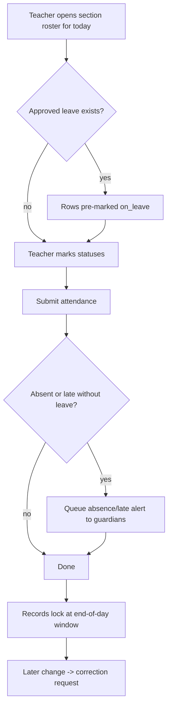
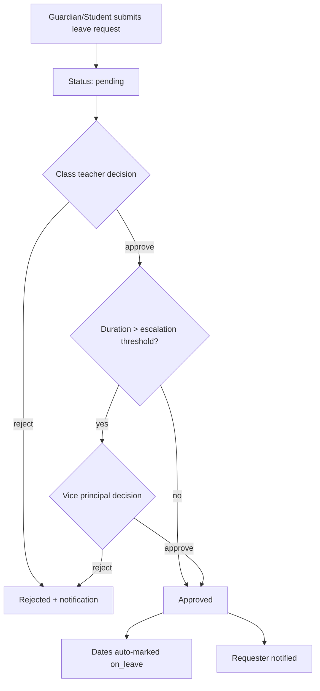

# Module: Attendance Management

> **Agent Context** — Load this block first.
> **Summary:** Daily and period-wise attendance for students, teachers, and all staff, including late-arrival/early-departure capture, post-hoc corrections with approval, the student leave request/approval flow, attendance reporting, and automatic parent absence alerts. Reduces manual registers to a two-minute daily task per section and gives leadership real-time visibility.
> **Co-load with:** `../02-architecture/auth-and-rbac.md` · `../05-database/entities/attendance.md` · `./hr-leave.md` · `./student-management.md`
> **Owns entities:** student_attendance, staff_attendance, attendance_corrections, leave_types, leave_policies, leave_balances, leave_requests, leave_approvals
> **Depends on modules:** student-management, staff-management, school-organization, timetable, hr-leave, communication

## 1. Purpose

Records who is present, absent, late, or on leave — for students (per day, optionally per period) and for teachers/staff (per day with check-in/check-out times). It also owns the correction workflow (fixing a wrongly marked record requires an approval) and the **student** leave request/approval flow. Staff leave *policy* detail (quotas, balances, payroll integration) is specified in [`hr-leave.md`](hr-leave.md); the underlying leave tables are shared and defined in this module's entity doc.

The module feeds parent notifications (absence alerts), the timetable module (substitutions triggered by absent teachers), payroll (staff attendance/leave inputs), and reporting/AI (anomaly and at-risk detection).

## 2. Business Objective

- Cut daily attendance capture to under 2 minutes per section and eliminate paper registers.
- Notify guardians of unexplained absences the same morning, improving safeguarding and reducing front-desk call volume.
- Provide auditable, correction-controlled attendance data trusted for report cards, exams eligibility, payroll, and compliance reporting.

## 3. Target Users

| Role | How they use this module |
| ---- | ------------------------ |
| `teacher` | Marks student attendance for assigned sections/periods; views own staff attendance |
| `class_teacher` | Marks homeroom attendance, requests corrections, first-level approver for student leave |
| `principal` / `vice_principal` | Approves corrections and student leave escalations; oversight dashboards |
| `school_admin` | Configures leave types/policies, marks staff attendance, manages defaults |
| `hr_staff` | Records staff attendance, late arrivals, early departures; manages staff leave data (detail in hr-leave) |
| `student` | Views own attendance; submits own leave requests (where tenant allows) |
| `guardian` | Views children's attendance; submits leave requests on a child's behalf; receives absence alerts |

## 4. Permissions

Permissions follow the RBAC model in [`auth-and-rbac.md`](../02-architecture/auth-and-rbac.md). Permission keys use `<module>.<resource>.<action>`. Module-specific verb declared here: `mark`.

| Permission key | Description | Default roles |
| -------------- | ----------- | ------------- |
| `attendance.student-attendance.view` | View student attendance (record-scoped: `own`, `assigned`, `all`) | `teacher`, `class_teacher`, `principal`, `vice_principal`, `school_admin`, `student` (own), `guardian` (own children) |
| `attendance.student-attendance.mark` | Mark/edit same-day student attendance | `teacher`, `class_teacher` |
| `attendance.student-attendance.import` | Import a historical register during tenant onboarding (§9) | `it_admin` |
| `attendance.staff-attendance.view` | View staff attendance (own for all staff; `all` for admin roles) | `hr_staff`, `school_admin`, `principal`; every staff role (own) |
| `attendance.staff-attendance.mark` | Record staff check-in/out, late arrival, early departure | `hr_staff`, `school_admin` |
| `attendance.correction.create` | Request a correction to a locked attendance record | `teacher`, `class_teacher`, `hr_staff` |
| `attendance.correction.approve` | Approve/reject correction requests | `principal`, `vice_principal`, `school_admin` |
| `attendance.leave-request.create` | Submit a student leave request | `student` (own), `guardian` (own children) |
| `attendance.leave-request.view` | View leave requests (scoped) | requesters (own), `class_teacher` (assigned), `principal`, `vice_principal`, `school_admin` |
| `attendance.leave-request.approve` | Approve/reject student leave | `class_teacher`, `vice_principal`, `principal` |
| `attendance.report.view` / `attendance.report.export` | Run and export attendance reports | `principal`, `vice_principal`, `school_admin`, `hr_staff`; `class_teacher` (assigned) |

Staff leave approval uses `hr.leave-request.approve` and is specified in [`hr-leave.md`](hr-leave.md). Approvers cannot approve requests they initiated (segregation of duties per RBAC doc §2.4).

**Who `.mark` reaches** is decided by record scope and assignment, not by the key alone (§11, [ADR-0028](../decisions/0028-one-attendance-mode-per-tenant.md)): `all` scope marks any section; `campus` scope marks its own campus's sections; with `assigned` scope, the section's class teacher marks it, and in period mode so does the teacher of the section's lesson in that period on that date — a confirmed substitute **replaces** the absent teacher for that date. The register read and `my-registers` take `.mark` too: a reader who cannot submit has no use for the marking form. The attendance mode and lock window (`/attendance-settings`, §16) are read with `school.settings.view` and changed with `school.settings.update`, school-organization's keys for `tenant_settings`; this module declares none of its own for them.

## 5. Main Features

1. **Student attendance marking** — per section per day (default) or per period (tenant-configurable), statuses: present, absent, late, half-day, excused, on-leave. Bulk "all present" then exceptions.
2. **Teacher & staff attendance** — daily status plus check-in/check-out times; teachers are staff, so one mechanism covers both.
3. **Late arrival & early departure** — captured as times against the tenant's configured school-day window; minutes late/early computed and reportable.
4. **Student leave requests & approvals** — guardian/student submits with reason and optional attachment; configurable approval chain (default: class teacher, escalation to vice principal for long leaves). Approved leave auto-marks the dates as `on_leave`.
5. **Attendance corrections with approval** — past records are locked after a tenant-configurable window (default: end of day); changes go through a correction request reviewed by an approver, preserving before/after values.
6. **Attendance reports** — registers, summaries, defaulter lists, staff punctuality (§13).
7. **Parent notifications** — automatic absence alerts and late-arrival notices per tenant preference (§12).

## 6. Sub-features

- **Marking:** roster auto-loaded from `student_enrollments`; pre-filled from approved leave; duplicate-mark protection; offline-tolerant re-submission (idempotent per student+date+period).
- **Late/early:** grace-period minutes per tenant; repeated-lateness thresholds trigger reports and (optionally) guardian notices.
- **Student leave:** leave types configured per tenant (`applies_to = student|both`); attachment (e.g. medical note) required per leave type; cancellation allowed until start date; overlapping-request rejection.
- **Corrections:** reason mandatory; approver sees before/after diff; approved corrections update the record and keep the correction row as audit trail; all correction traffic also lands in `audit_logs`.
- **Reports/exports:** CSV/Excel/PDF; scheduled monthly register export (background job). The `source` field reserves biometric/RFID ingestion (scope §21) without schema change.

## 7. Workflows

### 7.1 Daily student attendance & absence alert

Steps: teacher (actor) loads roster → marks → submits; system fans out guardian alerts via communication module; records lock after the tenant window; subsequent changes require the correction flow (7.2 gate: `attendance.correction.approve`).

### 7.2 Student leave request

Approval chain is tenant-configurable (multi-tenancy doc §5); each step writes a `leave_approvals` row. The correction flow is analogous: requester → single approver → applied/rejected.

## 8. User Journeys

- **Teacher:** first period each day, opens Attendance → Register, picks today's class from "My registers", taps Mark all present, then the exceptions, and submits in under two minutes; sees a confirmation of how many rows were marked and how many guardian alerts were queued.
- **Guardian:** receives an 09:30 absence alert; if the child is sick, submits a leave request with a note from the portal; sees approval and the calendar update.
- **Class teacher:** reviews pending leave requests each morning; approves routine ones; a two-week request escalates automatically to the vice principal.
- **HR staff:** records staff check-ins (or reviews self check-ins), flags late arrivals, and exports the monthly punctuality report for payroll (hr-leave/payroll integration).
- **Principal:** watches the attendance dashboard — today's absence rate per class, chronic absentees, staff punctuality — and reviews AI anomaly flags (§14).

## 9. Inputs

- Marking form / bulk grid per section (statuses, times, remarks).
- Staff check-in/out entries (manual now; device feed later).
- Leave request form: leave type, date range, part-day flag, reason, optional file (via platform file upload flow).
- Correction request form: target record, new values, reason.
- CSV import of historical attendance during tenant onboarding (`attendance.student-attendance.import` granted to `it_admin` during migration). **Built** — `POST /api/v1/student-attendance-imports`. The key was named here in prose and missing from §4's table; it is now in both.

## 10. Outputs

- Attendance records (student & staff), correction audit trail, leave request/approval records.
- Guardian notifications (§12); webhook events `attendance.absent-marked`, `leave.approved` (recommendation).
- Report exports (CSV/Excel/PDF); attendance summaries consumed by report cards (examinations module) and payroll (hr-leave).

## 11. Validations

- One attendance row per student per date (per period when period mode is on); enforced by unique constraints.
- Marking date cannot be in the future; cannot mark on tenant-configured holidays/weekends (academic calendar from school-organization).
- Who may mark a register (`register.may_mark_register`, one predicate for the register read, `my-registers` and `:bulk-mark`; amended by [ADR-0028](../decisions/0028-one-attendance-mode-per-tenant.md)): `all` scope; `campus` scope on the section's campus; with `assigned` scope, the section's class teacher; and, in period mode, the teacher of the section's lesson in that period on that date, read from the version-aware, cover-aware timetable for that date (never today's grid). A confirmed substitute replaces the absent teacher, who may not mark the covered period. `own` scope alone marks nothing. A register the caller may not mark is a 404 on the read and a 422 on `section_id` at `:bulk-mark` for an `assigned` caller.
- One mode at a time: in daily mode a `period_id` is refused; in period mode it is required, and a break, a period with no lesson for the section that date, or any period while `module.timetable` is off is refused (422 on `period_id`, on the register read and at `:bulk-mark` alike). A student with a daily `on_leave` row for the date is refused in every period register, so no absence alert goes for them. A period row's lateness runs from its period's start, with the tenant's grace minutes.
- A closed or archived session's registers are read-only (`meta.unmarkable_reason = session_closed`; `:bulk-mark` answers 422).
- Leave: `start_date ≤ end_date`; no overlap with an existing approved/pending request for the same person; attachment required if the leave type demands it; requester must be the student or a linked guardian.
- Corrections: only against locked records; new value must differ; approver ≠ requester.
- Staff check-out must be after check-in; late/early minutes computed server-side, never client-supplied.

## 12. Notifications

| Event | Recipients | Channels | Template ref |
| ----- | ---------- | -------- | ------------ |
| Student marked absent (no approved leave) | Guardians of the student | Push, SMS, email (tenant preference) | `attendance.absence-alert` |
| Student late arrival | Guardians | Push, in-app | `attendance.late-alert` |
| Leave request submitted | Approver(s) at current step | In-app, email | `attendance.leave-submitted` |
| Leave approved / rejected | Requester (guardian/student) | Push, in-app, email | `attendance.leave-decision` |
| Correction approved / rejected | Correction requester | In-app | `attendance.correction-decision` |
| Chronic absence threshold crossed | Class teacher, principal | In-app, email | `attendance.chronic-absence` |

Absence and late alerts go only for a date still inside the lock window (on or after today − `lock_window_days`, read the way the lock reads it): a register backfilled for an older date writes its rows and alerts no one, since a guardian must not get a weeks-old absence as news.

Channels and delivery behavior follow [`notifications.md`](../02-architecture/notifications.md).

## 13. Reports

- **Daily attendance register** — per section/date; filters: campus, class, section, status; export CSV/PDF.
- **Student attendance summary** — percentage per student over session/term; grouping by class/section; feeds report cards.
- **Defaulter / chronic-absence report** — students below a configurable attendance threshold.
- **Late-arrival report** — students and staff, count and total minutes, per period range.
- **Staff attendance & punctuality report** — per department/designation; export for payroll.
- **Leave report** — requests by type/status/date range (student leave here; staff leave in hr-leave).

All reports respect record scopes (a class teacher sees assigned sections only) and role visibility per RBAC.

## 14. AI Capabilities

Cross-referenced to [`ai-features.md`](../04-ai/ai-features.md); all AI outputs are advisory and require human review before any action.

- **AI-ATT-01 — Attendance anomaly detection:** flags unusual patterns (e.g. absences clustered on specific weekdays/periods, sudden drops, section-level outliers) for class teacher/principal review.
- **AI-ATT-02 — At-risk / dropout-risk indicator (attendance signal):** combines attendance trend with academic signals to surface students needing intervention; visible to `principal`/`class_teacher` only.
- **AI-ATT-03 — Parent communication suggestions:** drafts absence follow-up messages for guardians; a staff member must approve/edit before sending (human-approval mandatory).
- **AI-ATT-04 — Natural-language attendance queries:** e.g. "Which Grade 6 students were absent more than 3 days this month?" answered within the querying user's permission scope.

## 15. Database Entities

All tables are tenant-scoped per [`multi-tenancy.md`](../02-architecture/multi-tenancy.md). Full column-level specs: [`../05-database/entities/attendance.md`](../05-database/entities/attendance.md).

- `student_attendance` — one row per student per date (optionally per period).
- `staff_attendance` — one row per staff member per date with times.
- `attendance_corrections` — requested changes to locked records + approval outcome.
- `leave_types` — tenant-configured leave categories for students and staff.
- `leave_policies` — quota/accrual rules per leave type (staff detail governed by hr-leave).
- `leave_balances` — per-staff entitlement/usage per period (consumed by hr-leave/payroll).

> **Ownership, settled.** [`hr-leave.md`](hr-leave.md) §15 claims the same five leave
> tables, and only one Django app can ship the migration. **This module owns them**
> (`apps/api/apps/attendance/migrations/0003_leave_system.py`) because it ships first;
> **hr-leave adds no tables** and layers the staff policy semantics, accrual/carry-forward
> jobs and the configurable multi-step approval engine on top — which §1 above already
> says in prose. `leave_policies` and `leave_balances` are created here and read by
> nothing in this module: they are staff concepts, and the entity doc is explicit that
> students have neither.
- `leave_requests` — student and staff leave requests.
- `leave_approvals` — per-step approval records for leave requests.

## 16. API Requirements

Conventions per [`api-architecture.md`](../02-architecture/api-architecture.md).

- `GET /api/v1/student-attendance` — filters: `date`, `date__gte/lte`, `class_id`, `section_id`, `student_id`, `period_id`, `academic_session_id`, `status`, `is_locked`; cursor pagination.
- `POST /api/v1/student-attendance:bulk-mark` — idempotent bulk upsert for one section+date(+period). A named `academic_session_id` must contain the date, in either mode (422 on that field).
- `GET /api/v1/student-attendance/register?section_id=&date=[&period_id=]` — one register: the section's active roster in roll-number order, each row with its record for that date (and period) and `on_leave`. Unpaginated by design (one section). `meta`: `attendance_mode`, `markable` and `unmarkable_reason` (`future`, `holiday` with `holiday_name`, `non_working_day`, `session_closed`) for the **date only** — the lock is per row, in `record.is_locked` — plus `is_locked` (the date is past the lock window) and `academic_session_id`, the session containing the date. A date no session contains is refused in either mode (422 on `academic_session_id`). Keyed `attendance.student-attendance.mark`.
- `GET /api/v1/student-attendance/my-registers?date=` — the registers the caller's own Staff rows mark that date (default today): in daily mode the sections they class-teach; in period mode the lessons they teach that day (less any a confirmed substitute took from them, and including any they cover), plus every effectively timetabled lesson that day of the sections they class-teach, one row per (section, period). Each row carries `marked_count`/`roster_count`, and every entry passes `:bulk-mark`'s marker and scope check (its date and session checks are not applied to the list). `meta`: `attendance_mode`, `date`. Keyed `attendance.student-attendance.mark`.
- `GET/PATCH /api/v1/attendance-settings` — the tenant's `attendance_mode`, `lock_window_days` (0–7) and `leave_escalation_threshold_days` (at least 1). PATCH merges only the keys sent, is audited, and refuses `attendance_mode: period` (422) while `module.timetable` is off. Keyed `school.settings.view` / `school.settings.update` (§4).
- `GET/POST /api/v1/staff-attendance` · `POST /api/v1/staff-attendance/{id}:check-out`
- `GET/POST /api/v1/attendance-corrections` · `POST /api/v1/attendance-corrections/{id}:approve` · `:reject`
  - **List and retrieve** take either `attendance.correction.create` or `.approve` ([ADR-0027](../decisions/0027-any-of-permission-keys.md)). Which rows a caller reads is their record scope, not the key that matched: `all` reads the tenant's queue, `campus` the requests whose target row's section is on their campus, and `assigned` or `own` only the caller's own requests. So an `assigned` holder of `.approve` has nothing to decide (its default holders are normally assigned school- or campus-wide; scope comes from the role assignment, not §4).
  - **Filters:** `status`, `subject_type`, `student_attendance_id` and `mine` (`true` is the caller's own requests; `false` is everyone else's, the approver's queue); `ordering` by `created_at` or `status`; cursor pagination.
  - **Each row** names its target for a reader: `student_id`, `student_name`, `attendance_date`, `period_name` (null for a daily row), `requested_by_name` and `reviewed_by_name`. All are nullable, because a staff correction has no student row. A user with no first or last name is a null name, never their email.
  - **POST** resolves `student_attendance_id` through the caller's own record scope on student attendance, the same scope `GET /student-attendance` applies. A target that is out of scope, unknown or another tenant's is a **404**. It used to resolve tenant-wide, so a campus-A teacher could raise, and on approval have applied, a correction to a campus-B row by its id.
  - **`:approve` / `:reject`** take an optional `review_note` (500 characters) and answer `meta.message` ("Correction applied." / "Correction rejected."). A request already decided is a 409; the caller's own request is a 422 on `reviewed_by`.
- `GET/POST /api/v1/leave-requests` · `POST /api/v1/leave-requests/{id}:approve` · `:reject` · `:cancel`
  - **Student requests only** (`requester_type = student`, §20). **Filters:** `status`, `requester_type`, `student_id`, `leave_type_id`, `date__gte` (on `start_date`) and `date__lte` (on `end_date`), so a range finds the requests wholly inside it; cursor pagination.
  - **Each request** carries `student_name`, `admission_number`, `section_name`, `leave_type_name` and `submitted_by_name`, and each step of `approvals` its `approver_name`; a user with no first or last name is a null name, never their email, since a co-guardian reads it. **`section_name` is the student's active section in the *current* session**, not the session the leave dates fall in, because the queue is worked in the present: a request from last session shows today's section, or null for a student with no active enrollment now.
  - **`:approve` / `:reject`** take an optional `note` and answer `meta.auto_marked_days`: the days the final approval marked `on_leave`, and 0 for a rejection or for an approval that only moves the chain to its next level. Refused in this order: already decided (409), the caller submitted it (422), no pending step (409), the caller decided an earlier level (422), and level 2 by a caller with no `campus` or `all` scope (422). Each 422 is on `approver_id`.
- `GET/POST/PATCH /api/v1/leave-types` · `/api/v1/leave-policies` · `GET /api/v1/leave-balances`
- `GET /api/v1/reports/attendance-summary` — heavy exports return `202` + job resource per API doc §2.7. `POST` to the same path always returns a job, in `format` = `csv` | `xlsx` | `pdf` (§6). `period_id` (the `daily-register` kind only, carried into the export job) lists one period's own rows instead of each student's derived day; `meta.attendance_mode` says which mode the tenant runs.
- `POST /api/v1/student-attendance-imports` → `202` + job resource — §9's onboarding migration. **Not listed in this section originally**: §9 describes the capability and §4 (now) keys it, so the endpoint is declared here rather than left as a documented feature with no route.

## 17. Integration Requirements

- **Internal:** communication module (alert fan-out via Celery), files service (leave attachments), academic calendar (school-organization), timetable (absent-teacher feed for substitutions), hr-leave/payroll (staff attendance & balances), AI gateway (§14).
- **External:** SMS/email/push providers via the notification adapter layer; future biometric/RFID device ingestion via a signed device-token endpoint (recommendation, scope §21).

## 18. Dependencies on Other Modules

| Module | Direction | What is shared |
| ------ | --------- | -------------- |
| student-management | inbound | Student rosters, guardian links for alerts |
| staff-management | inbound | Staff records, designations for staff attendance |
| school-organization | inbound | Academic calendar, sessions, sections, holidays |
| timetable | bidirectional | Outbound: absent-teacher signal triggers substitution flow. Inbound (period mode): the section's lessons on a date, version-aware and with confirmed cover applied (`timetable.slots.services.effective_slots_for`), decide who may mark a period register and which periods have one; a teacher's own lessons that day (`teacher_slots_for`, shared with `/timetables/my`) list their period registers. Read through the service, never a timetable view (ADR-0013) |
| hr-leave | bidirectional | Staff leave policies/balances (detail there); staff attendance feeds payroll |
| examinations | outbound | Attendance summaries printed on report cards |
| communication | outbound | All notifications in §12 |
| reporting-analytics | outbound | Attendance datasets for dashboards |

## 19. Open Questions / Recommendations

- Period-wise vs daily student attendance: **decided** ([ADR-0028](../decisions/0028-one-attendance-mode-per-tenant.md)). One mode per tenant, `tenant_settings.academic.attendance_mode`, **daily** by default and for any missing or unknown value; period mode needs `module.timetable`. Reports count derived days in either mode, so history stays comparable across a switch.
- Lock window for corrections: end of marking day (recommendation; tenant-configurable 0–7 days, set through `/attendance-settings`).
- Whether students may self-submit leave (vs guardian-only) should be a tenant policy toggle (recommendation). Biometric attendance is out of initial scope; the schema reserves `source` for it (recommendation).

## 20. Implementation status

Built as three stacked PRs; this section is updated by each. **All three PRs have landed:
marking (PR 1), the leave system (PR 2), staff attendance and reports (PR 3).**

**The dashboard follows in three more** (plan
`docs/superpowers/plans/2026-10-24-attendance-dashboard.md`): **PR A** — the register, Records,
Settings and the attendance mode — and **PR B** — the corrections and leave queues, with the
approvals contract behind them — are in flight; **PR C** (staff attendance, reports, import)
follows.

### Built

**Complete.**

| Area | State |
| ---- | ----- |
| Entities | All eight §15 tables — `student_attendance`, `staff_attendance`, `attendance_corrections`, `leave_types`, `leave_policies`, `leave_balances`, `leave_requests`, `leave_approvals` — tenant-owned with RLS policies |
| §16 endpoints | `GET /student-attendance` (filters: `date`, `date__gte`, `date__lte`, `class_id`, `section_id`, `student_id`, `period_id`, `academic_session_id`, `status`, `is_locked`; cursor paginated), `POST /student-attendance:bulk-mark` (accepts `Idempotency-Key`; its 200 is typed as the marked rows), `GET /student-attendance/register`, `GET /student-attendance/my-registers`, `GET/PATCH /attendance-settings`, `GET/POST /attendance-corrections`, `POST /attendance-corrections/{id}:approve` · `:reject`, `GET/POST /leave-requests`, `POST /leave-requests/{id}:approve` · `:reject` · `:cancel`, `GET /leave-types` (read-only — see below), `GET/POST /staff-attendance`, `POST /staff-attendance/{id}:check-out`, `GET/POST /reports/attendance-summary` |
| §4 permissions | All ten keys registered. `mark` was already in `core/rbac/registry.py`'s `EXTRA_ACTIONS` |
| §11 validations (marking) | Not future-dated · not a weekend or holiday (via `school_organization.calendar`) · one row per student per date/period, enforced by two partial unique indexes · the markers of §11, through one predicate (`register.may_mark_register`) · the period's shape for the mode · the register's session contains the date, in either mode (422 on `academic_session_id`) · `late_minutes` computed server-side (from the period's start for a period row) and a client value discarded · corrections need a locked target, a changed value, and an approver who is not the requester |
| Attendance mode | `tenant_settings.academic.attendance_mode`, read by `services.attendance_mode()` (daily for a missing or unknown value) and written through `PATCH /attendance-settings` ([ADR-0028](../decisions/0028-one-attendance-mode-per-tenant.md)). In period mode: markers widened per §11, an on-leave student refused in every period register, guardian alerts deduplicated per (student, date, event) across every row that date, and `my-registers` built from the teacher's own lessons that day. The importer and approved-leave auto-marking stay mode-agnostic and write daily rows |
| The assigned-scope fix | An `assigned`-only class teacher could not mark: `scope_queryset` resolves a model with no `filter_assigned_to_user` hook (`Section` has none) to `.none()`. The register views now resolve the section directly and let `may_mark_register` decide. Proven over HTTP in `tests/test_register_api.py` (`test_assigned_only_class_teacher_can_bulk_mark_over_http`); the live lane's class teacher is `all`-scoped and does not prove it |
| Record scope: reads vs reports | `StudentAttendance.filter_assigned_to_user` (record reads, Records) matches the sections the user class-teaches **or rows the user marked**, so a period teacher sees their own marks. Student reports and the export job keep §13's narrower rule, class-teacher sections only (`filter_class_teacher_sections`, through `scope_queryset(..., assigned_filter=)`): a report built from one period of another class's student would be a wrong number |
| Derived days | Every student report — summary, defaulters, late arrivals, the daily register — and report cards (through `reports.student_summary`) count one derived day per (student, date): a daily row is the day; otherwise all periods absent is `absent`, any absent `half_day`, the earliest marked period late `late` with its minutes, all excused `excused`, else `present`. Computed in SQL: the scoped queryset is wrapped as a CTE, grouped per (student, date), then per student, with the defaulter threshold and the row cap in the same statement; a queryset that can match nothing returns `[]` without a query. `attendance_rate` rounds half up to one decimal (SQL `ROUND(numeric, 1)`: 1 of 16 days is 6.3, not 6.2), matching examinations' `ROUND_HALF_UP` (`examinations/grading.py`), and the defaulter threshold compares that rounded rate (81.25% is 81.3, not below a threshold of 81.3). Applies in both modes, so daily-only data reports exactly as before |
| Register per-row lock | `meta.markable` reflects date validity only (future, holiday, non-working day, `session_closed`). A row past the window is read-only on its own (`record.is_locked`) and offers Request correction; an unmarked student on a past working day inside the session can still be marked, as `:bulk-mark` has always allowed |
| Dashboard (PR A) | `/attendance` with Register, Records and Settings tabs, each gated on its §4 key. **Register:** the date, My registers, Class/Section (and Period, in period mode) pickers; Mark all present; per-row status, times and remarks; a refused row shows the server's sentence inline and the register reloads; a 409 reloads with locked rows read-only; Request correction on a locked row. The mode comes from `my-registers`' meta, which every marker can read. **Records:** a cursor-paged list (Previous/Next) filtered by date range, class, section, status and lock, with Request correction on locked rows. **Settings:** mode, lock window and escalation threshold, sending only changed keys |
| Dashboard (PR B) | Two more tabs. **Corrections** (`/attendance/corrections`, shown to a holder of `attendance.correction.create` or `.approve`): a cursor-paged queue, pending by default, with a Status filter and a Mine toggle (`mine=true`); each row shows the student, date, period, the change field by field (old value to new), the reason, the requester and, once decided, the reviewer and note. Approve and Reject, each with an optional note, show only on a pending request from someone else to a holder of `.approve`. A 409 keeps the server's sentence in the dialog and reloads the queue; a 422 shows inline. **Leave** (`/attendance/leave`, shown to a holder of `attendance.leave-request.view`): a cursor-paged queue, pending by default, filtered by status, leave type and a date range; each row shows the student and admission number, section, type, dates, day part, days, status and level ("1 of 2"). A row opens a detail sheet with the reason, the approval chain (each level's required permission by name, or its raw key when it has no label, decision, approver, date and note; a level a rejection or cancellation cut off reads "Not reached") and the attachment, downloaded through `POST /files/{id}:download` by a holder of `platform.file.view`. Approve and Reject show on a pending request the viewer did not submit and decided no level of; level 2's scope rule is the server's, shown inline when it refuses. The approval toast says whether the request moved to the next level or how many days were marked. Leave is review-only: submission is the student's or guardian's, through parent-portal |
| §11 validations (leave) | `start_date ≤ end_date` · no overlap with a *live* (pending or approved) request · attachment required where the type demands one · requester is the student or a portal-enabled linked guardian · `days_count` computed net of holidays and non-working days · `max_consecutive_days` honoured · approver ≠ submitter, **and no one person decides two levels of the same request** |
| §7.2 approval chain | One level by default; a second when `days_count` exceeds `academic.student_leave_approval.escalation_threshold_days` (default 10, §8's fortnight). Approval auto-marks `on_leave` for the working days in range, skipping any date already marked. Cancellation before `start_date` withdraws the rows it wrote |
| §12 notifications | Five of six wired: `absence-alert`, `late-alert` (portal-enabled guardians, on commit, only for a date inside the lock window), `leave-submitted` (whoever holds the current step's key), `leave-decision` (the submitter), `chronic-absence` (staff) |
| §5.5 lock window | `tenant_settings.academic.attendance_lock_window_days`, clamped to §19's 0–7, set through `/attendance-settings`. Persisted nightly by `apps.attendance.tasks.lock_expired_attendance`; the service recomputes from the date and never trusts the column alone |
| Feature flag | `module.attendance`, `default_enabled=False` |
| §13 reports | All six — daily register, student summary, defaulters, student late arrivals, staff punctuality, leave — behind one `kind`-parameterised endpoint, with a 202 + job export lane in all three of §6's formats (CSV, XLSX, PDF). Every one asserted with `assertNumQueries` |
| §9 import | `POST /student-attendance-imports` → 202 + job, CSV or .xlsx, exact template headers, per-row error report on `GET /jobs/{id}` |
| §18 outbound | Marking a teacher absent proposes cover for each published slot they hold that day, via `timetable.services.propose_substitutions_for_absence` |
| Tests | Django: models, marking, leave, staff attendance, reports, API, leave API, cross-tenant, notifications, review regressions, the register and its scopes (`test_register_api.py`), the mode and period rules (`test_attendance_mode.py`). E2E: `attendance-marking` (with the register and `my-registers`), `attendance-leave` and `attendance-staff-reports` (live API lane); `attendance-register-journey` (live browser lane: the seeded `all`-scoped class teacher marks today's register and reads it back in Records); `attendance-register` (mocked lane: marking from My registers, an on-leave refusal on its row, a locked register with Request correction, a reader with Records and no Register, the settings' timetable refusal); `attendance-approvals` (mocked lane: a principal approves a correction and is offered no decision on their own, a correction decided elsewhere first shows the 409 sentence, a teacher sees only their own corrections, a class teacher approves a short leave and moves an escalated one to level 2, is refused a level 2 by scope, a rejected request's level 2 reads "Not reached", an attachment downloads). The approvals contract (who reads the correction queue, the correction target's record scope, the name fields, `section_name`'s session, `mine`) is pinned in `tests/test_approvals_api.py`. Jest: the services, the register, Records, Settings, Corrections and Leave |

### Corrected in review

Ten findings, worth recording because three of them describe rules the module now
depends on:

- **`:bulk-mark` keeps `DenyRestrictedPrincipals`; the reads drop it.** A
  viewset-wide portal exemption covered the write action too. Marking writes a
  whole section's register, and the marker check (now `register.may_mark_register`)
  grants `all`/`campus` scope before it looks for a `Staff` row — correctly, since
  many admin users have none — so the principal check has to sit in front of it,
  not inside it. The register read and `my-registers` are staff-only the same way.
- **A correction cannot set `on_leave`,** and its times are validated when the
  correction is *raised* rather than when approved days later. Approving a
  correction now **recomputes `late_minutes`**, which is not a correctable field
  and was previously carried over stale — a row corrected from absent to late
  reported zero minutes late and §13's punctuality report summed those zeros.
- **Alerts fire on a status *transition*, not on current status.** §6 requires
  retries to be safe, so alerting on current status meant the module's own
  idempotency promise re-sent every guardian the same message on every retry.
- A re-mark after a mid-session section change now moves the row's
  `section`/`academic_session` to the section it was marked in; a soft-deleted
  student is no longer markable; a genuinely simultaneous first insert is merged
  rather than 409'd; and `is_locked` on the wire is the *effective* lock the
  write path enforces, not the nightly-swept column.

### Two design decisions worth carrying forward

- **Marking is an upsert, not an insert.** §6 requires idempotency per (student,
  date, period), so `POST :bulk-mark` updates rows that already exist rather than
  failing on the unique index. A rejected row rejects the *whole* submission and
  is reported through `error.meta.rows` — partial commit is never the outcome.
- **`student` and `guardian` hold real permission keys here**, which makes this
  the first module whose viewsets are not uniformly behind
  `DenyRestrictedPrincipals`. The *record scope*, not the key, keeps a guardian to
  their own children: `StudentAttendance.filter_owned_by_user` delegates to
  `Student.filter_owned_by_user` rather than restating the portal-enabled
  guardian join.

### The leave-type write gap, and why it is shaped this way

**§16 of this module lists `GET/POST/PATCH /api/v1/leave-types`, `/leave-policies`
and `/leave-balances`. §4 of this module declares no permission key for any of
them.** The keys that govern them — `hr.leave-type.*`, `hr.leave-policy.*`,
`hr.leave-balance.*` — are declared by [`hr-leave.md`](hr-leave.md) §4.

Registering another module's `hr.*` keys from this app would break the permission
registry the day hr-leave ships its own `permissions.py` (duplicate key), and
inventing `attendance.leave-type.*` would put keys in the registry that no module
doc declares. So the split is by what §4 here *can* key:

- **Reading** the catalogue is part of working with leave requests, so
  `GET /leave-types` takes `attendance.leave-request.view` — the same move
  `timetable` makes for `/periods` and `/rooms`, which its §4 also leaves
  unkeyed. `.view` rather than `.create`, because §4 grants `.view` to
  requesters *and* approvers: an approver reading a request needs the type's
  name, and a key only requesters hold would hide it from the one person who has
  to decide.
- **Writing** leave types, and all of `/leave-policies` and `/leave-balances`, is
  HR configuration and ships with hr-leave (Tier 6).

**The consequence is real: until hr-leave lands, a tenant's leave types come from
the seeds (`seed_e2e_data`, `seed_dev_data`), not from the API.** Recorded here
rather than worked around, because the workaround would be a key nobody declared.

### Deliberately not built

- **`leave_policies` and `leave_balances` have tables and no behaviour.** They are
  staff concepts governed by hr-leave; nothing in this module reads or writes
  them. The tables exist so hr-leave adds none.
- **Staff leave requests.** `leave_requests` holds both kinds because both module
  docs describe one table, but only the student half has endpoints here —
  `LeaveRequestViewSet` filters to `requester_type = student` so an `all`-scoped
  attendance principal cannot read staff leave through an attendance-keyed
  endpoint before hr-leave has decided its visibility rules.
- **`ApprovalDecision.skipped`** is declared and unreachable. It is what a step
  becomes when a tenant edits a chain a request has already passed — the case
  hr-leave meets when it makes the chain editable mid-flight. Nothing here edits
  a chain after a request is raised.
- **`SubstitutionStatus.completed` is still unreachable.** The cover *feed* now
  exists, but "the covered period actually ran" needs a signal nothing emits —
  the register records the student's presence, not the substitute teacher's
  delivery of that period. Closing it means deciding what evidence counts, which
  is a module-doc decision rather than a code one. Period mode gives a candidate: the
  substitute submitting the covered period's register. It is recorded in
  `docs/deferred-work.md`, not wired, because a register says who marked the period,
  not that the lesson was taught.
- **Cover picks the first free substitute, not the best one.** §14's AI-TTB-03
  is the ranked suggestion (workload balance, subject match) and is Phase 3 work
  behind the `core/ai` gateway that does not exist. An arbitrary pick a human
  approves is honest; a hand-rolled ranking would be a worse version of a
  feature the doc already specifies properly.
- ~~**Exports are CSV only.**~~ **All three of §6's formats now ship** —
  `core/exports/tabular.py` renders one row shape as CSV, XLSX or PDF (it began
  as this module's own `exports.py` and moved to `core/` when `examinations`
  became its second caller). Only the PDF carries a row cap (`PDF_ROW_LIMIT`,
  2000): a 40,000-row register is hundreds of pages nobody opens, and the caller
  is told rather than handed a truncated document that looks complete. PDF
  values are escaped through `core.documents.html`, which is escape-by-default
  — these are student and staff names, and one containing `&` would otherwise
  break the table silently.
  **CSV and XLSX values are neutralised against formula injection**: `remarks` is
  free text a teacher types, so a remark reading `=HYPERLINK(...)` executes when
  the export is opened in Excel or Sheets — a client-side execution vector that
  starts inside our own data. openpyxl also writes a leading `=` as a real
  formula, so the guard stops us authoring one as well as defending the reader.
- ~~**§9's historical CSV import.**~~ **Built**, as
  `POST /student-attendance-imports`. It refuses an **on-leave** row, or a
  **locked row it did not itself write**, into the error report rather than
  overwriting it — a migration must not silently rewrite what the correction
  workflow or an approved leave request owns. The discriminator is `source`, not
  the lock: the import writes its own rows locked by design, so a bare
  locked-row refusal would block the re-run §9's journey depends on. It deliberately does **not** apply three other rules the register does, and each omission is why it is a separate path rather
  than a flag on `bulk_mark_student_attendance`:
  no calendar gate (today's working week and holidays describe *this* year; a
  register migrated from three years ago was kept against that year's, and
  refusing rows against today's would rewrite what the school's records say
  happened), no lock-window check (every imported row is historical by
  construction, so the window has passed for all of them), and — the important
  one — **no guardian alerts**: importing a year of history must not email a
  parent about an absence from last March. Imported rows land locked and
  `source=import`, which makes `AttendanceSource.IMPORT` reachable for the first
  time. Keyed to `it_admin`, not the marking roles: giving import to `teacher`
  would make "rewrite any past register, bypassing the lock window and the
  correction workflow" a routine classroom permission.
- **§13's scheduled monthly register export** (§6) has no beat entry. It needs a
  per-tenant schedule, which is `reporting-analytics`' `report_schedules` — the
  module `CELERY_BEAT_SCHEDULE`'s own comment already names as the one that
  should bring `django-celery-beat` with it.
- **`attendance.correction-decision`** (§12). The correction flow ships here, but
  its recipient is a member of staff working inside the dashboard, with no
  off-platform channel to reach; it waits on the in-app inbox surface rather than
  on any backend piece. Persisting rows nothing renders would be worse than the
  omission.
- **`AttendanceSource.DEVICE`** — §6 and §21 reserve it for biometric/RFID so it
  arrives without a schema change. Nothing writes it.
- **§14's four AI capabilities.** `core/ai` does not exist, and AGENTS.md hard
  rule 6 forbids reaching a provider SDK directly. Phase 3 work, the same shape as
  `timetable`'s `:generate-draft`.
- ~~**Period mode is supported by the schema but has no tenant switch.**~~ **Built**
  ([ADR-0028](../decisions/0028-one-attendance-mode-per-tenant.md)): one mode per
  tenant, switched through `PATCH /attendance-settings` and the dashboard's Settings
  tab. Still open, in `docs/deferred-work.md`: mapping a half-day leave to periods
  (a half-day leave writes a daily row and blocks every period that day); refusing
  the platform-admin toggle that turns `module.timetable` off while a tenant is in
  period mode (the registers themselves are enforced: every period register is a 422
  on `period_id` until it is back on or the mode is daily); and two
  simultaneous period submissions for one student, which can each send an alert.
- **Staff-on-behalf leave submission and the home widget.** Leave stays review-only
  in the dashboard: a student or guardian submits (§4, §11) and parent-portal brings
  that screen. A staff member entering leave for a family that phoned in needs a
  requester rule §11 does not have: the user chose review-only leave in the dashboard
  (2026-10-24), and submission waits for parent-portal. The
  dashboard home has no attendance widget yet. Both are in `docs/deferred-work.md`.
