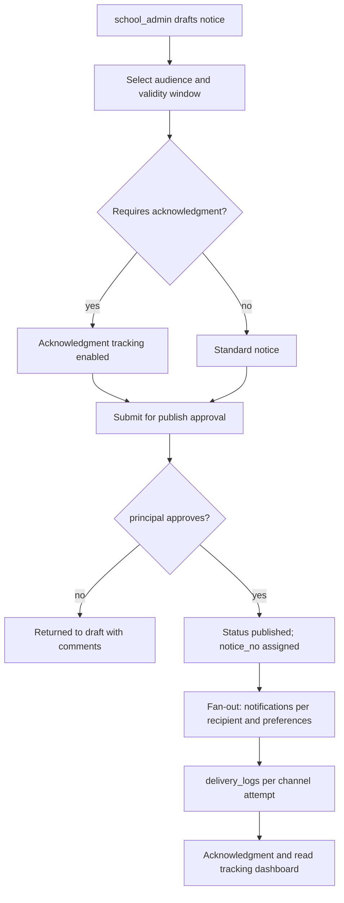

# Module: Communication Management

> **Agent Context** — Load this block first.
> **Summary:** All school-to-audience and person-to-person messaging: announcements, formal notices, guardian/teacher/internal message threads, emergency broadcasts, notification templates, per-user channel preferences, and delivery-status tracking across email/SMS/push/in-app. Business value: one governed channel replaces ad-hoc WhatsApp groups and paper circulars, with proof of delivery.
> **Co-load with:** `../02-architecture/notifications.md` · `../02-architecture/auth-and-rbac.md` · `../05-database/entities/communication.md` · `parent-portal.md`
> **Owns entities:** announcements, notices, message_threads, messages, notification_templates, notifications, notification_preferences, delivery_logs
> **Depends on modules:** school-organization, student-management, staff-management, parent-portal

## 1. Purpose

This module is the tenant's messaging hub. Staff publish **announcements** (informal, feed-style) and **notices** (formal, numbered, optionally acknowledgment-tracked); guardians, teachers, and staff exchange **message threads**; and every other module's events (attendance, fees, exams, library, transport) fan out to users as **notifications** rendered from tenant-manageable **templates** and delivered per user **preferences**, with per-attempt **delivery logs**.

Channel adapters, queues, retries, and provider failover are infrastructure and live in [`notifications.md`](../02-architecture/notifications.md) — this doc defines the functional surface only.

## 2. Business Objective

- Guarantee reach: measurable delivery rates per channel instead of "we posted it on the board."
- Cut emergency-response time to minutes via one-click multi-channel broadcast; raise parent engagement — read/acknowledgment metrics feed scope §18 analytics.
- Control cost: SMS/WhatsApp credits are plan-limited per tenant ([`multi-tenancy.md`](../02-architecture/multi-tenancy.md) §6); templates and preferences prevent redundant sends.

## 3. Target Users

| Role | How they use this module |
| ---- | ------------------------ |
| `school_admin` | Publishes announcements/notices, manages templates, runs emergency broadcasts, monitors delivery |
| `principal` / `vice_principal` | Approves/publishes formal notices; emergency broadcast authority |
| `teacher` / `class_teacher` | Class/section announcements; threads with guardians; internal threads |
| `reception` | Front-desk enquiry threads; enquiry follow-up messages |
| `guardian` / `student` | Receive notices/notifications; participate in threads; manage own preferences |
| `it_admin` | Channel provider configuration status, delivery failure triage |

## 4. Permissions

Permissions follow the RBAC model in [`auth-and-rbac.md`](../02-architecture/auth-and-rbac.md). Module-specific action verbs declared here: `send`, `broadcast`, `acknowledge`, `close`, `oversee`.

| Permission key | Description | Default roles |
| -------------- | ----------- | ------------- |
| `communication.announcement.create/update/delete` | Draft and manage announcements | `school_admin`, `teacher` (scope `assigned`) |
| `communication.announcement.publish` | Publish/schedule an announcement | `school_admin`, `principal` |
| `communication.notice.create/update` | Draft formal notices | `school_admin` |
| `communication.notice.publish` | Publish a notice (approval gate) | `principal`, `school_owner` |
| `communication.notice.acknowledge` | Acknowledge a notice requiring it | `guardian`, `student`, staff roles |
| `communication.broadcast.send` | Emergency multi-channel broadcast (audited, MFA-recommended) | `school_owner`, `principal`, `school_admin` |
| `communication.thread.create` / `communication.message.create` | Start/reply to threads; `message.create` also gates `:mark-read`, which writes `read_by` | all tenant roles (guardian/student scope `own`) |
| `communication.thread.view` | Read the threads one takes part in (membership is the record scope) | all tenant roles |
| `communication.thread.close` | Close or reopen a thread one takes part in | all staff roles (not `guardian`/`student`) |
| `communication.thread.oversee` | Audited, read-only access to every thread (safeguarding) | `school_owner`, `principal` |
| `communication.template.view/update` | Manage tenant notification templates | `school_admin`, `it_admin` |
| `communication.notification-preference.update` | Own channel preferences | all roles (scope `own`) |
| `communication.delivery-log.view/export` | Delivery status dashboards | `school_admin`, `it_admin` |

## 5. Main Features

1. **Announcements** — feed-style posts targeted at the whole school, staff, a class/section, or a custom audience; draft → scheduled → published lifecycle; optional website mirror.
2. **Notices** — formal, per-tenant-numbered documents (circulars, event notices) with publish approval, validity window, optional acknowledgment requirement, and PDF rendering.
3. **Message threads** — two-way conversations: guardian ↔ school (child-contextual), teacher ↔ teacher/staff (internal), and group threads; the parent-portal and dashboard both surface them.
4. **Multi-channel notifications** — every platform event renders a template and fans out over email/SMS/push/in-app (WhatsApp where enabled) per audience preferences.
5. **Emergency broadcast** — bypasses preferences and quiet hours, hits all channels simultaneously for a chosen audience, with delivery tracking and mandatory audit.
6. **Template management** — tenant-editable templates per event/channel/locale with typed placeholders; system templates seeded at provisioning.
7. **Delivery status** — per-recipient, per-channel logs (`queued/sent/delivered/failed/bounced`), failure dashboards, resend tools.

## 6. Sub-features

- **Targeting:** audience builder — roles, campuses, classes/sections, houses, individual users; saved audiences (recommendation).
- **Announcements:** attachments (via `files`), expiry, pinning, publish-to-website flag consumed by the website builder.
- **Notices:** auto sequence number per tenant, acknowledgment progress bar, escalation reminder to non-acknowledgers.
- **Threads:** child context binding (`student_id`), staff routing rules (class teacher default), close/reopen, internal-note visibility for staff (recommendation).
- **Templates:** placeholder validation against the event's variable set; per-locale variants; preview with sample data; SMS segment counter.
- **Preferences & delivery:** category × channel matrix per user (emergency locked on); tenant channel defaults; bounce/invalid-number flagging back onto the user profile; per-tenant SMS credit meter.

## 7. Workflows

**Notice publication with acknowledgment:**

Actors: `school_admin` (draft), `principal` (approval gate — approver cannot be the initiator, per RBAC §2.4). States: `draft → pending_approval → published → archived`.

**Emergency broadcast:** authorized user opens Emergency Broadcast → picks audience (default: everyone) → types message (or selects `AI-COM-03` draft) → confirmation step restates audience size and channels → send is immediate on all channels, ignoring preferences/quiet hours → live delivery board → full audit entry. No approval gate by design (speed); mitigated by narrow permission and audit.

**Guardian thread:** see [`parent-portal.md`](parent-portal.md) §7 — thread creation, routing, reply notifications.

## 8. User Journeys

- **School admin:** Monday — drafts the exam-week circular with `AI-COM-02`, targets classes 6–10 guardians, routes to principal, watches acknowledgments climb; resends via SMS to the 12% who didn't open email.
- **Teacher:** posts a section field-trip announcement; answers three guardian threads during a free period; internal thread with the coordinator.
- **Guardian:** receives push + SMS for a fee reminder (her chosen channels), acknowledges the medical-form notice, messages the class teacher.
- **Principal:** approves two notices; at 11:40 triggers an emergency early-closure broadcast and watches delivery hit 97% in four minutes.

## 9. Inputs

- Announcement/notice composer content, attachments, audience selections, schedules.
- Thread messages and attachments (upload flow per [`api-architecture.md`](../02-architecture/api-architecture.md) §2.8).
- Template bodies with placeholders; locale variants.
- Preference matrix updates; acknowledgment taps.
- Cross-module events (attendance marked, invoice issued, result published, book overdue, route changed) consumed as notification triggers.

## 10. Outputs

- Records: `announcements`, `notices`, `message_threads`/`messages`, `notifications`, `delivery_logs`.
- Rendered artifacts: notice PDFs, per-channel message payloads.
- Events emitted: `notice.published`, `announcement.published`, `broadcast.sent`, `message.created` (webhook-eligible per [`api-architecture.md`](../02-architecture/api-architecture.md) §2.6).
- Website feed: published items flagged `show_on_website` are exposed read-only to the website renderer.

## 11. Validations

- Audience resolution must yield ≥ 1 recipient; targeting rows are re-validated against the tenant (cross-tenant refs → `404`).
- `notice_no` unique per tenant; publish requires approval permission held by a non-initiator.
- Template placeholders must belong to the event's declared variable set; SMS templates warn past segment limits.
- Emergency sends require `communication.broadcast.send` and a typed confirmation phrase (recommendation); always audited.
- Guardians/students can only open threads about themselves/linked children (`own` scope); only thread participants may post.
- Preference changes cannot disable the `emergency` category; sends respect per-tenant SMS/WhatsApp credit quotas (hard stop plus admin alert).

## 12. Notifications

This module *is* the notification surface; its own lifecycle events:

The birthday trigger is system-scheduled (daily job over active students/staff, per certificates-documents.md §7.3), not raised by a user action like the others in this table; the card attachment is generated by certificates-documents and delivered here. Tenants can disable the trigger entirely *(recommendation)*.

| Event | Recipients | Channels | Template ref |
| ----- | ---------- | -------- | ------------ |
| Notice published | Resolved audience | per preferences (email, SMS, push, in-app) | `communication.notice-published` |
| Announcement published | Resolved audience | in-app, push | `communication.announcement-published` |
| Acknowledgment reminder | Non-acknowledgers | push, SMS | `communication.notice-ack-reminder` |
| Thread reply | Thread participants | push, in-app | `communication.thread-reply` |
| Emergency broadcast | Audience (preferences bypassed) | all channels | `communication.emergency-broadcast` |
| Delivery failure spike | `school_admin`, `it_admin` | in-app, email | `communication.delivery-failure-alert` |
| Birthday *(recommendation)* | Guardian(s) of the student, or the staff member | per preferences (email, SMS, push, in-app) | `communication.birthday-card` |

Channels and delivery behavior follow [`notifications.md`](../02-architecture/notifications.md).

## 13. Reports

- **Delivery report:** sends by channel/status/provider; filters: date range, event category, channel; export CSV.
- **Engagement report:** notice read/acknowledgment rates by class/campus; announcement reach.
- **Thread SLA report:** staff first-response and resolution times (recommendation).
- **Credit usage:** SMS/WhatsApp consumption vs. plan quota, trend and forecast.
- Visibility: `communication.delivery-log.view`; owner/principal see all, teachers see own threads' stats only.

## 14. AI Capabilities

Cross-referenced to [`ai-features.md`](../04-ai/ai-features.md); all drafts require human review before send.

- **`AI-COM-01` Automated parent communication suggestions** — proposes targeted messages from cross-module signals (attendance dips, overdue fees, upcoming exams); staff review, edit, and approve every suggestion before sending. Never auto-sends.
- **`AI-COM-02` AI-generated announcements & notices** — drafts from a short prompt in the tenant's tone and locale(s); mandatory human edit/approval; publish gates unchanged.
- **`AI-COM-03` Tone, translation & emergency drafting assistant** — rewrites for clarity/formality, produces locale variants (e.g. English + Urdu), and offers pre-structured emergency drafts; the emergency confirmation step is never bypassed.

## 15. Database Entities

Owned tables (all tenant-scoped, RLS-enforced; column specs in [`entities/communication.md`](../05-database/entities/communication.md)):

- `announcements` — feed-style posts with audience targeting and publish lifecycle.
- `notices` — formal numbered notices with approval, validity, acknowledgment tracking.
- `message_threads` — conversation containers (guardian↔school, internal, group) with optional student context.
- `messages` — individual posts within a thread.
- `notification_templates` — per event/channel/locale render templates.
- `notifications` — per-user notification records (in-app source of truth, fan-out parent).
- `notification_preferences` — user × category × channel opt-ins.
- `delivery_logs` — per-channel delivery attempts and provider status.

## 16. API Requirements

Conventions per [`api-architecture.md`](../02-architecture/api-architecture.md); notification sends accept `Idempotency-Key`.

- `GET/POST /api/v1/announcements` · `PATCH/DELETE /api/v1/announcements/{id}` · `POST /api/v1/announcements/{id}:publish`
- `GET/POST /api/v1/notices` · `POST /api/v1/notices/{id}:submit` · `POST /api/v1/notices/{id}:publish` · `POST /api/v1/notices/{id}:return-to-draft` · `POST /api/v1/notices/{id}:acknowledge` · `GET /api/v1/notices/{id}/download`
- `POST /api/v1/broadcasts:preview` — `communication.broadcast.send`; returns `{recipient_count, audience_digest, channels, unavailable_channels}` for an `audience_type`/`audience_filter`/`campus_id` and a `message` (≤ 1000 chars). `audience_digest` is the sha256 of the sorted recipient ids; channels with no adapter yet are listed as unavailable. A foreign targeting id is `404`; an empty audience is `422`. A campus-scoped sender must give one of their own campuses as `campus_id` (none is `422`, another campus is `404`; a sender whose scope reaches no campus at all, `own` or `assigned` only, is `404`), and a `custom` audience may only name users that campus's audience contains (else `404`); both endpoints enforce this
- `POST /api/v1/broadcasts:emergency` — 202 + job resource (fan-out is a background job per §2.7, on the `emergency` queue). Repeats the preview back as `confirm_recipient_count` and `audience_digest`; either mismatching is `409 audience_changed` with the current values in `error.meta`, and no job is created. Accepts `Idempotency-Key` (a repeat with the same body replays the first 202; the same key with a different body is `422 idempotency_key_reused`); audited as `broadcast` with the message and channels
- `GET/POST /api/v1/message-threads` (the caller's own threads, latest activity first, each with the caller's `unread_count`; filters `status`, `thread_type`, `student_id`; a `POST` creates the thread and its first message together) · `GET /api/v1/message-threads/{id}` · `GET/POST /api/v1/message-threads/{id}/messages` (newest first; internal notes hidden from guardians/students; posting needs `communication.message.create`) · `POST /api/v1/message-threads/{id}:mark-read` (stamps `read_by`, returns `{marked}`) · `POST /api/v1/message-threads/{id}/attachments/{file_id}:download` (a signed `download_url` for a file attached to one of the thread's messages; `communication.thread.view`; a guardian or student gets `404` for a file only an internal note carries) · `POST /api/v1/message-threads/{id}:close` · `POST /api/v1/message-threads/{id}:reopen` (both `communication.thread.close`, staff participants only) · `GET /api/v1/message-threads/recipients?search=` (staff a caller can add to an `internal` or `group` thread, at most 20, unpaginated; `communication.thread.create`, staff only). A thread the caller does not take part in, or one about a child a guardian no longer owns, is `404` everywhere; a reply to a closed thread is `409`
- `GET /api/v1/message-thread-oversight` (filters `status`, `thread_type`, `student_id`, `assigned_to`) · `GET /api/v1/message-thread-oversight/{id}` · `GET /api/v1/message-thread-oversight/{id}/messages` — `communication.thread.oversee`, read-only, every thread in the school; internal notes included; retrieve and messages each write an audit row (`oversight_view`, `oversight_view_messages`); never marks read. `POST /api/v1/message-thread-oversight/{id}/attachments/{file_id}:download` signs any attachment of the thread, internal notes included, and writes an `oversight_download_attachment` row naming the file
- `GET/POST/PATCH /api/v1/notification-templates` · `POST /api/v1/notification-templates/{id}:preview`
- `GET /api/v1/notifications?read=false` · `POST /api/v1/notifications/{id}:mark-read` (SSE badge stream per api-architecture §3) — *not built yet; see [`deferred-work.md`](../deferred-work.md)* · `GET/PATCH /api/v1/notification-preferences`
- `GET /api/v1/delivery-logs?channel=sms&status=failed&created_at__gte=…` — filters whitelisted: `channel`, `status`, `notification_id`, date range

## 17. Integration Requirements

- Email/SMS/push/WhatsApp providers via the provider-agnostic adapter layer in [`notifications.md`](../02-architecture/notifications.md) (provider webhooks update `delivery_logs`).
- Object storage for attachments; WeasyPrint for notice PDFs; AI gateway for `AI-COM-*`; website renderer reads published, website-flagged items via scoped machine token.

## 18. Dependencies on Other Modules

| Module | Direction | What is shared |
| ------ | --------- | -------------- |
| school-organization | reads | campuses, classes, sections, houses for audience targeting |
| student-management / staff-management | reads | recipients, guardian links, contact data |
| all event-emitting modules | consumes | notification triggers (attendance, fees, exams, library, transport, admissions) |
| parent-portal / website-builder | serves | notices, threads, notifications, preferences UI; published website-flagged items |
| platform-admin | governed by | channel provider config, plan SMS/AI quotas |

## 19. Open Questions / Recommendations

- WhatsApp Business API as a first-class channel: **recommendation — phase 2**, gated per tenant (cost + template pre-approval overhead).
- Thread participants stored as JSONB on `message_threads` initially; promote to a `message_participants` join table if group messaging grows (flagged for the database consistency pass).
- Notice approval chain fixed at one step (principal) initially; configurable multi-step chains follow the workflow engine (scope §22). Read receipts on staff↔guardian threads: on by default, tenant-disableable (recommendation).

## 20. Implementation status

Built as three stacked backend PRs (A, B, C) and a dashboard PR (D) for threads,
oversight and the emergency broadcast. This section is updated by each.

**PR A — templates and preferences.** Tenant-editable per-channel
notification templates, per-user channel preferences, and the delivery
dashboard — built on top of `core/notifications`, which already owns
`notifications`/`delivery_logs`/`notify()`/the platform-default template
registry (§15's note on that split still holds; see `entities/communication.md`).
**PR B — announcements and notices.** Feed-style announcements and
formal, sequence-numbered notices with a publish-approval gate, both fanning
out through the real `notify()`.
**PR C — threads and emergency broadcast.** Guardian, internal and group message
threads with read receipts and audited oversight, and the emergency broadcast with a
digest-confirmed send. That completes the module's backend except the `GET /notifications` inbox (deferred); see "Built (PR C)" below.
**PR D — the threads, oversight and broadcast dashboard.** The Messages inbox, thread
oversight and the emergency broadcast screens under `/communication`; see "Built (PR D)" below.
The other staff screens (announcements, notices with their publish-approval gate, template
overrides, notification preferences, delivery logs) are not built yet.
**Post-PR-B refactor.** `apps/communication` restructured from shared
`views.py`/`services.py` files into one package per resource
(`notices/`, `announcements/`, `template_overrides/`, `preferences/`,
`delivery/`) — a vertical slice per resource, matching the convention the
HackSoft Django Styleguide itself uses: `services/` splits granularly, one
file per action, since that pays for itself (independently testable, reusable
outside HTTP); `viewset.py` stays one file per resource, every action a
plain method calling into its paired service function, since a `ViewSet`
already gives each action a clearly-bounded home and a further mixin-per-
action split on the view side bought little. Pure reorganization, verified
by regenerating `openapi.yaml`/`schema.d.ts` and diffing to nothing (two
docstring-only `description` fields aside) against the pre-refactor commit
— no endpoint, permission, or response shape changed. File paths named
below reflect this new layout, not PR B's original
one.

### Built (PR A)

| Area | State |
| ---- | ----- |
| `core/notifications` extension | `notify()` renders each channel's own template (previously every channel reused the single in-app-rendered string) and gates delivery through a batch-shaped preference resolver (`(user_ids, category, channel, tenant_id) -> {user_id: bool}` — one call per gated channel per fan-out, not one per recipient, after a review found the per-item version reintroduced the per-recipient round trip `resolve_addresses` already avoids for email); both hooks self-register from this module's `AppConfig.ready()` so `core/` never imports a Tier-4 app, and both are gated on the `module.communication` feature flag so a tenant that hasn't enabled the module pays a cached flag check rather than a table query on every `notify()` call platform-wide. With neither hook registered, behaviour is unchanged from before this module shipped — regression-tested against attendance/fees_finance/examinations' existing `notify()` call sites |
| Entities | 2 of §15's 8 tables — `notification_templates` (as `NotificationTemplateOverride`), `notification_preferences` — tenant-owned with RLS policies. The other 6 are either already built (`notifications`, `delivery_logs`, owned by `core/notifications`) or arrive in PR B/C |
| Templates | Tenant overrides validated against the platform template's declared variable set *and* the subject/subjectless-channel shape (mirroring `TemplateRegistry.register()`'s own two-direction check) at save time; `code`/`channel` locked after creation; inactive or soft-deleted rows fall back to the platform default, never to nothing |
| Preferences | A per-user category × channel matrix with "no row = enabled" as the default, cached per user and evicted on write; the `emergency` category is refused closed at the service layer, on top of `core/notifications`' own hard-coded bypass |
| Endpoints | §16's `/notification-templates` (+ `:preview`), `/notification-preferences`, `/delivery-logs` (read-only, + `:summary` for §13's delivery report) |
| Deferred | Locale variants beyond `en` (no `User.locale` field yet); SMS/push/WhatsApp providers (no `core/integrations`, same reasoning as fees-finance's payment gateway); quiet hours, suppression lists, SMS credit quotas (notifications.md §4/§6/§7's own words: communication-module scope, and there is no SMS provider yet to meter) |

### Built (PR B)

| Area | State |
| ---- | ----- |
| Entities | 2 more of §15's 8 tables — `Announcement`, `Notice` — tenant-owned with RLS policies. `Notice` has no `campus_id` column (§15's own schema), unlike `Announcement`'s nullable one |
| Audience resolution | `audience.resolve_audience(audience_type, audience_filter, tenant_id, campus_id=None)` — one query per branch: `all`/`staff`/`students`/`guardians`/`custom`, plus `class`/`section` which resolve to the **guardians** of enrolled students, not the students themselves, matching §8's own worked example ("targets classes 6-10 guardians") and which refuse (not silently widen to the whole tenant) when their required `class_ids`/`section_ids` is missing. `custom` validates every requested id belongs to the tenant, refusing the whole request rather than silently dropping foreign ids. `campus_id` — `Announcement.campus_id` at publish time — narrows every branch except `custom`; `all` becomes a union of three bounded per-branch queries rather than one when campus-scoped. `students`/`guardians` also exclude a recipient whose linked portal account is inactive or deleted, not just their Student/Guardian record |
| Announcements | Draft → scheduled → published → archived; `:publish` resolves the audience (narrowed by the announcement's own `campus_id`), asserts it's non-empty, and fans out through `notify()` once for the whole resolved list |
| Notices | Draft → pending_approval → published → archived; `notice_no` allocated gaplessly at publish (`notices/numbering.py`, mirrors `fees_finance/numbering.py`'s blank-the-`{seq}`-token pattern); approver must differ from drafter, enforced in `notices/services/publish.py`'s `publish_notice` and by a DB `CheckConstraint` (auth-and-rbac §2.4, mirrors `fees_finance.Expense`'s identical constraint); a submitted/published notice's content is read-only until returned to draft (`NoticeSerializer.validate`); optional acknowledgment, idempotent, requires `status=published`, tracked on the recipient's own `Notification.acknowledged_at` row rather than a new table; `Notice.filter_owned_by_user` lets a guardian/student `own`-scoped for `communication.notice.acknowledge` reach only notices they're a real recipient of, and `notices/viewset.py`'s `get_permissions()` exempts the `acknowledge` action from `DenyRestrictedPrincipals` so they can reach it at all; rendered to an A4 PDF (`GET /notices/{id}/download`) — no thermal layout, unlike fees-finance's receipts/vouchers |
| Endpoints | §16's `/announcements` (+ `:publish`), `/notices` (+ `:submit`, `:publish`, `:return-to-draft`, `:acknowledge`, `/download`) |
| Notifications | §12's `communication.announcement-published` and `communication.notice-published` |
| Deferred | A guardian/student-facing `GET /announcements`/`GET /notices` browse endpoint (guardians are meant to consume through the `GET /notifications` inbox, which is itself not built yet — see [`deferred-work.md`](../deferred-work.md); a browse endpoint is recorded as parent-portal's task); the acknowledgment-reminder Celery Beat sweep (`communication.notice-ack-reminder`, §12) — the per-recipient tracking it would read exists, the sweep itself does not yet; an acknowledgment-progress aggregate endpoint/report |

### Built (PR C)

| Area | State |
| ---- | ----- |
| Entities | `message_threads` and `messages`, tenant-owned with RLS (migrations `0006_message_threads`, `0007_rls_and_grants`); see `entities/communication.md` for where they differ from the spec |
| Visibility | [ADR-0030](../decisions/0030-message-thread-visibility-and-oversight.md): membership, not record scope. Every thread route resolves through `threads.viewset.visible_threads`, so an `assigned`-scope class teacher reaches the threads routed to them and a scope-`all` admin who takes no part gets `404`. A guardian or student must also still own the thread's child: revoking portal access hides the thread on list, retrieve and post |
| Starting a thread | `threads/services/create.py`, three shapes: a guardian or student starts only a `guardian_school` thread about a child they own and does not choose the staff side; staff starting one pick a student in their record scope, and the child's guardians who have portal access and receive communications join (none is `422`); staff starting `internal` (one colleague) or `group` (two or more) name active staff of the tenant. Any miss on a student or participant is `404` for the whole request |
| Routing | `threads/routing.py`: the class teacher of the child's active section (`class_teacher_staff_id` -> active `Staff.user_id` -> an active staff login), assigned the thread; else every holder of the tenant's `TenantSettings.communication["thread_fallback_role"]`, default `school_admin` (`THREAD_FALLBACK_ROLE_DEFAULT`), unassigned. An unknown or restricted-principal slug falls back to the default with a warning rather than a `422` |
| Posting | `threads/services/post_message.py` is the single write path, the opening message included. Under a row lock: a non-participant or a guardian who no longer owns the child is `404`; a closed thread is `409`; a guardian or student posting an internal note is `422`. An internal note does not move the thread's `last_message_at`, which guardians see in their inbox. A message body is at most 5000 characters (`MESSAGE_BODY_MAX_LENGTH`; `400` past it), the opening message's included. Attachments must be ready `communication.thread-attachment` files of the tenant (PDF, PNG or JPEG, at most 10 MB; `uploads.py`) |
| Attachments | `communication.thread-attachment` is a **module-gated** purpose (`core/files/purposes.py`): the generic `GET /files` leaves its files out and `GET /files/{id}` and `:download` answer `404`, because `platform.file.view` (every staff role) says nothing about who is in a conversation. A participant downloads through `/message-threads/{id}/attachments/{file_id}:download` (the thread resolves through `visible_threads`; the file must be on one of its messages; a guardian or student never reaches a file only an internal note carries), an overseer through the audited oversight twin. Staff still upload and confirm through `/files`; a guardian cannot upload yet (`platform.file.create` is staff-only; parent-portal) |
| Read receipts | `:mark-read` stamps `read_by` on every message the caller neither sent nor has read, in one raw `UPDATE` of that column only (the one column the app role may update on `messages`); a guardian or student never stamps an internal note. It needs `communication.message.create`: a write key by choice, since a receipt is a write. The write-permission contract test only rejects an action missing from `required_permission_map`; an explicit read-key mapping would also pass. The dashboard calls `:mark-read` only when the user holds `communication.message.create`. `unread_count` on each inbox row is per caller and leaves internal notes out for guardians and students |
| Close and reopen | Staff participants only, checked in the service as well as by the key; a no-op transition is `409`; both audited |
| Oversight | `/message-thread-oversight` for `communication.thread.oversee` (`school_owner`, `principal`): every alive thread in the tenant, read-only, internal notes included, with `assigned_to` as an extra filter. Retrieve, each messages page and each attachment download write `oversight_view` / `oversight_view_messages` / `oversight_download_attachment` audit rows (the second records the cursor, the third the file); the list is not audited; nothing stamps `read_by` or notifies. The audit is fail-open, as `record_audit` is everywhere (ADR-0030) |
| Emergency broadcast | [ADR-0029](../decisions/0029-emergency-broadcast-preview-and-digest-confirmation.md): `:preview` returns the count, an audience digest and the channels; `:emergency` must repeat the count and digest (`409 audience_changed` otherwise, with the current values in `error.meta`, and no job), accepts `Idempotency-Key` (bound to the request body: a corrected message under the same key is `422 idempotency_key_reused`, not a replay), and queues a job whose payload freezes the recipient ids. The task and its deliveries run on the `emergency` queue; the `emergency` category bypasses preferences inside `notify()`. A campus-scoped sender is held to their campuses (`broadcasts/services/scope.py`), read from the roles that grant `communication.broadcast.send` only (`user_scopes_for_key`), so an unrelated `all`-scoped role does not lift the limit. The task claims its job with one conditional UPDATE (`core.jobs.services.claim_queued_job`), so a redelivered task sends nothing. The send is at most once: a crash after the claim leaves the job `running`, and nothing re-sends it. The message is at most 1000 characters (`BROADCAST_MESSAGE_MAX_LENGTH`). Every send is audited as `broadcast` |
| Notifications | §12's `communication.thread-reply` (in-app, push), to every participant who can read the new message: the opening message notifies the routed staff, a reply the other participants, and an internal note or a thread about a child a guardian no longer owns skips that guardian or student. It is an allowlist: staff in `thread_staff_users`, plus guardians and students holding a live restricted role who still own the child; a participant with neither (every role removed) is notified of nothing. `communication.emergency-broadcast` (category and priority `emergency`, all five channels; SMS, push and WhatsApp have no adapter yet and are recorded `skipped`) |
| Permissions | Gap-fills registered and added to §4: `communication.thread.view` (every role), `communication.thread.close` (staff roles), `communication.thread.oversee` (`school_owner`, `principal`), and the RBAC verb `oversee` in `core/rbac/registry.py`'s `EXTRA_ACTIONS` |
| Endpoints | §16's `/message-threads` (+ `/{id}`, `/{id}/messages`, `:mark-read`, `:close`, `:reopen`, `/recipients`, `/{id}/attachments/{file_id}:download`), `/message-thread-oversight` (+ `/{id}`, `/{id}/messages`, `/{id}/attachments/{file_id}:download`), `/broadcasts:preview`, `/broadcasts:emergency`. Every list declares `ordering_fields` (the cursor's own column) |
| Live lane | `e2e/tests/live/api/communication-threads-broadcast.spec.ts` on `seed_e2e_data`'s comms fixture (a guardian linked to a child in the baseline section, whose class teacher is an `assigned`-scope login): the thread routed, answered with an internal note hidden from the guardian, read receipts, the notifications read from `/delivery-logs`, the principal's oversight and inbox `404`, the other tenant's `404`; a broadcast previewed, refused on a tampered digest, sent, replayed by key and fanned out as a job |
| Deferred | See `docs/deferred-work.md`'s communication entries: the `GET /notifications` inbox; message soft delete; uploader-checked attachments; sender names on messages; audited replies and read receipts; batched broadcast fan-out; the live delivery board; MFA step-up; quiet hours; a read-receipt tenant toggle; the `message_participants` join table; §10's webhook events; `AI-COM-03`; parent-portal §7's topic category; the thread SLA report; campus-narrowed oversight |

### Built (PR D)

The threads, oversight and broadcast dashboard is built: the inbox, oversight and the emergency
broadcast, as three tabs under
`/communication` (`apps/dashboard/src/features/communication/`). Each tab shows only when the
viewer holds its key (`communication.thread.view`, `communication.thread.oversee`,
`communication.broadcast.send`), and `/communication` sends the viewer to the first they may open.

| Area | State |
| ---- | ----- |
| Messages | The caller's threads (newest activity first, cursor paged, filtered by status) beside the open thread; `?thread=` and `?status=` keep both in the URL. A staff member with `communication.thread.create` starts a conversation (guardian-school about a student, internal with one colleague, group with two or more); a participant replies, flags an internal note (offered only with the staff-only `communication.thread.close`, since `/auth/me` carries no restricted-principal flag; the server's `422` for a guardian's or student's note is the enforcement) and, with `communication.thread.close`, closes and reopens. A `409` on a reply, close or reopen shows the server's sentence and reloads the thread. A closed thread disables the reply box and offers Reopen |
| Read receipts | `:mark-read` is called at most once per opened thread, only when it has unread messages and the user holds `communication.message.create`: the server keys it on that write key, so a reader without it would only get a `403`. Every inbox write invalidates the inbox and oversight reads; a conversation keeps the pages the user loaded, since TanStack Query refetches each from the fresh page before it |
| Message senders | A bubble says "You" or "Participant". The API returns only `sender_id`, so names are not shown; a name field on the message is deferred (`docs/deferred-work.md`) |
| Attachments | A message's attachments download through the thread's own route (`/message-threads/{id}/attachments/{file_id}:download`), or the oversight twin on the oversight tab, a fresh signed URL per click. Uploading from the composer is deferred, for staff as well as guardians |
| Oversight | The same list and thread view over `/message-thread-oversight`, read-only: no reply box, no close or reopen, no `:mark-read`, under a banner that every view is audited |
| Emergency broadcast | A four-step wizard: Audience, Message, Confirm, Status. A section audience picks a class first, then that class's sections (the class only narrows the picker; the API sees `section_ids`). Confirm previews the audience (count, channels with their names, and channels not delivered for want of a provider) and arms Send only when the sender types that exact count (grouping separators and Arabic-Indic or Urdu digits are accepted). A refused preview or send (an empty audience, a campus-scoped sender who named no campus) shows the server's own sentence, and a failed preview offers Try again. A `409 audience_changed` shows the new count from `error.meta`, re-previews and asks for the new number. The `Idempotency-Key` is minted per (preview, message, audience) and survives Back and Next, so a send whose reply was lost is replayed, never doubled; a changed message, count or digest gets a new key. The accepted job is polled to its end |
| Tests | Jest for the services, the screens, the broadcast key and the job panel, and mocked Playwright journeys `e2e/tests/dashboard/communication-messages.spec.ts` (open, reply, close and reopen; a reader who never triggers `:mark-read`; read-only oversight) and `communication-broadcast.spec.ts` (preview 42, type 42, send, job succeeds; the refused-then-resent 409; a section audience; no Broadcast tab without the send key). The server's behaviour stays with the live API journey above |
| Deferred | Composer attachment upload; sender names on bubbles; `GET /notifications`; staff screens for announcements, notices (with the publish-approval gate), template overrides, notification preferences and delivery logs (`docs/deferred-work.md`) |
