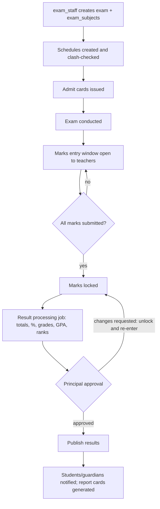
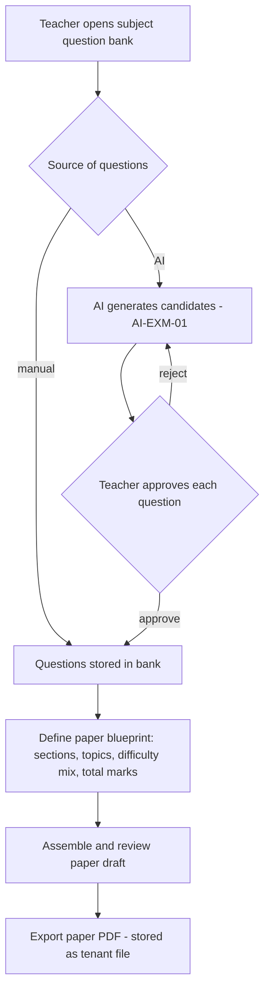

# Module: Examination & Assessment

> **Agent Context** — Load this block first.
> **Summary:** End-to-end examination lifecycle: exam setup, subject-wise configuration, schedules, admit cards, marks entry, grade/GPA/percentage calculation against tenant grading scales, result processing with approval and controlled publishing, report cards, exam-paper generation, and question-bank management. Transcripts and certificates are issued through the certificates-documents module.
> **Co-load with:** `../02-architecture/auth-and-rbac.md` · `../05-database/entities/examinations.md` · `./academics.md` · `./certificates-documents.md`
> **Owns entities:** exams, exam_schedules, exam_subjects, grading_scales, grade_bands, marks, results, report_cards, admit_cards, question_banks, questions
> **Depends on modules:** academics, student-management, timetable, attendance, certificates-documents, communication

## 1. Purpose

Manages every assessment a school runs — unit tests, midterms, finals, practicals — from configuration through published results. Exam staff define exams and subject-wise settings (max/pass marks, weightage), schedule papers into dates/rooms, issue admit cards, and open marks entry to teachers. The system computes totals, percentages, GPA, and grades from the tenant's grading scales, processes results through an approval gate (principal), and publishes them to students and guardians. Report cards are generated per student; question banks feed both AI-assisted exam-paper creation and quizzes.

Grading structure is fully tenant-configurable (scales, bands, weightages) — no country-specific grading model is assumed.

## 2. Business Objective

- Compress the result cycle (last paper → published results) from weeks to days with automated calculation and a single approval gate.
- Eliminate manual calculation errors: 100% of grades/GPA computed server-side from configured scales.
- Reduce teacher paper-setting time via question banks and AI generation (§14) while keeping teachers in control.

## 3. Target Users

| Role | How they use this module |
| ---- | ------------------------ |
| `exam_staff` | Creates exams, schedules, subject configs, admit cards; runs result processing (not approval) |
| `teacher` | Enters marks for assigned class-subjects; builds question banks and exam papers |
| `class_teacher` | Adds report-card remarks for the homeroom section; reviews section results |
| `principal` / `vice_principal` | Approves and publishes results (delegated review to vice principal); exam-day oversight; performance analytics |
| `school_admin` | Configures grading scales/bands; manages exam calendar conflicts |
| `student` / `guardian` | Views admit cards, exam schedules, published results, and report cards (own / own children) |

## 4. Permissions

Permissions follow the RBAC model in [`auth-and-rbac.md`](../02-architecture/auth-and-rbac.md). Permission keys use `<module>.<resource>.<action>`. Module-specific verbs declared here: `issue` (admit cards), `lock` (marks).

| Permission key | Description | Default roles |
| -------------- | ----------- | ------------- |
| `exams.exam.view` / `create` / `update` / `delete` | Manage exam definitions | `exam_staff`, `school_admin`; view also `principal`, `vice_principal`, `teacher` |
| `exams.schedule.create` / `update` | Manage exam schedules | `exam_staff` |
| `exams.grading-scale.create` / `update` | Manage grading scales and bands | `school_admin`, `principal` |
| `exams.marks.create` / `update` | Enter/edit marks (record scope `assigned` for teachers) | `teacher`, `exam_staff` |
| `exams.marks.import` / `exams.marks.lock` | Bulk marks import (Excel); lock/unlock after entry window | `exam_staff`; lock also `school_admin` |
| `exams.result.view` | View processed results (scoped: `own` for student/guardian, `assigned` for teachers) | all tenant roles per scope |
| `exams.result.approve` | Approve processed results | `principal` (delegable to `vice_principal`) |
| `exams.result.publish` | Publish approved results | `principal`, `school_admin` |
| `exams.report-card.create` / `view` / `publish` | Generate/view/publish report cards | `exam_staff` (create), `class_teacher` (remarks + view), `principal` (publish) |
| `exams.admit-card.issue` | Generate and issue admit cards | `exam_staff` |
| `exams.question-bank.create` / `update` / `delete` | Manage question banks and questions | `teacher`, `exam_staff` |
| `exams.question.approve` | Approve AI-generated questions into a bank | `teacher` (assigned subject), `vice_principal` |
| `exams.result.export` | Export result data | `exam_staff`, `principal`, `school_admin` |
| `exams.grading-scale.view` | Read grading scales and bands (needed to render any grade) | all staff |
| `exams.schedule.view` | View exam schedules | all staff, `student`, `guardian` |
| `exams.admit-card.view` | View issued admit cards | `exam_staff`, leadership, `student`, `guardian` |
| `exams.result.create` | Run result processing (not approval) | `exam_staff`, `school_admin` |
| `exams.question-bank.view` | Read question banks and questions | `teacher`, `exam_staff`, leadership |
| `exams.marks.view` | Read marks, the entry grid and entry progress (record-scoped by section, as entry is) | `teacher`, `class_teacher`, `exam_staff`, `school_admin`, `principal`, `vice_principal` |

The approver of a result cannot be the user who ran processing (segregation of duties, RBAC doc §2.4).
It is the **latest** run that counts: every run stamps `results.processed_by` on every pending row of the exam
(including a row it did not recompute, such as a student withdrawn since), so after a send-back and a re-process
by someone else, the new processor may not approve and the original one may.

Report-card remarks are split by field: `class_teacher_remarks` needs `exams.report-card.create` and
`principal_remarks` needs `exams.report-card.publish`. The `PATCH` takes either key
(`AnyOf`, ADR-0027), and a body naming a field whose key the caller lacks is a 403 naming that field.

A `teacher` reads exams at record scope `assigned`: the exams with a subject they are currently allocated
to in that exam's session, or any subject of their homeroom's class in the homeroom's session (the session
of the active enrolments that make the section theirs).
Grading scales are reference data, readable in full by every holder of `exams.grading-scale.view`. §20
records how both are resolved.

Marks entry (`exams.marks.create`) and the marks reads (`exams.marks.view`) are narrowed per **section**,
each under its own key's scope (`scopes_for`), and a key held at several scope types reads their union
(ADR-0031 decision 7): `all` reaches every section; otherwise a section is reached when a `campus` grant
covers the section's campus **or** an `assigned` grant covers the section. **`assigned` differs between
read and write.** Reading (`services.may_enter_marks`, the grid, progress) counts a current allocation for
that section and subject in the exam's session **or** the homeroom in that session, as
`Marks.filter_assigned_to_user` does, because §3 gives the class teacher a review role. Writing
(`services.assert_marker_may_enter`, `:bulk-entry`, the import and the grid's `writable` flag) counts the
allocation only: a homeroom-only class teacher reads the grid with `writable` false (`no_permission`) and
a submit is a 422 on `section_id`. §11 states the write rule.

`exams.marks.view` was added with the marks dashboard. Before it, the marks reads fell back to
`exams.marks.create`, so `principal`, `vice_principal` and `school_admin`, who review marks but do not
enter them, could not open the grid or the progress board. `exams.marks.update` is registered but no endpoint
reads it yet: `:bulk-entry` writes a new row and an update alike under `exams.marks.create`
([`deferred-work.md`](../deferred-work.md)).

The five rows from `exams.grading-scale.view` to `exams.question-bank.view` were added during implementation. Each names a capability this
document already granted in prose while the table omitted the key, so the capability
was documented and unreachable: §3 says a `student`/`guardian` "views admit cards,
exam schedules, published results, and report cards" and §12 notifies both about a
published schedule and an issued admit card; §5.5 computes every grade from a scale a
client has to be able to read; §13 reports on question-bank usage; and §3 says
`exam_staff` "runs result processing (not approval)" while the table listed only
approve, publish, view and export. This is the same correction
`attendance.student-attendance.import` needed, and the same resolution: register the
key and add the row, rather than invent a key the document never mentions.

Result processing takes the standard `create` verb rather than a new `process` one —
processing is precisely what creates `results` rows, and `core/rbac/registry.py` asks
that a new verb be declared in a module doc §4 before being added.

## 5. Main Features

1. **Examination setup** — exams per academic session/term with type, weightage toward the final result, and grading scale; subject-wise exam configuration (`exam_subjects`): max/pass marks, theory/practical split, per-class applicability.
2. **Exam scheduling** — date/time/room/invigilator per exam-subject per section; clash checks against rooms, invigilators, and other exams.
3. **Admit cards** — batch-generated per exam per section from a tenant template, delivered as PDFs to student/guardian portals; revocable (e.g. fee-clearance policy, tenant-configurable).
4. **Marks entry** — per exam-subject grids for teachers (theory/practical columns, absent/exempt flags), Excel import, submit → lock lifecycle.
5. **Grade calculation & result processing** — totals, percentage, grade band, grade points, and GPA computed from the exam's grading scale; optional section/class ranks; batch processing as a background job.
6. **Result approval & publishing** — processed results go to the principal for approval; publishing releases them to students/guardians and fires notifications; withheld results supported per student.
7. **Report cards** — per student per exam (or term consolidation), combining results, attendance summary (attendance module), and class-teacher/principal remarks; PDF via the platform document pipeline.
8. **Exam papers & question banks** — subject/class question banks (manual, imported, or AI-generated with approval); papers assembled from banks by difficulty/topic blueprint and exported as PDFs.
9. **Transcripts & certificates** — cumulative transcripts and exam-related certificates are issued via [`certificates-documents.md`](certificates-documents.md), consuming this module's `results` data (cross-module read, no duplication).

## 6. Sub-features

- **Setup & scheduling:** clone an exam from a previous term; per-section applicability; grace-marks policy per exam (tenant-configurable, recommendation); clash list (room double-booked, invigilator clash, student sitting two papers at once); schedule publish to portals.
- **Marks entry:** entry window dates; out-of-range rejection; missing-entries dashboard per exam; re-open (unlock) requires `exams.marks.lock` and is audited.
- **Processing & report cards:** recompute is idempotent and re-runnable until approval; pass/fail per subject and overall; best-of/weighted aggregation across exams for term results; tenant report-card templates, locale-aware rendering, regeneration versioning.
- **Question banks:** tagging by topic/difficulty/type; usage tracking (which paper used which question); duplicate detection (recommendation).

## 7. Workflows

### 7.1 Exam lifecycle

States on `exams`: draft → scheduled → ongoing → marks_entry → processing → approved → published. Approval gate: `exams.result.approve`; publish gate: `exams.result.publish`; both audited.

### 7.2 Question bank → exam paper

AI-generated questions never enter a bank without explicit approval (`exams.question.approve`).

## 8. User Journeys

- **Exam staff:** sets up "Term 1 Midterm" by cloning last year's, adjusts dates, resolves the two room clashes the checker flags, issues admit cards in one batch, and after marks lock runs processing and sends results for approval.
- **Teacher:** gets a "marks entry open" notice, enters Grade 8 Math marks in the grid (2 absentees flagged), submits; later uses the question bank to assemble the Grade 8 final paper from an AI-drafted set she prunes.
- **Principal:** reviews the result summary (pass rates per section, outliers flagged by AI-EXM-04), sends one section back for a data-entry fix, approves, and publishes.
- **Guardian:** receives the publish notification, opens the child's result and report card PDF, and compares the trend across terms.

## 9. Inputs

- Exam/subject/schedule configuration forms; grading scale and band definitions.
- Marks: grid entry, Excel import (`exams.marks.import`), absent/exempt flags.
- Report-card remarks (class teacher, principal); question authoring/import forms; paper blueprints; AI prompts for question generation (subject, class, topic, difficulty, count).

## 10. Outputs

- Processed result records; published results in portals; report card, admit card, and exam paper PDFs (all stored via the tenant `files` pipeline).
- Notifications (§12); webhook event `result.published` (per [`api-architecture.md`](../02-architecture/api-architecture.md) §2.6); exports (marks sheets, result registers — CSV/Excel/PDF); result data consumed by certificates-documents for transcripts.

## 11. Validations

- Unique: exam name per session; one `exam_subjects` row per (exam, class, subject); one marks row per (exam_subject, student); one result per (exam, student).
- Marks: `0 ≤ obtained ≤ max_marks` per component; pass marks ≤ max marks; entries rejected outside the entry window unless unlocked; absent flag and marks are mutually exclusive.
- Marks entry is per section: a submit names one `section_id` of the exam-subject's class and may only carry students on that section's active roll in the exam's session (any other is a `meta.rows` issue). The section must be one the caller may enter under `exams.marks.create`: `all`, a `campus` grant covering the section's campus, or an `assigned` grant with a current allocation for that section and subject in the exam's session (the homeroom does not count for entry); anything else is a 422 on `section_id`. The import applies the same rule per row under `exams.marks.import`.
- Marks entry scope: every student in a `:bulk-entry` grid must be within the caller's `exams.marks.create` record scope — `campus` reaches the held campuses' students, `assigned` the students enrolled in a section the caller is currently allocated the subject in (`academics.TeacherSubjectAllocation`). A student outside it is a rejected row, reported as an ineligible one is, and nothing is saved. A marks import matches rows only against the students the importer's `exams.marks.import` scope reaches, in the sections that key lets them enter (the key travels in the job as `scope_permission`, and a job without it fails closed); any other admission number, including one in a section the importer may not enter, is reported as an unknown one is. A student whose own campus differs from their section's is refused on submit even where the section is enterable (`deferred-work.md`).
- Scheduling: no student may have two papers at overlapping times; room and invigilator single-booked; exam dates within the session/term.
- Processing: blocked while any assigned exam-subject has unsubmitted marks (override with an audited waiver — recommendation); grading bands must be contiguous, non-overlapping, and fully cover 0–100%.
- Publishing: only approved results; report cards only from published results; approver ≠ processor.

## 12. Notifications

| Event | Recipients | Channels | Template ref |
| ----- | ---------- | -------- | ------------ |
| Exam schedule published / admit card issued | Students, guardians (schedule also to teachers of affected sections) | Push, in-app, email | `exams.schedule-published` / `exams.admit-card-issued` |
| Marks entry window open / closing reminder | Teachers with pending entries | In-app, email | `exams.marks-entry-reminder` |
| Results submitted for approval | `principal` | In-app | `exams.result-approval-pending` |
| Results published / report card available | Students, guardians | Push, SMS, email (tenant preference) | `exams.result-published` / `exams.report-card-ready` |

Channels and delivery behavior follow [`notifications.md`](../02-architecture/notifications.md).

The `exams.marks-entry-reminder` template's `class.name` variable carries the class and section together ("Class Section"), because the reminder goes per section.

## 13. Reports

- **Result register** — per exam per section: marks, grades, GPA, rank; export Excel/PDF.
- **Pass/fail analysis** — per class/subject/section; trend across exams and sessions.
- **Subject performance report** — averages, distribution histograms, hardest questions (where paper metadata exists).
- **Marks-entry status** — pending/submitted/locked per exam-subject (operational chase list).
- **Grade distribution & question-bank usage** — band counts per exam per class; questions by topic/difficulty and reuse frequency.

Role visibility per RBAC: teachers see assigned sections; students/guardians see own; leadership sees all.

## 14. AI Capabilities

Cross-referenced to [`ai-features.md`](../04-ai/ai-features.md). All AI outputs require human approval before becoming records visible to students or guardians.

- **AI-EXM-01 — Exam-question & question-bank generation:** drafts questions (MCQ, short/long answer) from subject, class level, topic, and difficulty; each question individually approved by a teacher before entering the bank (§7.2).
- **AI-EXM-02 — AI grading assistance:** suggests scores and feedback for short/long-answer responses supplied by the teacher; the teacher confirms or adjusts every suggestion — AI never writes to `marks` directly.
- **AI-EXM-03 — Student performance analysis:** per-student and per-section insight summaries after publishing (strengths, declining subjects, comparison to prior exams); feeds the at-risk indicator shared with attendance (AI-ATT-02).
- **AI-EXM-04 — Result anomaly screening:** pre-approval screen for entry errors (impossible jumps, uniform values, outlier sections) surfaced to the approver as advisory flags.

## 15. Database Entities

All tables are tenant-scoped per [`multi-tenancy.md`](../02-architecture/multi-tenancy.md). Full column-level specs: [`../05-database/entities/examinations.md`](../05-database/entities/examinations.md).

- `exams` — an examination event within a session/term, with type, weightage, status.
- `exam_subjects` — per-class subject configuration for an exam (max/pass marks, splits).
- `exam_schedules` — date/time/room/invigilator per exam-subject per section.
- `grading_scales` — tenant grading models (percentage, letter, GPA).
- `grade_bands` — bands within a scale (label, range, grade points).
- `marks` — per-student per-exam-subject marks with entry lifecycle.
- `results` — processed per-student per-exam outcome (%, grade, GPA, rank, approval state).
- `report_cards` — generated report-card records + remarks + document link.
- `admit_cards` — issued admit-card records + document link.
- `question_banks` — question collections per subject/class.
- `questions` — individual questions with type, difficulty, source (manual/AI), approval flag.

Exam papers are generated documents (assembled from `questions`, stored via the platform `files` pipeline and templated per [`certificates-documents.md`](certificates-documents.md)); they have no dedicated table (recommendation).

## 16. API Requirements

Conventions per [`api-architecture.md`](../02-architecture/api-architecture.md).

- `GET/POST/PATCH /api/v1/exams` · `/api/v1/exam-subjects` · `/api/v1/exam-schedules` · `/api/v1/grading-scales` (bands nested: `/api/v1/grading-scales/{id}/grade-bands`)
- `GET /api/v1/marks` — filters: `exam_subject_id`, `section_id`, `student_id`, `status`; `GET /api/v1/marks/grid?exam_subject_id=&section_id=` (one section's roll with its marks, and `meta.writable`); `POST /api/v1/marks:bulk-entry` (idempotent grid submit for one `section_id`) · `POST /api/v1/exam-subjects/{id}:lock-marks` · `:unlock-marks`
- `POST /api/v1/exams/{id}:process-results` — `202` + job resource (API doc §2.7)
- `POST /api/v1/exams/{id}:approve-results` · `:send-results-back` · `:publish-results` — colon-actions, permission-guarded, audited
- `GET /api/v1/exams/{id}/schedule-conflicts` (the clash list) · `POST /api/v1/exams/{id}:publish-schedule`
- `GET /api/v1/results` (scoped) · `POST /api/v1/results/{id}:withhold` · `GET/PATCH /api/v1/report-cards` (remarks only) · `POST /api/v1/report-cards/{id}:download` · `GET /api/v1/admit-cards` · `POST /api/v1/exams/{id}:generate-report-cards` · `:issue-admit-cards` (jobs) · `:publish-report-cards` · `POST /api/v1/admit-cards/{id}:revoke` · `:download`
- `GET/POST /api/v1/reports/exam-summary` — one `kind` per report, inline rows under a ceiling, a job above it and for every export
- `GET/POST/PATCH/DELETE /api/v1/question-banks` · `GET/POST/PATCH/DELETE /api/v1/question-banks/{id}/questions` · `POST /api/v1/question-banks/{bank}/questions/{id}:approve` · `POST /api/v1/question-banks/{id}:generate-questions` (AI, job) · `:assemble-paper` (job → paper PDF file)

List and read shapes the dashboard depends on:

- **Pagination.** `/exams`, `/grading-scales` and `/question-banks` page by number (`?page=`, `meta.pagination.total_count`), as
  [`api-architecture.md`](../02-architecture/api-architecture.md) §2.4's bounded admin lists do: one school's exams,
  its handful of scales and its banks are navigated by position. `/exams` is ordered `-starts_on, name, id` by default (`id` makes the order total),
  `/grading-scales` and `/question-banks` by `name` (then `id`). A bank's `/questions` keeps the cursor. `/exam-subjects` keeps the cursor and is ordered by class, then subject, so a client
  grouping by class reads each class's rows together. A scale's `/grade-bands` is **unpaginated**, in display order
  (`sort_order`, then `-min_percent`): a scale has a handful of bands and a client needs all of them.
- **Names on the row.** An exam carries `academic_session_name`, `term_name` (null without a term),
  `grading_scale_name` and `subject_count` (all of the exam's live exam-subjects, not only the ones the viewer
  can see under record scope `assigned`); an exam-subject carries `exam_name`,
  `class_name` and `subject_name`. All read-only, from joins and one annotation in the list's own query, so a
  list renders without a lookup per id.
- **The duplicate subject is a 422.** A second live (exam, class, subject) is refused as a
  `domain_rule_violation` under `subject_id` ("This subject is already on this exam for this class."), checked
  before the partial unique index would turn it into a bare 409.
- **The two state refusals are 409s.** A write to an exam, or to its subjects, once it is past `scheduled`
  ("… its configuration is frozen."); a delete of any exam but a draft ("This exam is scheduled. Only a draft
  exam can be deleted.").
- **A sitting carries its names.** `ExamSchedule` reads `exam_id`, `exam_name`, `subject_name`, `class_name`,
  `section_name`, `room_name` and `invigilator_name` (null without a room or an invigilator), so the schedule
  renders without a lookup per id.
- **The clash list has its own read.** `GET /exams/{id}/schedule-conflicts` returns `ExamConflict[]` (`type`,
  `severity`, `schedule_ids`, `message`), hard findings first: the same engine every sitting write runs into
  `meta.conflicts` and `:publish-schedule` blocks on, so a client sees what publishing would refuse without
  saving a sitting or computing clashes itself. Staff-only (`exams.schedule.view`). Its exam, like
  `:publish-schedule`'s and `:issue-admit-cards`', resolves through `ExamViewSet`'s record scope, so an exam
  outside an `assigned` caller's teaching is a 404.
- **A colon action reaches its exam under two keys** (ADR-0031 decision 3). The exam is scoped by the hosting
  view's read key (`exams.schedule.view` for the clash list and `:publish-schedule`, `exams.admit-card.view`
  for `:issue-admit-cards`, …), then by the route's own key, each with `ExamViewSet`'s scope settings. A wide
  action role cannot reach an exam the caller's view role hides, and a schedule reader without
  `exams.exam.view` keeps the clash list. **An exam-subject addressed by id follows the same two-key rule**
  (`scoped_exam_subject`, with `ExamSubjectViewSet`'s scope settings): the grid under `exams.marks.view`
  alone, `:lock-marks` and `:unlock-marks` under `exams.marks.view` and then `exams.marks.lock`,
  `:bulk-entry` under `exams.marks.view` and then `exams.marks.create`, and `POST /marks-imports` under
  `exams.marks.import`. An exam-subject outside that reach is a 404 before any section is looked at, so a
  caller who teaches none of it cannot learn which sections are in its class.
- **The publish is typed.** `:publish-schedule` answers `{status, conflicts}` (`ExamSchedulePublish`): the
  exam's new status, `scheduled`, and the soft findings that did not block it. A hard finding is a 422
  `domain_rule_violation` carrying the **whole** list in `error.meta.conflicts` (never flattened into
  `details`, which would keep one `schedule_ids` entry); a schedule with no sittings is a 422 under `exam_id`.
  Only a `draft` or `scheduled` exam publishes: the school's schedule lock, then the exam row (`select_for_update`), are taken first, and any later status is
  a 409, so a publish can never move an exam back to `scheduled`.
- **An admit card carries its student and section.** `AdmitCard` reads `student_name`, `admission_number`,
  `section_id` and `section_name`, the section from the student's enrolment **in the exam's session**, in
  any status, so a promoted or graduated student's card keeps the section they sat in (both null without one),
  prefetched once per page. The `section_id` filter reads the same row. An `assigned` reader (a class teacher)
  sees a card only through a homeroom in the exam's own session. `/admit-cards` keeps the cursor, filters on `exam_id`,
  `section_id`, `status` and `student_id`, and orders by `admit_card_no` or `created_at`.
- **Issuing reports its counts in the `202`.** `:issue-admit-cards` creates the missing rows synchronously and
  queues only the PDFs: the `202`'s `data` (`AdmitCardIssueAccepted`) carries `added` and `existing` beside
  `job_id` and `status`, so a client renders its own localised summary (the job's `result` is
  `{rendered, failed, cards}`, the render's own count). A card revoked while the job renders stays revoked: the
  job's save is conditional on the card not being revoked. A re-run tops up and never re-creates a
  revoked card. A draft exam is a 409 (no published schedule to print).
- **A card's document has its own action.** `POST /admit-cards/{id}:download` returns `{download_url}`, a
  short-lived signed link, under `exams.admit-card.view` and the record scope (`get_object()` runs first, so a
  student or guardian reaches only their own card). It is a **404**, not a 409, while the card has no file
  (the render job has not written it), once it is revoked, or when its file is not `ready` or was soft-deleted
  (the same checks as `core/files`' `get_display_url`): either way there is no document to hand out.
- **The marks grid is one section's roll.** `GET /marks/grid?exam_subject_id=&section_id=` (`exams.marks.view`)
  returns `MarksGridEntry[]` unpaginated: the section's active roll in the exam's session, in roll order
  (`enrollment_roll_order`), each with `student_id`, `student_name`, `admission_number`, `roll_number` and its
  `marks` row or null. `meta.exam_subject` carries `max_marks`, `pass_marks`, `has_practical` and
  `practical_max_marks`; `meta.writable` says whether `:bulk-entry` would take the grid now, and when false
  `meta.unwritable_reason` (`no_permission`, `exam_status`, `locked`, `window_not_open`, `window_closed`) and
  `meta.unwritable_message` (the refusing gate's sentence). **The flag runs the submit's own gates**:
  `no_permission` is the section write gate itself (`assert_marker_may_enter` under `:bulk-entry`'s key, not
  "holds the key somewhere"), then the exam, lock and window gates, so a grid never looks writable where the
  submit refuses. An exam-subject outside the caller's record scope, or a section `services.may_enter_marks`
  refuses them under `exams.marks.view`, is a 404.
- **Bulk entry names its section and refuses whole.** `POST /marks:bulk-entry` takes `exam_subject_id`,
  `section_id` and `entries`, with an `Idempotency-Key`. In order: the serializer (a mark on an absent row, or
  absent with exempt, is a 400 under `entries.N.<field>`; a student twice is a 400); the exam-subject's record
  scope (a 404, above); the exam's status, the lock and the entry window (409s, each with its own
  sentence); the section gate (a 422 on `section_id`); then
  every row (on the section's roll, at most `max_marks`). Any refused row refuses the grid: a 422
  `domain_rule_violation`, "N of M rows were rejected; nothing was saved.", with each row in
  `error.meta.rows` as `{index, student_id, field, issue}`, and nothing written. The 200 is
  `BulkMarksEntryResult` (`entered`, `updated`, `rows`).
- **Progress is per section.** `GET /exams/{id}/marks-progress` (`exams.marks.view`) returns
  `MarksProgressRow[]` unpaginated, one per (exam-subject, section with an active roll), in class, subject and
  section order: `exam_subject_id`, `subject_name`, `class_name`, `section_id`, `section_name`, `expected`,
  `entered`, `submitted` (submitted or locked rows) and `is_locked`. A caller without `all` scope for the
  progress route's key (`exams.marks.view`) gets only the pairs the read predicate allows under that key; the
  exam resolves through `ExamViewSet`'s record scope (out of scope is a 404).
- **Lock and unlock are typed and scoped.** `:lock-marks` answers `{locked_rows, already_locked}` and
  `:unlock-marks` `{unlocked_rows, already_unlocked}`; a repeat is a retry, not a conflict. The exam-subject
  resolves through `ExamSubjectViewSet`'s record scope under two keys (ADR-0031 decision 3): the marks read key
  `exams.marks.view`, then `exams.marks.lock`, so an `all` lock role cannot reach an exam-subject the caller's
  marks view role hides (a 404). An unlock once results are approved is a 409.
- **The marks import checks the file's type and the importer's sections.** `POST /marks-imports` refuses a
  content type outside the `exams.marks-import` purpose's MIME allowlist (`text/csv`, Windows' `application/vnd.ms-excel` CSV type and `.xlsx`; a 400 under
  `file`), and a caller who may enter no section of the exam-subject under `exams.marks.import` (a 422 on
  `exam_subject_id`). The job carries that key as `scope_permission` and **fails closed** without it (a job
  queued before the key existed is failed, never read under every role's scope). Each row's student must be in
  a section the importer may enter and within the key's record scope; any other row reads as an unknown
  admission number, so a refused row does not say the student exists.
- **Every imported row re-checks the entry gates, under the exam's and the subject's locks.** The upload's
  check is only a fail-fast. For each row, the job takes the exam `FOR KEY SHARE`, which conflicts with
  `:process-results`, and then the exam-subject `FOR NO KEY UPDATE`, which conflicts with `:lock-marks`.
  Under those locks it reads the lock, the window and the exam's status again (`lock_subject_for_entry`).
  `:bulk-entry`, `:lock-marks` and `:unlock-marks` take the same two locks, in the same order, before anything
  else. If the subject is locked, closed, removed, or its exam moves past marks entry while the job is queued
  or running, the rows after that point are refused. Each refused row is reported under `exam_subject` with the
  grid's message, so a failed-rows re-import works once entry reopens (L47).
- **A result carries its names and its processor.** `Result` reads `student_name`, `admission_number`,
  `section_name` (the section recorded at processing time), `processed_by` and `processed_by_name` (who ran the
  latest processing), and `approved_by` and `approved_by_name` (null until approved). Names are first and last,
  never an email, loaded in one query per page. A client disables Approve for the user whose id is
  `processed_by`; a forced `:approve-results` by them is a 422 `domain_rule_violation` under `approved_by`.
  The same serializer serves a student's or guardian's read of their published results, so the portal also
  receives the processor's and approver's staff ids and names; dropping them there is deferred
  (`deferred-work.md`).
- **The results actions are typed and scoped.** `:approve-results` answers `{approved}`, `:send-results-back`
  `{reopened, reason}` and `:publish-results` `{published, withheld, published_ids}` (the ids this call moved; a
  repeat moves none). `:process-results` is a `202` with an `Idempotency-Key`, refused with a 409 of its own
  code, `marks_outstanding`, while any exam-subject has marks outstanding; its job's `result` is
  `{created, updated, students}`. `:generate-report-cards` is a `202` too, its job's `result`
  `{rendered, failed, cards}`. `:process-results`, `:approve-results`, `:send-results-back` and
  `:publish-results` resolve the exam through `ExamViewSet`'s record scope under two keys, `exams.result.view`
  then the action's own, as every exam colon action does; `:withhold` resolves the result through `/results`'
  own (L46). Out of scope is a 404, so an `all` approve or publish role cannot reach an exam the caller's
  results view role hides.
- **A report card carries its student, section and figures.** `ReportCard` reads `student_name`,
  `admission_number`, and from its result `section_id`, `section_name`, `percentage` and `grade` (all four null on
  a term-consolidated card, which has no single result). `/report-cards` filters on `exam_id`, `term_id`,
  `student_id`, `section_id` (the result's section) and `status`. `:generate-report-cards` and
  `:publish-report-cards` resolve the exam through `ExamViewSet`'s record scope under `exams.report-card.view`
  and then their own key; `:publish-report-cards` answers
  `{published, published_ids}`.
- **Remarks are written per field.** `PATCH /report-cards/{id}` takes `class_teacher_remarks` (needs
  `exams.report-card.create`) and `principal_remarks` (needs `exams.report-card.publish`), each held for this
  card's student's campus, not anywhere (ADR-0031); a field whose key the caller lacks for the card is a 403 naming it in `error.details`, checked after the scoped lookup (out of scope stays a 404)
  and before anything is written. A published card is a 409.
- **A report card's document has its own action.** `POST /report-cards/{id}:download` returns `{download_url}`
  under `exams.report-card.view` and the record scope, the admit card's shape (ADR-0021). A student or guardian
  reaches only their own **published** card; a card with no rendered file, or whose file is not `ready` or was
  soft-deleted, is a 404.
- **A bank and a question carry their names.** `QuestionBank` reads `subject_name` and `class_name` (null for a
  bank with no class, which covers every level), joined in the list's own query. `Question` reads `approved_by`
  and `approved_by_name` (first and last name, never an email, one query per page), both read-only and null for
  a question nobody approved: a teacher's own question is approved on save with no approver, and an AI draft
  until `:approve` names one.
- **Questions filter on the blueprint's own axes.** A bank's `/questions` (cursor, oldest first) takes
  `topic` (matched whole, case-insensitively), `difficulty`, `question_type`, `source` and `is_approved`,
  and `search` over the text and topic; `/question-banks` takes `subject_id`, `class_id`, `status` and
  `search` over the name and description.
- **The nested question routes are record-scoped.** `/question-banks/{id}/questions` and its `:approve` resolve
  the bank through `QuestionBankViewSet`'s record scope (L46), so a bank outside an `assigned` teacher's subjects
  is a 404 on every route, the list and a create included, exactly as a foreign bank is.
- **An `assigned` creator's bank stays in a subject they teach.** On `POST /question-banks` and on a `PATCH`
  that sends `subject_id`, a caller whose scope is `assigned` must hold a current allocation
  (`_assigned_teaching`) in that subject, or it is a 422 on `subject_id`; `all` and `campus` callers are
  unrestricted, as their reads are.
- **A question's `source` is fixed at create.** A `PATCH` that changes it is a 422 on `source` (resending the
  same value is accepted), so an AI draft's label cannot be removed.
- **Assembly is a job with a typed result.** `:assemble-paper` takes `{title, sections}` and answers a `202`
  (`PaperAssemblyAccepted`, `{job_id, status}`); its job's `result` is `{result_file_id, questions, total_marks}`:
  the paper PDF's file id, the number of questions used, and the paper's total marks as a decimal string. A
  blueprint the bank's approved questions cannot fill is a 422 `domain_rule_violation` before any job exists,
  with every short section in `error.meta.sections` as `{index, difficulty, topic, requested, available}`. A
  pool that shrinks between the check and the job fails the job rather than truncating the paper, and the
  job's `error` is the plain sentence naming the section, not the error's field dict.
- **Report rows are typed per `kind`.** `GET /reports/exam-summary` answers `ExamReportRow[]`, a `oneOf` keyed by
  each row's `kind` (`result-register`, `pass-fail-analysis`, `subject-performance`, `marks-entry-status`,
  `grade-distribution`, `question-bank-usage`), each row type mirroring its report function field for field
  (ADR-0022). Decimals stay JSON numbers; averages are rounded to two places in the query, so an inline row
  and an export of the same report carry the same figure.

## 17. Integration Requirements

- **Internal:** academics (classes/sections/subjects/enrollments), attendance (report-card attendance summary), timetable (rooms + clash checks for schedules), certificates-documents (transcripts, templates, PDF pipeline via WeasyPrint per [`tech-stack.md`](../02-architecture/tech-stack.md)), files service (PDFs), communication (notifications), AI gateway (§14), background jobs (processing, batch generation). **External:** none mandatory; SMS/email for result notifications via the notification adapter layer.

## 18. Dependencies on Other Modules

| Module | Direction | What is shared |
| ------ | --------- | -------------- |
| academics | inbound | Classes, sections, subjects, enrollments, sessions/terms |
| student-management | inbound | Student records for marks, results, admit cards |
| attendance | inbound | Attendance summaries for report cards; exam-day attendance |
| timetable | inbound | Rooms, clash checking with regular periods |
| certificates-documents | outbound | Result data for transcripts/certificates; templates for PDFs |
| fees-finance | inbound (optional) | Fee-clearance check before admit-card issue (tenant policy) |
| communication | outbound | All notifications in §12 |
| parent-portal | outbound | Result/report-card/admit-card views |
| reporting-analytics | outbound | Performance datasets and dashboards |

## 19. Open Questions / Recommendations

- Fee-clearance gating of admit cards: supported as an optional tenant policy, default off (recommendation).
- Grace marks / moderation policy: schema supports a per-exam adjustment recorded on `results`; policy details need client confirmation (recommendation).
- Term-consolidated report cards (weighted across exams) recommended as the default output; per-exam cards remain available.
- Re-evaluation/rechecking requests by guardians and online exam delivery (students answering in-app) are future enhancements, not initial scope; question banks are designed so online delivery can be added later (recommendation).

## 20. Implementation status

Built as five stacked PRs. This section is updated by each. **All five have landed.**

**PR A — setup.** Grading scales with validated bands, exams, and per-class
subject configuration.
**PR B — scheduling and admit cards.** Sittings with a clash engine, schedule
publish, and the admit-card batch.
**PR C — marks entry.** The grid, the four entry gates, the lock lifecycle,
the sheet import and the missing-entries dashboard.
**PR D — results and report cards.** Processing, the approval gate,
publishing, withholding, and versioned report cards.
**PR E — reports and question banks (this PR).** §13's six reports with the
export lane, question banks with §7.2's approval gate, and deterministic paper
assembly. **The module is complete.**

### Built

| Area | State |
| ---- | ----- |
| Entities | **All 11** of §15's tables — `grading_scales`, `grade_bands`, `exams`, `exam_subjects`, `exam_schedules`, `admit_cards`, `marks`, `results`, `report_cards`, `question_banks`, `questions` — tenant-owned with RLS policies |
| §16 endpoints | `GET/POST/PATCH/DELETE /grading-scales`, `POST /grading-scales/{id}:set-default`, `GET/POST/PATCH/DELETE /grading-scales/{id}/grade-bands`, `GET/POST/PATCH/DELETE /exams`, `GET/POST/PATCH/DELETE /exam-subjects`, `GET/POST/PATCH/DELETE /exam-schedules` (every write returns `meta.conflicts`), `GET /exams/{id}/schedule-conflicts`, `POST /exams/{id}:publish-schedule`, `GET /admit-cards`, `POST /exams/{id}:issue-admit-cards` (202 + job, accepts `Idempotency-Key`), `POST /admit-cards/{id}:revoke` · `:download`, `GET /marks` (filters `exam_subject_id`, `exam_id`, `section_id`, `student_id`, `status`, `is_absent`, `is_exempt`), `GET /marks/grid`, `POST /marks:bulk-entry` (one `section_id`, accepts `Idempotency-Key`), `POST /exam-subjects/{id}:lock-marks` · `:unlock-marks`, `GET /exams/{id}/marks-progress`, `POST /marks-imports` (202 + job), `GET /results`, `POST /exams/{id}:process-results` (202 + job) · `:approve-results` · `:publish-results` · `:send-results-back`, `POST /results/{id}:withhold`, `GET/PATCH /report-cards` (remarks only), `POST /exams/{id}:generate-report-cards` (202 + job) · `:publish-report-cards`, `GET/POST /reports/exam-summary` (six report kinds, inline under 1,000 rows and a 202 job above), `GET/POST/PATCH/DELETE /question-banks`, `GET/POST/PATCH/DELETE /question-banks/{id}/questions`, `POST /question-banks/{bank}/questions/{id}:approve`, `POST /question-banks/{id}:assemble-paper` (202 + a job rendering a paper PDF) |
| §4 permissions | `exams.exam.{view,create,update,delete}`, `exams.grading-scale.{view,create,update}`, `exams.schedule.{view,create,update}`, `exams.admit-card.{view,issue}`, `exams.marks.{view,create,update,import,lock}`, `exams.result.{view,create,approve,publish}`, `exams.report-card.{view,create,publish}`. `exams.question-bank.{view,create,update,delete}`, `exams.question.approve`, `exams.result.export`. **All of §4's keys are registered, and every one but `exams.marks.update` has an endpoint behind it:** `:bulk-entry` checks `exams.marks.create` for a new row and an update alike, so `.update` gates nothing yet (`docs/deferred-work.md`, lesson L48). `tests/test_endpoint_contracts.py` checks that every key a view names is registered, not the reverse |
| §11 validations | Exam name unique per session · exam dates set together and ordered · dates within the named term, or the session where no term is named · a term must belong to the exam's session · the session must be writable · one `exam_subjects` row per (exam, class, subject) · `pass_marks ≤ max_marks` · a practical component requires a practical maximum · the subject must be in the class's curriculum for the session · grading bands contiguous, non-overlapping and covering 0–100% before an exam may use the scale |
| §13 reports | All five — result register (ordered by rank, unranked last), pass/fail analysis per section, subject performance over `marks`, marks-entry status, grade distribution — plus question-bank usage, behind one `kind`-parameterised endpoint with a 202 export lane in all three of `core.exports.tabular`'s formats. Every one asserted at **one query** |
| §5.8 question banks | Banks per subject (class optional — null means every level), questions with §7.2's approval gate, and deterministic blueprint assembly ordered by `usage_count` so reuse spreads and a re-run produces the same paper |
| §5.5 processing | `processing.py` — totals with subject weightage on *both* sides of the fraction, percentage, grade band, GPA, dense ranks, and outcome. Five queries for a whole school; the per-student loop never queries |
| §11 processing | Blocked while any exam-subject has marks outstanding, measured against the **expected roll** rather than rows that happen to exist: a 409 with its own code, `marks_outstanding`, naming the subjects. Recompute is idempotent and refused once approved (a plain `conflict`) |
| §5.6 approval | Per-row `status` and per-exam status both move. **The approver cannot be the processor** — compared against `results.processed_by`, which every processing run re-stamps on every pending row of the exam (a re-process after a send-back included), not `created_by`, which names only the first run (lesson L50). Publishing releases approved, non-withheld rows only; withholding is a per-student `outcome` |
| §5.7 report cards | Versioned on regeneration, remarks preserved, stale file cleared. Attendance is a JSONB **snapshot** from `attendance.reports.student_summary` — one query for the whole cohort |
| §11 marks | One row per (exam-subject, student) · nothing negative and absent-excludes-a-mark at the **database**; `0 ≤ mark ≤ max_marks` in `services`, because a CHECK cannot read `exam_subjects.max_marks` · absent and exempt are mutually exclusive · a practical mark on a theory-only subject is refused · only students on the submitted section's active roll in the exam's session, in a section of the exam-subject's class, and within the marker's `exams.marks.create` scope (a `:bulk-entry` grid) or the importer's `exams.marks.import` scope (a marks import) |
| §5.4 lifecycle | `draft → submitted → locked` on the row, plus `exam_subjects.marks_locked_at` on the *window*. Four gates on every write, each with its own message because each has a different remedy: the exam's status (§7.1), the entry window (§6), the subject lock, and the teacher's allocation (§4). An **unset** window means always open |
| §6 dashboard | `GET /exams/{id}/marks-progress` — expected / entered / submitted per (exam-subject, section), narrowed by `services.may_enter_marks` for a caller without `all` scope, in a bounded number of queries whatever the size of the exam. The marks-entry reminder goes per section to that section's allocated subject teachers |
| §11 scheduling | One sitting per (exam-subject, section) · `end_time > start_time` · a section must belong to the exam-subject's class · a completed or cancelled sitting cannot be rescheduled · admit cards need a published schedule · a revocation needs a reason (CHECK, not only a service rule) |
| §5.2 clash engine | `conflicts.py` — hard: room double-booked, invigilator double-booked, a student sitting two papers at once, a sitting outside the exam's own dates, a sitting on a non-working day or holiday. Soft: an over-capacity room, a sitting on a weekday the sections have published lessons. Every write returns the whole list; only hard findings block `:publish-schedule` |
| §12 notifications | Two of six wired — `exams.schedule-published` (one `notify()` for the whole exam, on commit) and `exams.admit-card-issued` (one per card, because §12's template names the card number, with guardians fetched once and grouped rather than queried per card). The admit-card one fires after the **render**, not at issue: it says the card is ready to download, which is only true once a document exists. PR C adds `exams.marks-entry-reminder`, sent once per outstanding section, to that section's allocated subject teachers in the exam's session, for any exam-subject whose window closes within two days with marks still outstanding — §12 says "teachers with pending entries", and a broadcast to all staff is the kind of notification people learn to ignore. PR D adds the last three — `result-approval-pending` (in-app only, to whoever holds `exams.result.approve`, resolved from the **permission** so a delegation to `vice_principal` is followed), `result-published` and `report-card-ready` (both to the students whose rows actually *transitioned*, whose ids the caller passes in). **All six of §12's rows now have a caller** — PR B's review found one registered with none |
| §5.5 grading | `grading.py` — `percentage_for` (ROUND_HALF_UP, one decimal place), `assert_scale_is_complete`, `band_for` (boundary resolves to the upper band), `gpa_for` (None unless the scale type is `gpa` or `hybrid`) |
| §7.1 lifecycle | `exams.status` starts at `draft` and is **read-only on the wire**. Configuration is frozen past `scheduled`; only a draft exam may be deleted |
| Feature flag | `module.examinations`, `default_enabled=False` |
| Tests | Models (constraints), grading (the maths and every band-rule refusal), API (endpoints, permissions, the feature gate), cross-tenant (one case per endpoint, all asserting 404) |

### Decisions worth carrying forward

- **§11's band rule cannot be a constraint, and the split is deliberate.**
  "Contiguous, non-overlapping, covering 0–100%" is a statement about a *set* of
  rows — a band is only wrong relative to its neighbours — so no CHECK can hold
  it, and enforcing coverage per row would make a scale impossible to build,
  since the first band inserted would violate it. The database holds each band's
  own range and label uniqueness; `grading.assert_scale_is_complete` holds the
  rest, and is called **when an exam attaches a scale**, not on every band write.
  That placement is the whole point: early enough that an admin fixes it on a
  form, rather than at result processing, where the same problem is a failed job
  over a whole school's marks.
- **A band's ends are both inclusive, so `band_for` resolves a boundary upward.**
  A student on exactly 80.0 gets the better grade. Decided and tested here rather
  than left to emerge from row ordering, because it is the kind of thing a school
  has to be able to explain to a parent.
- **`is_default` moves through `:set-default`, not a PATCH.** The partial unique
  `grading_scales_one_default` refuses two live defaults, so making a scale the
  default is two writes in one transaction. A `PATCH {"is_default": true}` would
  409 against whichever scale currently holds it — describing the constraint
  rather than the caller's intent.

- **The clash engine shares no code with `timetable/conflicts.py`, on purpose.**
  A timetable slot is a cell in a weekly grid (`day_of_week` + `period_id`) and
  takes its times from the period it names, so a clash there is an equality
  test on a key tuple. An exam sitting is a wall-clock interval on a calendar
  date, so a clash is an *overlap* test and two sittings can conflict without
  sharing any key. Every detector in that file reads `TimetableSlot`
  attributes, and its own header records that its duplication with the database
  constraints is load-bearing — bending it to serve two row shapes would risk
  that to save a file. What is copied is the **pattern**: a frozen `Conflict`
  carrying severity and every row involved, one prefetching `collect_scope`,
  pure detectors with no query inside any of them, and hard findings blocking
  publish while soft ones warn.
- **Overlap is half-open** (`a.start < b.end and b.start < a.end`). A paper
  ending at 11:00 and one starting at 11:00 do not clash: back-to-back sittings
  are the normal shape of an exam day, and the closed reading reports a false
  conflict on every one of them.
- **A sitting on a holiday is a *hard* finding, not a soft one.** The
  alternative is a hall of students arriving at a locked school. A school that
  genuinely opens for an exam edits its working week or removes the holiday,
  which is a real change rather than an override — and it reads the same
  calendar `attendance` refuses to mark against.
- **A student collision is computed through section *rosters*, not section
  ids.** A student enrolled across two sections (an elective cohort, a resit
  group) is exactly the case an identity comparison would miss while appearing
  to check it.
- **The admit-card batch is idempotent, and a revoked card is never
  reinstated.** §8's journey is "issues admit cards in one batch", which in
  practice means pressing the button again after the roll changes — so a re-run
  tops up and reports both counts. But revocation is a decision someone made
  (§5.3's fee-clearance case), and a top-up silently undoing it would reverse
  that decision without anyone asking.
- **Rows are created synchronously; only the PDFs are deferred.** The caller
  learns immediately how many cards the run added, and the job renders whatever
  has no `file_id` — which is what makes it re-runnable after a partial failure
  rather than something that has to be unpicked.
- **`cancelled` is a status, not a soft delete.** A cancelled sitting stays
  visible to a student who already saw it, and — the load-bearing half — is
  excluded from every clash check and from the occupancy constraints, because a
  room freed by a cancellation is free.

- **A rejected row rejects the whole grid; a rejected row in an *import* does
  not.** The two paths are in the same module and behave oppositely on purpose.
  A grid is one act of judgement over one class, so partial commit is never the
  outcome — a teacher who believes they saved forty marks and saved thirty-nine
  is worse off than one told which cell is wrong, and the refusal carries
  `error.meta.rows` with each bad cell's index. An import is a file a school is
  migrating or transcribing, where §6 asks to "re-import failed rows only" —
  which needs a per-row verdict a whole-file rejection cannot give.
- **Unlike `attendance`'s import, this one applies the same rules as its grid.**
  That contrast is worth stating because a reader who has met that importer will
  expect the exemptions. Attendance's rows are historical *by construction*, so
  its calendar and lock gates would reject the entire file. These rows are this
  exam's marks arriving by a different door, and the window is exactly as
  relevant as it is to a teacher typing them.
- **Unlocking returns rows to `submitted`, not `draft`.** They *were*
  submitted. Sending them back to draft would lose the distinction §6's
  missing-entries dashboard depends on and make every reopened subject look
  unfinished.
- **A blank cell in an imported sheet is the absence of a mark, not a zero.**
  The distinction the whole import turns on: a school leaves a cell empty for a
  student who did not sit, and reading it as zero would fail them rather than
  mark them absent.
- **Entering marks is what moves an exam into `marks_entry`.** Done in the
  service rather than by a separate call, so the status cannot lag behind the
  data — a school looking at a `scheduled` exam that already holds marks has no
  way to tell which is true.
- **`marks_entry_progress` carries `class_id` and `subject_id`, not only their
  names.** So a caller acting on a row — the reminder sweep resolving which
  teachers to notify — does not re-fetch the exam-subject per row. That is the
  N+1 shape PR B's review caught twice, and the fix belongs in the query rather
  than at each call site.

- **Three rules in `processing.py` are the ones a school will argue about**, so
  each is named and tested rather than left implicit. An **absent** student is
  `outcome=absent`, not a zero — a zero would rank them last and drag the
  section's pass rate down, a data error presented as a child's result. An
  **exempt** subject shrinks the denominator rather than scoring zero (§5.4 —
  "excluded from aggregates"), while an **absent** subject keeps its maximum,
  because the paper was set and not sat. And **ties share a rank**: two students
  on 91% are both second, because breaking the tie by name or id would invent a
  difference the marks do not support.
- **Subject weightage scales both sides of the fraction.** §5.1 makes it a
  weight *within* the exam's aggregate, so a subject at 50% contributes half its
  marks and half its maximum — which keeps a percentage a percentage. Scaling
  only the obtained side would silently change what the total was out of.
- **§7.1's "changes requested" edge is built as `:send-results-back`, and §16
  does not list it.** That is a deliberate addition rather than an invention:
  §7.1's flowchart has the edge explicitly, and without an endpoint for it a
  data-entry error found at approval has no route back — someone reaches for a
  database edit. It is also what lets `assert_exam_accepts_marks` and
  `assert_exam_is_recomputable` be strict, since there is a sanctioned way out
  of `approved`. A send-back returns every unpublished row to `processing`, and
  the next run moves every one of them back to pending approval, including a row
  it did not recompute (a student withdrawn since); approval refuses with 409
  while any row is still `processing` (lesson L51).
- **A withheld result survives a recompute, and a revoked admit card survives a
  re-issue.** The same rule twice: a decision someone took is not undone by a
  batch operation running again.
- **Two narrowings on `/results`, and only one is record scope.** The model hook
  answers *whose* result a caller may see; the viewset adds *whether it is
  released*, filtering a restricted principal to `published`. Conflating them
  inside `filter_owned_by_user` would put a publishing rule somewhere nobody
  looks for one. `core.rbac.permissions.is_restricted_principal` was extracted
  from `DenyRestrictedPrincipals` so a queryset can ask the same question the
  permission class asks.
- **§12's three new triggers all fire on the rows that *transitioned***, whose
  ids the caller collects before the write and passes to the task. Publishing is
  idempotent, so notifying on current status would re-send every guardian the
  same message on a re-publish — `attendance`'s review finding, applied ahead of
  time.

- **§7.2's approval gate is asymmetric, and the asymmetry is the design.** A
  question a teacher wrote is usable as soon as it is saved — they have already
  exercised the judgement, and asking them to approve their own would be
  friction with no safeguard behind it. An `ai_generated` question arrives
  `is_approved=False` whatever the client sent, and needs a *named* human. The
  CHECK constraint is scoped to `ai_generated` for the same reason: demanding
  an approver on a manual question would block ordinary creation.
  `is_approved` is read-only on the serializer **and** forced in `create` —
  belt and braces, because a pre-approved AI question is the whole gate
  defeated. That is AGENTS.md invariant 5 in a column.
- **Paper assembly is deterministic, not random.** Ordered by `usage_count`
  then creation, which buys two properties: reuse spreads across a bank (making
  §6's usage tracking worth keeping), and two runs of the same blueprint over
  an unchanged bank produce the same paper — so a teacher who regenerates after
  fixing a typo in the title does not get a different exam. A question taken by
  an earlier section is never offered to a later one.
- **A blueprint reports every shortfall at once.** A teacher whose blueprint
  asks for eight hard questions from a bank holding three needs to know that
  about each section of the paper, not to fix one and resubmit — the same
  reasoning the clash engine's whole-list return uses.
- **`usage_count` is incremented, not derived**, and in the same transaction as
  the selection. §15 records that assembled papers are stored as files with no
  table to join against, so this column is the only record that a question was
  used — a crash between selecting and recording would lose it.
- **`marks_entry_status` (§13) and `marks_entry_progress` (§6) answer the same
  question differently, on purpose.** The dashboard computes an *expected* roll
  from enrolments, so a subject nobody has started shows as outstanding; the
  report counts what exists, so it can be exported over one queryset alongside
  the others. Where they disagree, the dashboard is for chasing and the report
  is a record of what was entered. Both docstrings say so.

### The dashboard's Schedule tab (examinations dashboard, PR B)

`/exams/{id}?tab=schedule`, shown to a holder of `exams.schedule.view`. Sittings are read whole
(`fetchSittings`) and drawn one card per date, by start time, with a clash marker (icon and word) on
any sitting a finding names. The clash panel reads `GET /exams/{id}/schedule-conflicts`, hard findings
first, each finding naming its sittings. Every sitting write and a publish invalidate the exam's reads,
so the table and panel reload from the server together. **Add** needs `exams.schedule.create` and an
exam up to `scheduled`; **reschedule** and **cancel** (a `status: cancelled` patch) need
`exams.schedule.update` (reschedule also an exam up to `scheduled`); **delete** needs `.update` on a
draft exam. The sitting form's section picker follows the paper's class, and its room picker the
**section's campus**, since an exam has none. **Publish schedule** needs `.update` and a draft or
scheduled exam (the server refuses any other status with a 409), is disabled while any hard finding stands
(with the count), and a refused publish shows the server's `error.meta.conflicts`.

### The dashboard's Admit cards tab (examinations dashboard, PR B)

`/exams/{id}?tab=admit-cards`, shown to a holder of `exams.admit-card.view`. The exam's cards, cursor-paged
(`CursorDataGridCard`), by card number, filtered by **section** (the sections the exam's sittings name,
read under the Schedule tab's key) and **status**, both in the URL. Each row shows the number, the student,
the admission number, the section and the status as token, icon and label; a revoked card shows its reason
under the status. **Download** fetches the card's own `:download` link and appears only once the render job
wrote a file and on a card not revoked. **Issue admit cards** needs `exams.admit-card.issue` and appears only
once the schedule is published (any status past `draft`, `assert_exam_is_issuable`); it sends an
`Idempotency-Key` (kept until the request is accepted, so a retry replays it, then dropped, so pressing it
again later is a new run), shows the server's own counts from the `202` beside the button (never a tally made
in the browser), polls the render job, and reloads the list when it ends. **Revoke** needs the same key, is
offered on a live card only, and asks for a reason (required, 255 characters at most).

**Sitting scope follows `_assigned_teaching`.** `ExamSchedule.filter_assigned_to_user` now reads the same
helper as `Exam`, `ExamSubject` and `Marks`: a subject teacher sees the sittings of the (section, subject) they
are allocated in the allocation's session; a **class teacher sees a section's sittings only through a
homeroom with active enrolments in the exam's session**, so last session's homeroom opens nothing; and an
invigilator still sees the sittings they supervise. Before, any sitting of a section whose
`class_teacher_staff_id` was the teacher's matched, whatever the session. `ScheduleAssignedScopeTests` pins both session cases (an
allocation and a homeroom in another session each hide the sitting). **Admit-card scope** reads the same helper:
a class teacher sees a card when its exam is in a homeroom's session and the student's enrolment in that
session (any status) is in that section, so neither last session's homeroom nor this session's reaches the
other's cards (`AdmitCardAssignedScopeTests`).

### The dashboard's Marks tab (examinations dashboard, PR C)

`/exams/{id}?tab=marks`, shown to a holder of `exams.marks.view`. It opens on the **progress list**
(`GET /exams/{id}/marks-progress`): one row per (exam-subject, section) the viewer may enter (every one for
`all` scope), with entered and submitted against the expected roll and a state as token, icon and label
(locked, submitted, in progress, not started). **Enter marks** opens that section's grid at
`?tab=marks&subject=<exam_subject_id>&section=<section_id>`, so a grid is a shareable link; a section the
viewer may not enter answers 404 and says so. A holder of `exams.marks.lock` gets **Lock** (straight away) and
**Unlock** (confirmed, saying it is audited) on each row; both act on the whole exam-subject. Whenever the exam is
in `marks_entry` with any subject locked, the tab notes that a locked subject takes no marks and must be
unlocked to be corrected, or that the viewer must ask someone who can. A send-back is one such case (the exam
returns to `marks_entry` with its subjects still locked); locking one subject while others are still being
entered is another, so the note is informational, not a warning.

The **grid** (`GET /marks/grid`) lists the section's roll: roll, name, admission number, then theory,
practical (only when the subject has one), absent, exempt and remarks. Absent and exempt exclude each other
and clear and disable the marks. Each mark is checked as typed: more than four digits before the point or two after (the serializer's
`max_digits=6, decimal_places=2`), or not a number, holds
the save (the server would refuse it as a 400), and a mark above `max_marks` shows a hint but is sent, so the
server's own refusal names it. **Save draft** sends every row that holds something, or held something before
(so a cleared row is cleared), as `draft`; **Submit** is held while any student has nothing entered, then
sends every row as `submitted`. Both send `section_id` and an `Idempotency-Key` that is remade on every edit
and after each success, and kept on a refusal. A refusal (422) marks each row `error.meta.rows` names, on the
cell its `field` names, with the server's sentence, and keeps every entry; a 409 (the window closed or the
subject was locked meanwhile) reloads the grid. A grid with `meta.writable` false is read-only with
`meta.unwritable_message`, whatever the reason, and shows only the saved values: an edit refused by a 409 is
not left on screen as if it were saved. Leaving the Marks tab drops `subject` and `section` from the URL, so
another tab (Admit cards filters by `section`) never inherits them. **Import marks** (`exams.marks.import`) uploads a sheet for
the exam-subject through the shared import dialog; it is offered while the grid takes marks, or when only the
entry key is missing.

The server side of the tab is §16's grid, bulk-entry, progress, lock and import shapes, and the one predicate
§4 describes. E2E coverage: `e2e/tests/dashboard/exams-marks.spec.ts` (mocked: a teacher opens their section
from progress, enters marks with an absentee and submits; an out-of-range mark refused on its row with every
entry kept; the author locks and the grid turns read-only) and `e2e/tests/live/api/exams-marks.spec.ts` (the
seeded `teacher`, allocated to one section, sees only that section in progress, reads its roll and submits;
the sibling section is a 404 to read and a 422 to write, another scaffold's exam and section are 404s; the exam
staff sees entered = expected, locks, and the teacher's re-submission is a 409).

### The dashboard's Results tab (examinations dashboard, PR D)

`/exams/{id}?tab=results`, shown to a holder of `exams.result.view`. The exam's results, cursor-paged
(`CursorDataGridCard`), highest percentage first, filtered by **section** (the sections the exam's sittings
name), **outcome** and **status**, all in the URL. Each row shows the rank in section, the student (a link that
opens the detail sheet) with their admission number, the section, percentage, grade, GPA, and the outcome and
status as token, icon and label; every figure is the server's. The **detail sheet** shows the result's figures,
who processed and who approved it, and the student's subject marks (`GET /marks?exam_id=&student_id=`, each
named by its exam-subject, read under the Subjects tab's key). The subject marks need `exams.marks.view`, which
not every Results viewer holds; without it the sheet says so and makes no `/marks` read.

Above the list, the lifecycle bar offers each action on its key and the exam's status:

- **Process results** (`exams.result.create`; `scheduled`, `ongoing`, `marks_entry` or `processing`) sends an
  `Idempotency-Key` (kept until the `202`, then dropped, as Issue admit cards does), polls the job and reloads
  the results when it ends. A 409 shows the server's sentence inline. While marks are outstanding the 409 carries
  its own code, `marks_outstanding` (`processing.MarksOutstanding`), its sentence names the subjects, and a
  **Go to Marks** link opens `?tab=marks`; the exam's other 409s keep `conflict` and show no link.
- **Approve** (`exams.result.approve`; `processing`) is held, with the reason beside it, when the signed-in user's
  id is the pending results' `processed_by` (one pending row is read for it: every run stamps every pending row
  of the exam, including one it did not recompute, such as a student withdrawn since), and when nothing awaits
  approval. A failed read says so with a retry, never a silent hold. A forced approval still gets the server's
  422, shown in the confirm dialog.
- **Send back** (`exams.result.approve`; `processing` or `approved`) asks for a reason (500 characters at most)
  and reports the server's count of results reopened.
- **Publish results** (`exams.result.publish`; `approved`) confirms, then reports the server's counts of results
  published and withheld.

**Withhold** (`exams.result.publish`) is a row action on a result neither published nor already withheld; it asks
for a reason (255 characters at most). A withheld result stays withheld through a re-process, and publishing
skips it.

### The dashboard's Report cards tab (examinations dashboard, PR D)

`/exams/{id}?tab=report-cards`, shown to a holder of `exams.report-card.view`. The exam's cards, cursor-paged,
newest first, filtered by **section** and **status** in the URL; each row shows the student, section, percentage
and grade, version and status. **Download** fetches the card's own `:download` link once the render job wrote a
file. **Remarks** is offered on an unpublished card to a holder of either remarks key, and shows and sends only
the fields the viewer may write: the class teacher's remark with `exams.report-card.create`, the principal's with
`.publish` (1000 characters each; a blank one clears it). A refused field (403) shows the server's sentence.
**Generate report cards** (`.create`) and **Publish report cards** (`.publish`) appear once the exam is
`published`; generating is a polled `202` job with an `Idempotency-Key` (a partial render warns with the job's
own count of cards that failed, which stay drafts until a re-run), and publishing reports the server's count.

Leaving any tab drops the list filters and the marks grid's keys (`subject`, `section`, `outcome`, `status`) from
the URL, so the next tab never reads another's filter.

### The dashboard's Reports section (examinations dashboard, PR D)

`/exams/reports`, a section of the Examinations tab bar and sidebar shown to a holder of `exams.result.view`
(§4). The viewer picks one of §13's six reports (result register, pass/fail analysis, subject performance,
marks-entry status, grade distribution, question-bank usage) and, for every kind but question-bank usage, the
exam it is about (the newest 100 exams, each named with its session); the picker is hidden for question-bank
usage, which is about the school's banks. Both live in the URL (`?kind=&exam=`), so a link names its report and
runs it on arrival. **Run report** reads `GET /reports/exam-summary`: up to 1,000 rows show as a table whose
columns follow the kind (the typed `ExamReportRow` union, narrowed on `row.kind`; every figure is the server's,
a null one a dash, the ungraded band named "Ungraded"); a larger report is a `202` whose CSV job the screen polls
to a download, offering to run it again if the poll is refused. **Export CSV / XLSX / PDF** (`POST`, a polled
job each) shows only to a holder of `exams.result.export`. A hint says when the form no longer matches the report
on screen. The job panel, export buttons and grid are the shared `components/reports/` pieces attendance's
Reports screen uses too. The five per-exam kinds are offered only to a viewer who also holds `exams.exam.view`,
since the exam picker reads `GET /exams`; without it (the accountant, the school owner and the other staff roles
that hold only `exams.result.view`) the kind picker offers question-bank usage alone, no `/exams` read is made,
and a note says the per-exam reports need exam access (recorded in `deferred-work.md`). A `student` or
`guardian` also holds `exams.result.view`, so sees the tab, but `ExamReportView` is staff-only and answers them
403 (recorded there too).

### E2E coverage of results, report cards and reports (examinations dashboard, PR D)

- **Mocked** (`e2e/tests/dashboard/exams-results.spec.ts` and `exams-report-cards.spec.ts`, on the shared
  world of `e2e/src/data/exams-results-scenario.ts`; stubs `e2e/src/mocks/domains/exams-results.ts` and
  `exams-report-cards.ts` over one `exams-results-state.ts`): the exam author processes (the Idempotency-Key sent,
  the results awaiting approval, no Approve for a role without the key) and is refused with a **Go to Marks** link
  while marks are outstanding; the principal, holding exactly the seeded `e2e-principal`'s keys, withholds one
  result, approves and publishes (the server's counts, the withheld result left unpublished), and a publish after
  a send-back behind the screen shows the 409; a school owner holding both keys who ran the processing finds
  Approve held with the reason, a re-process keeps the withheld result withheld, and an approval forced after a
  re-process behind the screen shows the 422; the author generates report cards and downloads one through its own
  `:download`; the principal runs the result register. The stub enforces approver ≠ processor, approve before
  publish, and withheld surviving a re-process (lesson L5).
- **Live API** (`e2e/tests/live/api/exams-results.spec.ts`, on a run-unique scaffold built by
  `buildProcessedExam` in `e2e/src/lib/live-exams.ts`): the exam staff builds the exam and publishes its schedule,
  the allocated `teacher` submits the marks, the exam staff locks and processes (the job awaited); the principal
  sends the results back; the worker's admin (the school owner, holding both keys) re-processes, which re-stamps
  `processed_by`, and its own approval is a 422 under `approved_by`; publishing before approval is a 409; the
  principal approves and publishes; the exam staff generates report cards, each gets a `file_id`, and `:download`
  returns a signed link. A second test pins the 409 `marks_outstanding` before any mark exists.
- **Live browser** (`e2e/tests/live/exams-results-journey.spec.ts`): the seeded principal signs in, opens
  Examinations, the exam and its Results tab, and approves and publishes an exam the spec took to `processing`
  through `buildProcessedExam`; one real login, every screen reached by a click.
- **Left to the Django suite:** a student's or guardian's view of published results (`ResultViewSet`'s
  restricted-principal narrowing). Seeing it live would mean enrolling the seeded student into a run-unique
  section, and parallel workers would race on that student's single active enrolment.

The e2e seed's `e2e-principal@schoolhub.test` holds the results approver's keys (`exams.result.view`,
`.approve`, `.publish`, `exams.report-card.view`, `.publish`, and the exam, schedule and marks reads), never
`exams.result.create`, so it is never the processor.

### The dashboard's Question banks section (examinations dashboard, PR E)

`/exams/question-banks`, the last section of the Examinations tab bar and sidebar, shown to a holder of
`exams.question-bank.view` (§4). The banks the viewer's record scope reaches, page-numbered by name and
filtered by **subject** (for a holder of `school.subject.view`, since the filter reads `/subjects`) and
**status** in the URL; each row shows the subject, the class or "Every level" (a bank with no class), its
question count and status. An `assigned` teacher sees the banks of every subject they are allocated to, at
any class, and a bank outside them is "not found" (the API's 404). **New question bank** (`.create`), **Edit**
(`.update`) and **Remove** (`.delete`) are dialogs; the subject and class pickers read their lists only for
a holder of their view keys.

A bank's page, `/exams/question-banks/{id}`, heads it with its subject, level, count and status, then lists
its questions cursor-paged in the bank's order, filtered in the URL by **topic** (applied on Enter, as the
server matches it whole), **difficulty**, **type**, **source** and **approval**, with a search over the text
and topic. Each row shows the type, difficulty, topic, marks, source, approval and times used. A question
from `ai_generated` carries the **AI-generated** label (ai-governance.md §8) before and after approval, and
once approved it says who approved it. **Approve** shows only on an unapproved AI draft, to a holder of
`exams.question.approve` (invariant 5), and opens a confirm showing the whole question, its choices, answer
key, marks and topic, saying approval cannot be undone; nothing is sent until Approve there, and a refusal
stays in the dialog. The server refuses a manual question, and a teacher's own is usable on save. **New question** and **Edit** take each type's own fields: a multiple-choice question its choices,
one per line (at least two), and the correct one; a true-or-false question True or False; a long answer a
model answer; any other a short answer key.

**Assemble paper** (`exams.question-bank.update`) takes a title and the blueprint's sections, each a
heading, topic (blank draws from every topic), difficulty, count (1 to 200) and marks each (blank keeps each
question's own). A blueprint the approved questions cannot fill is refused before any job, and the dialog
lists **every** short section the server names (`error.meta.sections`), with what it asked for and what the
bank holds. Otherwise the `202`'s job is polled (`useJobFileDownload`) and its `result_file_id` downloaded,
with the server's question count and total marks in the toast. The job is held by the bank's page
(`BankHeader`), not the dialog, so closing the dialog mid-job still downloads the paper while the page stays
open, and reopening it shows the running job. Papers are not kept in a list, so the dialog says to save the
file when it arrives; it holds Assemble while the job runs, and a stalled job is resumed rather than started
again. `:generate-questions` is not built (`core/ai`; `deferred-work.md`).

### E2E coverage of question banks (examinations dashboard, PR E)

- **Mocked** (`e2e/tests/dashboard/exams-question-banks.spec.ts`, stub `e2e/src/mocks/domains/exams-question-banks.ts`):
  an `assigned` teacher reaches the section from the sidebar, sees only their subject's bank and gets "not
  found" for another; approves an AI draft, the one question Approve shows on, through its confirm (the
  choices shown, nothing sent before Approve), and it keeps its label and names the approver; the exam staff,
  holding every bank key but the approval, sees no Approve, creates a bank for every level, is shown both
  short sections of an over-asking blueprint, then the server's sentence for a section asking two medium
  questions where one is approved and one is an unapproved AI draft, and downloads a paper. The
  stub enforces the record scope, the unapproved AI draft, the 409 on approving a manual question, and the
  shortfall counted over approved questions only (lesson L5).
- **Live API** (`e2e/tests/live/api/exams-question-banks.spec.ts`, on a run-unique subject): the seeded
  `exam_staff` creates a bank for every level and its questions, an AI draft posted as approved is saved
  unapproved, a two-section paper's job is awaited (`liveExamTimeout(1)`) and its file's signed link fetched,
  and an over-asking blueprint is a 422 `domain_rule_violation` whose `error.meta.sections` names each short
  section, the draft not counted. Rendering needs WeasyPrint in the API image (PR #151, open).

### The dashboard's setup contract (examinations dashboard, PR A)

The dashboard's Examinations section (`/exams`, `/exams/{id}` with its Subjects tab, `/exams/grading-scales`)
came with these server changes:

- **Record scope `assigned` for exams and their subjects.** `Exam` and `ExamSubject` gained
  `filter_assigned_to_user`, resolved through one helper, `models._assigned_teaching`, which `Marks` now reads
  too, so the three cannot drift apart. A teacher sees an exam-subject they hold a **current** allocation for
  (`effective_to IS NULL`), matched on (class, subject) **in the exam's own session**, so last year's
  allocation does not open last year's papers; and every exam-subject of the class of a section they are
  class teacher of, **in that homeroom's session**. An exam is visible when one of its exam-subjects is, and an assigned teacher opening it
  sees only those subjects. A teacher with neither sees no exam at all.
- **The homeroom side is session-limited too.** `_assigned_teaching` carries each homeroom as a
  `(section_id, session_id)` pair, the session taken from the active enrolments that make the section the
  teacher's; `Exam`/`ExamSubject` match the section's class **and** `exam.academic_session_id`. So a class
  teacher does not see last session's exams for the same class.
- **`Marks` shares the write rule.** `Marks.filter_assigned_to_user` and `services.may_enter_marks` both
  read `_assigned_teaching`, and both are pinned to the exam's session: a row is visible when the student's
  **active** enrolment in the exam's session is in a section the teacher holds a current allocation for
  (that subject, that session) or is class teacher of in that session. `PredicateAgreementTests` pins the
  agreement, including a last-session exam. Its `campus` side matches too: `Marks.filter_by_campus` reads
  the campus of the section the student's enrolment in the exam's session names, as `may_enter_marks`
  reads `section.campus_id`.
- **A closed session's marks leave the teacher with the enrolment.** The assigned read requires the
  enrolment to be `active`, deliberately unlike L45's historical reads: once a session's students are
  promoted, their subject and class teachers can no longer read that session's marks, exactly as they can
  no longer write them. Leadership (`all`/`campus` scope) still reads them; a teacher's history view is
  results, not raw marks.
- **Grading scales and bands are reference data at every scope.** Their `filter_assigned_to_user` returns
  every row, the same reasoning that gives their viewsets `scope_campus_field = None`: a scale belongs to no
  class, campus or teacher, and a teacher who can see an exam but not the scale it grades against could not
  read its results. `exams.grading-scale.view` is held by all staff (§4).
- **The delete refusal names no way out.** It used to say "archive it instead", but nothing sets `archived`
  (see `docs/deferred-work.md`), so it now reads "Only a draft exam can be deleted." and stops there.

The e2e seed carries two identities for the live lane: `e2e-exam-staff@schoolhub.test` (`exam_staff`, scope
`all`) and `e2e-teacher@schoolhub.test` (`teacher`, scope `assigned`, with its own teaching `Staff` row and no
allocation, so a spec allocates it per run), plus the complete default scale `E2E Percentage`
(`seed_e2e_examinations`). `e2e/tests/live/api/exams-setup.spec.ts` pins the scope against the real stack.

### Corrected in review

Seven findings. Three describe rules the module now depends on:

- **`:publish-schedule` had no restricted-principal guard.** `publish` was
  missing from `required_permission_map`, so it inherited `required_permission`
  — the bare *view* key every portal user holds — and from
  `STAFF_ONLY_ACTIONS`, so `DenyRestrictedPrincipals` never applied. This is the
  same class as PR #42's `:bulk-mark`, in the module whose own docstring warns
  about it, which is the argument for the structural half of the fix: both
  portal-readable viewsets now name their **readable** actions
  (`PORTAL_READABLE_ACTIONS`) and everything else is staff-only. A list of
  writes must be updated whenever one is added and forgetting is silent;
  forgetting to add a read is a 403 someone reports the same day.
- **The clash engine's null guard never fired.** `_pairs_by_key` checked
  `if group is not None`, but every detector returns a *tuple* — `(room_id,
  exam_date)` — which is never itself None. So an unroomed sitting grouped
  under `(None, date)`, and every pair of not-yet-roomed sittings on one day was
  reported as a **hard** room clash. A school builds a schedule before it
  assigns halls, so publish was unreachable on the ordinary case. The detectors
  now return None explicitly when the dimension they group by is unset.
- **One exam's clash list reported other exams' clashes.** `scope.schedules`
  includes other exams deliberately — a room clash is by definition with some
  other exam — but pairs were formed over the whole merged list, so a clash
  purely *between two others* blocked this exam's publish over something its
  caller could not fix. At least one side of every pair must now belong to the
  exam under check.

And four smaller ones: `DELETE` on a sitting fell through to the mixin's soft
delete with no `assert_schedule_is_editable`, making it the way around a rule
`PATCH` enforced; `exams.admit-card-issued` was registered with templates and
documented as wired while nothing called `notify()` for it; `issue_admit_cards`
reported `len(created)`, which overstated when two runs raced (both read the
same `existing` set). It now locks the exam row (`lock_exam`) before reading
`existing`, so a concurrent run waits and reports 0, and `issued` is simply the
rows it inserted, with no `ignore_conflicts`; and the render
job called the single-card `student_sittings` inside its loop — two queries per
card, so three hundred cards was six hundred round trips, the shape
`conflicts.collect_scope`'s own docstring warns against. `services.sittings_by_student`
answers the whole batch in two queries, and a test asserts it agrees with the
single form.

A later review found `:publish-schedule` locking the exam while sitting writes
did not, so a sitting saved concurrently could commit after publish had read the
clash list, and the exam went to `scheduled` over a hard clash nobody saw. Every
sitting write (create, update including a cancel, delete) now goes through
`services.save_schedule_with_conflicts`, `services.update_schedule` or
`services.delete_schedule`. Their lock order is: the school's schedule lock, then
(update and delete) the sitting row `FOR UPDATE`, then the parent exam (both
exams, in pk order, when an update moves the sitting to another exam).

Publish also reads room and invigilator clashes against *other* exams'
sittings, which those exams' locks did not cover. So every sitting write and
every publish first takes one per-school schedule lock,
`services.lock_school_schedule`: a transaction-scoped PostgreSQL advisory lock
(`pg_advisory_xact_lock`) keyed on the tenant, through the shared
`core.tenancy.locks.advisory_xact_lock`. It is taken before the exam row lock
everywhere, so the order is the same on every path. The exam row lock stays,
because results and admit-card actions change the exam's status without the
schedule lock. The cost is that schedule edits within one school run one at a
time, which the school chose over a publish that can miss a clash.

Update and delete then checked `scheduled` on the row read before those locks,
so a PATCH that read the sitting before a concurrent cancel committed saved its
stale copy and wrote `scheduled` back, and a DELETE removed a sitting cancelled
after it was read. Both now re-read the sitting `FOR UPDATE` under the school
lock (`services.lock_editable_schedule`), refuse with 409 unless that row is
still `scheduled`, and validate and save against it.

### Corrected in review (PR D)

**One Major: the result lifecycle took no row locks.** `approve_exam_results`,
`send_results_back` and `publish_exam_results` all read `exam.status` and the
result rows with plain queries and wrote back later in the same transaction —
while `set_default_scale` and `bulk_enter_marks`, in the same file, correctly
took `select_for_update()`. The module was inconsistent with itself, which is
what made it findable.

The race is not theoretical: two near-simultaneous approvals both pass the
`status == processing` check, both `bulk_update`, and the loser's commit
overwrites `approved_by`/`approved_at` — corrupting the very audit trail the
segregation-of-duties rule exists to protect. The same window let a concurrent
publish schedule §12's guardian notification twice.

Fixed with a shared `services.lock_exam`, called by all four state-changing
actions. It locks the **exam** row rather than the result rows deliberately:
that is the one row all of them have in common, so it serialises them against
*each other* rather than only against themselves. `withhold_result` locks the
result instead, because withholding is per student and locking the exam would
serialise every hold against every other one.

The notification half needed a second change. The view had collected the moved
ids *before* calling the service — outside the lock — so
`publish_exam_results` and `publish_report_cards` now **return** the ids they
actually moved, and only the winner's list is non-empty.

### Corrected in review (PR E)

Two Majors, and both were silent failures rather than errors.

- **`Question` had no `filter_assigned_to_user`, unlike its sibling
  `QuestionBank`.** `scope_queryset` falls through to `.none()` for an
  `assigned`-scoped principal reaching a model with no hook — so a teacher who
  could correctly see their own bank got an **empty list** of the questions
  inside it, on list, retrieve, update, delete and `:approve` alike. §4 gives
  teachers exactly that scope, so it was the normal case. The existing scope
  test only exercised the bank list, which is why it survived; every nested
  route is now asserted, because the gap was per-endpoint rather than
  per-model. The hook delegates to `QuestionBank.filter_assigned_to_user`
  rather than restating the allocation join — a second copy of that predicate
  is a second place for a reassigned teacher to keep access.
- **Paper selection sliced `[:count]` silently and took no lock.** The
  endpoint's satisfiability check runs synchronously; selection runs later in
  the job's own transaction. Between the two, a concurrent assembly on the same
  bank can take the questions or someone can unapprove one — and the original
  produced a **short exam paper** with the job marked succeeded. Nobody notices
  until a hall of students has a paper missing its last section. The pool is now
  locked with `select_for_update` for the duration, and a shortfall raises
  rather than truncating, naming the section and its topic so a teacher with a
  five-section blueprint knows which one. The job records it as a failure.

  The endpoint's check is still there and still worth having — it gives an
  immediate, readable refusal — but it is no longer the one that holds.

### Deliberately not built

The module is otherwise complete; what follows is the full register.

**§14's four AI capabilities.** AI-EXM-01 (question generation), AI-EXM-02 (grading
assistance), AI-EXM-03 (performance analysis) and AI-EXM-04 (anomaly screening)
all need `core/ai`, which does not exist, and AGENTS.md hard rule 6 forbids
reaching a provider SDK directly. §16's
`POST /question-banks/{id}:generate-questions` is the endpoint for the first of
them and waits on the same thing. **The schema is ready for all four**:
`questions.source = ai_generated` with `is_approved=False` and an attributable
`approved_by` is exactly the gate §7.2 and AGENTS.md invariant 5 require, and
`marks` deliberately has *no* `source` column because AI-EXM-02's confirmed
value is a teacher's, not a model's.

**§11's processing waiver is not built**, and now that the block it would
waive exists, the reason is sharper: §11 calls it a recommendation and §4
declares no key for it. A waiver is only worth designing once a school has met
the block often enough to say what should bypass it — and an unaudited override
of "marks are outstanding" is exactly the kind of switch that gets used by
default.

**Term-consolidated report cards are deferred.** §19 calls them the recommended
default output, and they need weighted aggregation across several exams — which
needs more than one exam's results to exist. `report_cards.term_id` and its
partial unique ship now, so the later work is data-compatible rather than a
migration.

**§10's `result.published` webhook is not built.** `api-architecture.md` §2.6
describes a webhook dispatcher and nothing on the platform implements one.
The call site it would occupy is `ResultViewSet.publish`, beside the
notification.

**§14's AI-EXM-02 (AI grading assistance) is out of scope, and the schema says
so.** `marks` has no `source` column, because there is only one source — a
person. AI-EXM-02 suggests a score to a teacher who confirms or adjusts it, and
the confirmed value is what reaches the table; AGENTS.md invariant 5 requires
exactly that, and `core/ai` does not exist in any case.

**§11's processing waiver is not built.** §11 calls it a recommendation —
"blocked while any assigned exam-subject has unsubmitted marks (override with an
audited waiver)" — and PR D is where the block itself lands. A waiver with no
processing to waive would be a permission key guarding nothing.

**§19's fee-clearance gate on admit-card issue is not built.** `fees-finance`
does not exist, §19 makes the policy "optional, default off" and leaves its
details to client confirmation, and a policy hook with no policy behind it is a
lie in the code. The place it would go is
`services.assert_exam_is_issuable`, and `admit_cards.revoked_reason` already
records the outcome when a school applies the rule by hand.

§14's four AI capabilities (AI-EXM-01 to 04) and §16's
`POST /question-banks/{id}:generate-questions` are **out of scope for this
module**: `core/ai` does not exist and AGENTS.md hard rule 6 forbids reaching a
provider SDK directly. The `questions.source = ai_generated` /
`is_approved = false` shape will ship with PR E precisely so the generator drops
in later without a migration, and AGENTS.md invariant 5 ("AI drafts, humans
publish") is already satisfied by the `:approve` gate §7.2 describes.
