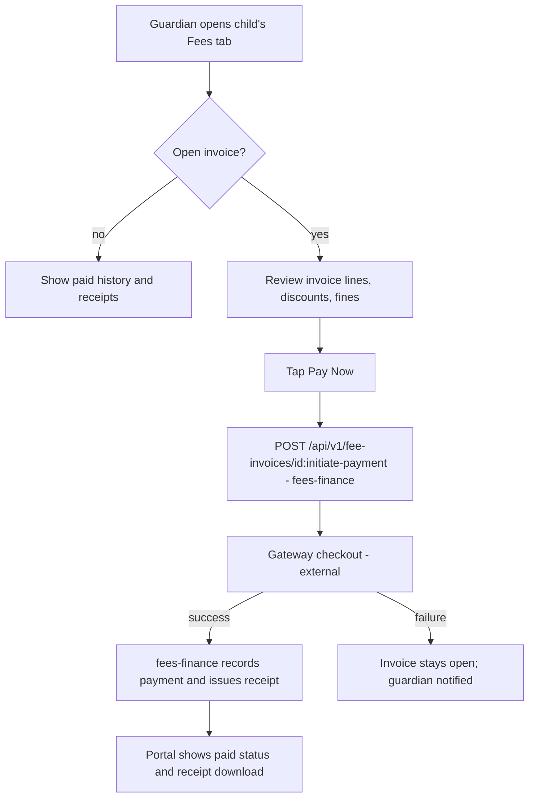

# Module: Parent Portal (incl. Student Self-Service View)

> **Agent Context** — Load this block first.
> **Summary:** Read-and-act portal for guardians across all of their linked children — attendance, fees, results, notices, school communication, and notification preferences — plus the equivalent self-service view for students (same read patterns, `own` scope). It owns no tables: it is a scoped presentation layer over other modules' data. Business value: it is the family-facing face of the school and the main driver of parent engagement and on-time fee payment.
> **Co-load with:** `../02-architecture/auth-and-rbac.md` · `../05-database/entities/people.md` · `fees-finance.md` · `communication.md` · `attendance.md` · `examinations.md`
> **Owns entities:** none (reads other modules' entities; see §15)
> **Depends on modules:** student-management, attendance, fees-finance, examinations, communication, timetable, library, transport

## 1. Purpose

The Parent Portal gives guardians a single place to see and act on everything concerning their children: daily attendance, fee invoices and payment initiation, published results and report cards, notices, and two-way communication with the school. One guardian account covers **multiple children** (one guardian ↔ many students via `student_guardians`), and one student can be visible to several guardians.

The same module also defines the **student self-service view**: an identically-scoped read experience where the principal is the student (own timetable, own attendance, own results, own fee status, own library loans), per the `student` role in [`users-and-roles.md`](../00-overview/users-and-roles.md).

## 2. Business Objective

- Reduce front-desk and phone load by making attendance, fees, and results self-serve.
- Improve fee-collection timeliness by pairing invoice visibility with in-portal payment initiation.
- Increase parent engagement (a scope §18 analytics area) with measurable portal-adoption and notice-read rates.
- Differentiate the product with the AI parent assistant (§14).

## 3. Target Users

| Role | How they use this module |
| ---- | ------------------------ |
| `guardian` | Views all linked children; pays fees; reads notices/results; messages the school; sets notification preferences |
| `student` | Student view: own timetable, attendance, results, fee status, library loans; AI study assistant |
| `school_admin` | Configures which portal panels are enabled per tenant; manages guardian account activation |
| `class_teacher` | Receives/answers guardian messages routed from the portal (via communication module) |

## 4. Permissions

Permissions follow the RBAC model in [`auth-and-rbac.md`](../02-architecture/auth-and-rbac.md). Permission keys use `<module>.<resource>.<action>`. The portal grants **no new data**: guardian/student roles hold other modules' `view` keys constrained to record-level scope `own` (guardian → own children; student → self). Guardian and student are restricted principals and can never hold staff keys.

| Permission key | Description | Default roles |
| -------------- | ----------- | ------------- |
| `parent-portal.dashboard.view` | Access the portal shell and per-child dashboard | `guardian`, `student` |
| `students.student.view` *(scope `own`)* | View linked children's / own profile | `guardian`, `student` |
| `attendance.student-attendance.view` *(scope `own`)* | View attendance records and summaries | `guardian`, `student` |
| `fees.invoice.view` *(scope `own`)* | View invoices, payment history, receipts | `guardian`, `student` |
| `fees.payment.create` *(scope `own`)* | Initiate online payment of an invoice (flow owned by fees-finance) | `guardian` |
| `exams.result.view` *(scope `own`)* | View published results and report cards only | `guardian`, `student` |
| `communication.thread.create` / `communication.message.create` *(scope `own`)* | Start/reply to a thread with the school about a linked child | `guardian`, `student` |
| `communication.notification-preference.update` *(scope `own`)* | Manage own channel preferences | `guardian`, `student` |
| `communication.notice.view` / `communication.notice.acknowledge` | Read and acknowledge published notices sent to the caller | `guardian`, `student` (and staff) |
| `platform.notification.view` | Read and mark read the caller's own in-app notifications | every tenant role |
| `timetable.timetable.view` *(scope `own`)* | A child's (or own) published week via `/timetables/my` | `guardian`, `student` (and staff) |

## 5. Main Features

1. **Multi-child dashboard** — one login, a switcher across all children linked via `student_guardians`; per-child summary cards (today's attendance, due fees, latest result, unread notices).
2. **Attendance visibility** — daily and monthly views, late/absent flags, absence reasons where recorded; read-only.
3. **Fee visibility & payment initiation** — open/paid invoices, line items, discounts/scholarships applied, downloadable receipts; "Pay now" hands off to the payment flow owned by [`fees-finance.md`](fees-finance.md).
4. **Results & report cards** — published results only (never draft/unapproved), downloadable report-card PDFs, term-over-term trend view.
5. **Notices & announcements** — tenant/class/section-targeted notices from [`communication.md`](communication.md), with read/acknowledgment tracking where required.
6. **Communication with school** — start message threads tied to a specific child; routed to the class teacher or configured office role.
7. **Notification preferences** — per-category, per-channel opt-in/out (emergency category not disableable).
8. **Student self-service view** — the student-role variant of the above, `own`-scoped, plus timetable, homework/assignment visibility, and library loans.

## 6. Sub-features

- **Dashboard:** child switcher; combined calendar (exams, holidays, fee due dates); profile view with guardian-visible fields only.
- **Attendance:** month grid; percentage vs. class threshold; absence-notification history.
- **Fees:** outstanding balance across all children; partial-payment display where the tenant allows it; receipt PDF download; payment-status tracking (`initiated → confirmed/failed`, states owned by fees-finance).
- **Results:** grade bands per tenant grading scale; teacher remarks; admit-card download during exam windows.
- **Communication:** thread history per child; attachment view; office-hours auto-notice (recommendation).
- **Preferences:** language/locale selection per user; quiet hours for push (recommendation).
- **Student view:** timetable by day/week; issued library books with due dates; transport route/stop info if assigned.

## 7. Workflows

**Guardian fee payment initiation** (payment execution itself is owned by fees-finance):

Steps: guardian (actor) selects invoice → portal calls the fees-finance initiation endpoint with an `Idempotency-Key` → gateway redirect → webhook confirmation updates `payments`/`receipts` (fees-finance tables) → portal reflects status and notification is sent. No approval gate; refunds/waivers are staff-side fees-finance workflows.

**Guardian messages the school:** guardian picks child → picks topic category → thread created (`message_threads`, communication module) → routed to class teacher / configured role → replies notify the guardian → thread closed by staff. Students follow the same flow scoped to self.

## 8. User Journeys

- **Guardian (daily):** push notification "Ayesha marked absent" → opens portal → checks attendance tab → messages class teacher with reason → later pays the month's invoice from the dashboard's due-fees card.
- **Guardian (term end):** result-published notification → views report card → downloads PDF → asks the AI parent assistant "how did she do compared to last term?"
- **Student (daily):** logs in with school-issued username → checks today's timetable → sees homework and library due date → asks the AI study assistant to explain a topic from the syllabus.

## 9. Inputs

- Guardian/student credentials and profile edits limited to contact fields (guardian phone/email — subject to school verification policy).
- Payment initiation requests (invoice id, amount context) — forwarded to fees-finance.
- Message thread posts and attachments (file-upload flow per [`api-architecture.md`](../02-architecture/api-architecture.md) §2.8).
- Notification-preference toggles; locale selection.
- Notice acknowledgments where a notice requires them.

## 10. Outputs

- No new domain records except communication artifacts (threads/messages, owned by communication) and payment initiations (owned by fees-finance).
- Downloaded documents: receipts, report cards, admit cards (PDFs generated by owning modules).
- Events consumed (not emitted): `attendance.marked`, `fee.invoice.issued`, `fee.paid`, `result.published`, `notice.published`.
- Portal-engagement telemetry (views, read receipts) feeding parent-engagement reports (§13).

## 11. Validations

- A guardian can only ever resolve students linked through an active `student_guardians` row; all queries carry scope `own` — violations return `404` per [`multi-tenancy.md`](../02-architecture/multi-tenancy.md) §3.
- Results are visible only when `results.status = published`; draft/withheld results are absent, not masked.
- Payment initiation re-validates invoice tenant/ownership/open balance server-side (fees-finance rules authoritative).
- Contact-field edits may require staff verification before taking effect (tenant-configurable, recommendation).
- Students cannot see sibling data or guardian financial history beyond their own invoices.

## 12. Notifications

| Event | Recipients | Channels | Template ref |
| ----- | ---------- | -------- | ------------ |
| Child marked absent/late | Linked guardians | push, SMS, in-app | `attendance.absence-alert` |
| Fee invoice issued / due reminder / payment confirmed | Linked guardians | email, SMS, push, in-app | `fees.invoice-issued`, `fees.due-reminder`, `fees.payment-receipt` |
| Result published | Guardians + student | push, in-app, email | `exams.result-published` |
| Notice targeting child's class | Guardians (+ students where addressed) | per preferences | `communication.notice-published` |
| New message reply | Thread participants | push, in-app | `communication.thread-reply` |

Channels and delivery behavior follow [`notifications.md`](../02-architecture/notifications.md); templates live in `notification_templates` ([`entities/communication.md`](../05-database/entities/communication.md)).

## 13. Reports

- **Parent engagement** (staff-facing, `reporting-analytics`): portal adoption %, active guardians, notice read rates, message response times — filters: campus, class, date range; export CSV/XLSX.
- **Guardian-facing summaries:** per-child attendance summary, fee statement (period-filtered), result history — export PDF.
- Role visibility per RBAC: staff reports require `reports.parent-engagement.view` (defined in reporting-analytics).

## 14. AI Capabilities

Cross-referenced to [`ai-features.md`](../04-ai/ai-features.md). All run server-side with the requesting user's permission context (`own` scope) per [`auth-and-rbac.md`](../02-architecture/auth-and-rbac.md) §3.

- **`AI-PAR-01` AI parent assistant** — natural-language Q&A over the guardian's own children only ("what fees are due?", "attendance this month?"). Read-only tool calls; never initiates payments; answers carry data citations.
- **`AI-PAR-02` Child performance digest** — periodic plain-language summary of attendance/results trends per child, generated on publish events. Sent only through normal notification channels; guardian can disable the category.
- **`AI-PAR-03` AI study assistant (student view)** — syllabus-aware explanations and practice questions for the student's own classes; age-appropriate content policy enforced; no access to other students' data.

Human-approval: none required for read-only Q&A; digest templates are tenant-approved before enablement (recommendation).

## 15. Database Entities

**This module owns no tables.** It reads, under RLS + `own` scope:
- `students`, `guardians`, `student_guardians`, `emergency_contacts` — [`entities/people.md`](../05-database/entities/people.md)
- `student_attendance` — [`entities/attendance.md`](../05-database/entities/attendance.md)
- `fee_invoices`, `fee_invoice_lines`, `payments`, `receipts` — [`entities/finance.md`](../05-database/entities/finance.md)
- `results`, `report_cards`, `admit_cards` — [`entities/examinations.md`](../05-database/entities/examinations.md)
- `notices`, `announcements`, `message_threads`, `messages`, `notifications`, `notification_preferences` — [`entities/communication.md`](../05-database/entities/communication.md)
- `timetable_slots`, `student_enrollments` — [`entities/academics.md`](../05-database/entities/academics.md); `book_issues`, `student_transport_assignments` — [`entities/library-transport-inventory.md`](../05-database/entities/library-transport-inventory.md)

## 16. API Requirements

Conventions per [`api-architecture.md`](../02-architecture/api-architecture.md). The portal consumes owning modules' endpoints under `own` scope, plus one aggregate. Filter names below are the ones the code accepts. A student id the caller does not own is `404` on every route (Invariant 2).

- `GET /api/v1/parent-portal/dashboard` — `parent-portal.dashboard.view`, behind `module.parent_portal`. Returns `{children, unread_notifications, unread_threads, modules}`: one entry per child the caller owns (`student` plus the `attendance`, `fees` and `latest_result` cards), the caller's unread notification and thread counts, and `modules: {attendance, fees, examinations, communication, timetable}`. See §20 for each card's rule.
- `GET /api/v1/auth/me` — `is_restricted_principal` tells a client to route the user to the portal ([ADR-0032](../decisions/0032-parent-portal-in-dashboard-route-group.md)).
- `GET /api/v1/students` · `GET /api/v1/students/{id}` — the caller's own children (or self).
- `GET /api/v1/student-attendance` — filters `student_id`, `section_id`, `class_id`, `academic_session_id`, `period_id`, `date`, `date__gte`, `date__lte`, `status`, `is_locked`.
- `GET /api/v1/fee-invoices` — filters `student`, `academic_session_id`, `fee_structure_id`, `status`, `period_label`, `due_date__gte`, `due_date__lte`, `outstanding` (`true`: balance due and not canceled). A guardian or student never sees a draft invoice. `GET /api/v1/receipts` · `GET /api/v1/receipts/{id}/download` (fees-finance). Payment initiation is not built (§20).
- `GET /api/v1/results` — filters `exam_id`, `student_id`, `section_id`, `status`, `outcome`; a guardian or student sees published results only. `GET /api/v1/report-cards` — filters `exam_id`, `term_id`, `student_id`; published only.
- `GET /api/v1/timetables/my?student_id=…` — optional `student_id` (also `date`, `academic_session_id`): a guardian names one of their children, a student only themselves; a child they do not own is `404`, and a staff caller passing it is `400`.
- `GET /api/v1/notices` · `GET /api/v1/notices/{id}` · `POST /api/v1/notices/{id}:acknowledge` — a guardian or student reads only published notices sent to them, in the `PortalNotice` shape (communication.md §16).
- `GET /api/v1/notifications` (filters `read`, `category`) · `GET /api/v1/notifications/{id}` · `GET /api/v1/notifications:unread-count` · `POST /api/v1/notifications/{id}:mark-read` · `POST /api/v1/notifications:mark-all-read` — the caller's own inbox (communication.md §16).
- `GET/POST /api/v1/message-threads`, `POST /api/v1/message-threads/{id}/messages` (communication).
- `GET/PATCH /api/v1/notification-preferences` (communication).

## 17. Integration Requirements

- **Payment gateways** — indirect only, via fees-finance; the portal never talks to gateways directly.
- **Notification providers** (email/SMS/push) — via the platform notification service ([`notifications.md`](../02-architecture/notifications.md)).
- **AI gateway** — for `AI-PAR-*` features per [`ai-architecture.md`](../02-architecture/ai-architecture.md).
- Future mobile apps consume these same endpoints unchanged (scope §20).

## 18. Dependencies on Other Modules

| Module | Direction | What is shared |
| ------ | --------- | -------------- |
| student-management | reads | students, guardian links, documents metadata |
| attendance | reads | student_attendance, absence notifications |
| fees-finance | reads + initiates | invoices, receipts; payment initiation (flow owned there) |
| examinations | reads | published results, report cards, admit cards |
| communication | reads + writes | notices, threads/messages, notifications, preferences |
| timetable / library / transport | reads | student's slots, loans, route assignment |

## 19. Open Questions / Recommendations

- Guardian self-registration vs. school-issued invitations: **recommendation — invitation-only** (school verifies guardianship before linking), self-registration deferred.
- Cross-school guardians (children in two tenant schools) are separate accounts per [`multi-tenancy.md`](../02-architecture/multi-tenancy.md) §1; account linking is a future enhancement.
- Whether guardians may edit emergency contacts directly or only request changes — default **request + staff approval** (recommendation).
- Portal panels (fees, results, transport, library) individually toggleable per tenant feature flags (recommendation).

## 20. Implementation status

### Built (backend, PR 1)

Plan: [`docs/superpowers/plans/2026-11-04-parent-portal.md`](../superpowers/plans/2026-11-04-parent-portal.md). The dashboard screens are PR 2 ([ADR-0032](../decisions/0032-parent-portal-in-dashboard-route-group.md)), below.

| Area | State |
| ---- | ----- |
| App | `apps/api/apps/parent_portal/`: no models, no migration. Key `parent-portal.dashboard.view` (`PORTAL_ROLES`, declared once in `core/rbac/roles.py`), flag `module.parent_portal` (default off) |
| Which children | `Student.filter_owned_by_user` (an active `student_guardians` link with `has_portal_access`, or the student themself) intersected with `students.student.view` scope. A school owner, who holds every key at scope `all` but owns no child, gets `children: []` |
| Card rule | A card is `null` unless the caller holds its key (`effective_permission_keys`, cached) and the tenant has its module on (cached): attendance `attendance.student-attendance.view` + `module.attendance`; fees `fees.invoice.view` + `module.fees_finance`; `latest_result` `exams.result.view` + `module.examinations`; `unread_threads` `communication.thread.view` + `module.communication`. `modules.timetable` is `timetable.timetable.view` + `module.timetable` (no card) |
| Visibility | Each card reads its owning module's own visibility function from that module's `services` (ADR-0013), the same one its list endpoint uses: `attendance.services.visible_attendance` (the `attendance.student-attendance.view` record scope), `fees_finance.services.visible_invoices` and `outstanding_invoices` (no draft or canceled invoice), `examinations.services.visible_results` (published only), `communication.threads.services.access.unread_thread_count`, `core.notifications.services.unread_notification_count` |
| Attendance card | `{today, month_percentage, month_present_days, month_counted_days}` from `attendance.services.student_month_summary` and `student_day_status` over `visible_attendance(user)`, so the figures are the §13 student summary's own. `month_percentage` is `null` when nothing is counted yet. "Today" is the tenant's local date (`Tenant.local_date()`) |
| Fees card | `{outstanding_total, outstanding_count, next_due_date}` over outstanding invoices |
| Results card | `{exam_name, percentage, grade, published_at}`: the newest published result |
| Queries | A constant number per card, whatever the number of children (`test_query_count_constant_for_one_and_three_children`) |
| Notices | Guardians and students hold `communication.notice.view`; `list`, `retrieve` and `:acknowledge` are portal-readable and return `PortalNotice` (published notices sent to the caller, with their own `acknowledged_at`). Expired notices are still listed (deferred) |
| Timetable | `/timetables/my?student_id=` narrows to one owned child |
| Inbox | `GET /notifications` and its actions (communication.md §20). **Revoked access:** notifications already delivered stay in the guardian's inbox (they are the user's own mail; a notification has no student column to filter on), while new ones stop, because every fan-out resolves the current links |
| Routing flag | `/auth/me` and the login response carry `is_restricted_principal` |
| Accounts | Only seeded guardians and students can log in until account onboarding ships ([`deferred-work.md`](../deferred-work.md)) |
| Tests | `parent_portal/tests/test_dashboard.py`, `test_cross_tenant.py`; `communication/notices/tests/test_portal.py`; `timetable/slots/tests/test_endpoints.py` (`MyTimetableTests`); `core/rbac/tests/test_me.py`; `core/notifications/tests/test_inbox.py` |
| Live lane | `e2e/tests/live/api/parent-portal.spec.ts` on `seed_e2e_data`'s comms fixture and the portal fixtures it runs (`parent_portal/management/commands/seed_e2e_portal.py`: attendance, an issued invoice, a result taken through marks entry, lock, processing, a second person's approval and publication, and a notice): the summary matches the seed and each module's own reads, an unlinked child is `404`, a staff reply reaches the inbox, a notice is listed and acknowledged, and the other tenant sees none of it |
| Deferred | Pay now, account onboarding, the AI features, §13's guardian PDF summaries and the other entries in [`deferred-work.md`](../deferred-work.md)'s parent-portal section |

### Built (dashboard, PR 2)

The `(portal)` route group in `apps/dashboard` ([ADR-0032](../decisions/0032-parent-portal-in-dashboard-route-group.md)); screens are client components under `apps/dashboard/src/features/portal/`, and each route page is a thin server component.

| Area | State |
| ---- | ----- |
| Routes | `src/app/(portal)/portal/`: `/portal` (a card per child), `/portal/[studentId]` (one child's overview), `/portal/[studentId]/attendance`, `/fees`, `/fees/[invoiceId]`, `/results`, `/timetable`, and the child-free `/portal/messages`, `/portal/notices`, `/portal/notices/[noticeId]`, `/portal/notifications` and `/portal/settings` |
| Redirect rule | `/auth/me`'s `is_restricted_principal` decides the shell. `AudienceGate` (`src/components/audience-gate.tsx`) renders nothing until `/auth/me` resolves, then `router.replace`s a student or guardian on a staff page to `/portal` and a staff user on a portal page to `/dashboard` (`homePathFor`, `src/lib/home-path.ts`); on a `/auth/me` error it shows the shell rather than a blank page. The token is in memory, so the proxy cannot decide this. It is routing, not authorisation: every call is still the owning module's endpoint with its own key and scope |
| Tabs | Only from `summary.modules` (`portal-nav-items.ts`): Attendance, Fees, Results and Timetable per child; Messages and Notices with `communication`. Notifications and Settings are always shown (the inbox has no module flag). A card the server sent as `null` is left out of the home, not blanked |
| Child switcher | The child is the `[studentId]` URL segment, so a refresh keeps it. The switcher (`child-switcher.tsx`) is shown for two or more children and keeps the section when it moves between children (`switchChildPath`). A segment that is not one of the viewer's children says "Child not found" and its pages' own requests answer 404 |
| Attendance | A month on the `packages/ui` `Calendar` plus a day-by-day table (colour is never the only signal). "This month" is the month of `summary.as_of`, the school's local date from the server; the viewer's clock is never read. The percentage is the summary card's `month_percentage`, shown for the current month only; no percentage is computed in the client |
| Fees | Read-only: outstanding and paid invoices, an invoice page with lines and server-computed totals, and no Pay button. A receipt downloads through `Services.receipts.downloadReceipt`, which is `ApiClient.downloadBlob` (bearer header, the usual 401 refresh) and `saveBlob`, because a bare anchor would send no `Authorization` header. Receipts are fetched tenant-wide (capped) and matched to invoices by `invoice_no` |
| Results | The API's published results, newest first, grouped under `term_name`. This PR added `exam_name` and `term_name` to `ResultSerializer` and `as_of` to the summary for it |
| Messages | The staff inbox's `ThreadPanes` reused with `canTransition={false}` (no close or reopen); the new-conversation form has no type or recipient picker, and its Student field lists only the summary's children |
| Notices | The `PortalNotice` list and detail, with Acknowledge only while `requires_acknowledgment` and not yet acknowledged; the body renders as text, never HTML |
| Inbox and settings | Opening a notification marks it read once (retried after a failure); Mark all read sends the newest on-screen `created_at` as `before`; the shell's unread badge reads `:unread-count`. Settings is the category x channel matrix; only the emergency row is locked, on every channel, as on the server |
| Sign-out | `useSignOut` clears the TanStack Query cache before `/login`, and a login removes the cached `/auth/me`, so the next user never lands on the previous user's cached account |
| Tests | Jest beside each screen under `features/portal/**/__tests__` and the service tests; the shell and routing in `components/__tests__/audience-gate.test.tsx`; mocked `dashboard`-project journeys `e2e/tests/dashboard/portal-home.spec.ts` (two children, the switcher, a module that is off, a guardian on a staff page and staff on `/portal`), `portal-child-pages.spec.ts` (attendance month and percentage, fees and a receipt download, results by term) and `portal-communication.spec.ts` (acknowledge a notice, mark an inbox row and all read, the preference matrix). The stub is `e2e/src/mocks/domains/portal.ts` (shapes from the generated schema); what a guardian may see stays the Django suite's and the live lane's job |
| Deferred | The report-card download button, the receipt `format` parameter in the OpenAPI contract, a native-speaker Urdu review, the mark-all-read scope on later pages, the attendance legend swatch and a student filter on `/receipts` (see [`deferred-work.md`](../deferred-work.md)) |

