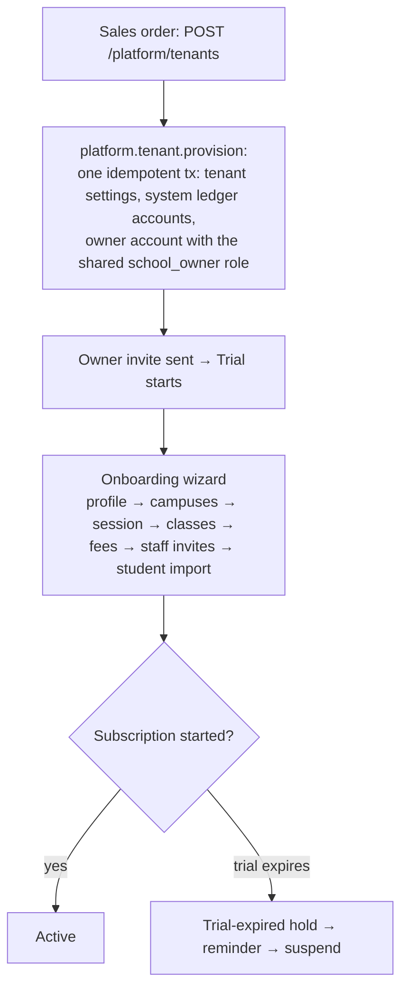
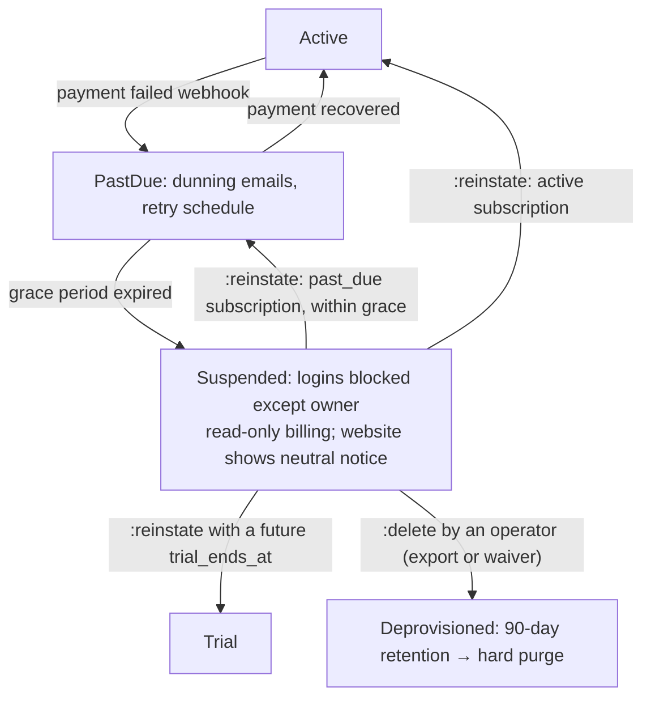

# Module: Platform Administration

> **Agent Context** — Load this block first.
> **Summary:** The platform (SaaS-operator) scope above all tenants: tenant lifecycle (provisioning → trial → active → suspension → deletion), plans/subscriptions and billing of schools, feature flags, usage tracking and quotas, the school onboarding wizard, legacy-data migration/import, platform-level aggregate reporting, and audited impersonation. Used only by platform roles — never by tenant users. Implements scope §10 and the platform items of §22.
> **Co-load with:** `../02-architecture/multi-tenancy.md` · `../02-architecture/auth-and-rbac.md` · `../05-database/entities/tenancy.md`
> **Owns entities:** `tenants`, `tenant_settings`, `plans`, `subscriptions`, `feature_flags`, `tenant_feature_overrides`, `custom_domains`
> **Depends on modules:** all tenant modules (flag/quota enforcement targets), reporting-analytics (boundary), website-cms (domain/suspension effects)

## 1. Purpose

The product is sold to many schools; someone has to operate the fleet. This module is the platform console where the SaaS operator provisions tenants, manages plans and subscriptions, bills schools, toggles feature flags, monitors usage against quotas, runs onboarding and legacy-data migrations, views aggregate platform reporting, and — under strict audit — impersonates tenant users for support.

Everything here runs in the **platform scope**: platform-scope JWTs, platform roles only ([`users-and-roles.md`](../00-overview/users-and-roles.md) §2), and a separate read path for reporting that never exposes row-level school data ([`multi-tenancy.md`](../02-architecture/multi-tenancy.md) §8).

## 2. Business Objective

- Make tenant acquisition cheap: provisioning is a single idempotent transaction, onboarding is self-guided — sales-to-live measured in hours, not weeks.
- Protect revenue: subscription states drive access (trial expiry, past-due dunning, suspension) automatically.
- Control margins: usage quotas (students, storage, SMS, AI tokens) enforce plan boundaries server-side.

## 3. Target Users

| Role | How they use this module |
| ---- | ------------------------ |
| `platform_super_admin` | Full platform control: tenants, plans, billing, flags, migrations, platform staff |
| `platform_support` | Tenant lookup, health/usage views, audited time-boxed impersonation; read-mostly |
| `school_owner` (touchpoint only) | Sees own subscription/billing state and the onboarding wizard inside the tenant dashboard — served by this module's tenant-facing endpoints, not the platform console |

## 4. Permissions

Permissions follow the RBAC model in [`auth-and-rbac.md`](../02-architecture/auth-and-rbac.md). Permission keys use `<module>.<resource>.<action>`. Module-specific verbs declared here: `provision`, `suspend`, `reinstate`, `impersonate`.

| Permission key | Description | Default roles |
| -------------- | ----------- | ------------- |
| `platform.tenant.view` | View tenant list, detail, health, usage | `platform_super_admin`, `platform_support` |
| `platform.tenant.provision` | Create/provision a tenant | `platform_super_admin` |
| `platform.tenant.update` | Edit tenant record, lifecycle metadata | `platform_super_admin` |
| `platform.tenant.suspend` / `platform.tenant.reinstate` | Suspend / reinstate a tenant | `platform_super_admin` |
| `platform.tenant.export` | Trigger full tenant data export | `platform_super_admin` |
| `platform.tenant.delete` | Start deprovision (retention → purge) | `platform_super_admin` |
| `platform.tenant.impersonate` | Time-boxed, reason-required impersonation | `platform_super_admin`, `platform_support` |
| `platform.plan.view` / `create` / `update` / `delete` | Manage plan catalog | `platform_super_admin` (view: + `platform_support`) |
| `platform.subscription.view` / `update` | Manage tenant subscriptions and billing state | `platform_super_admin` (view: + `platform_support`) |
| `platform.feature-flag.view` / `update` | Flag defaults and per-tenant overrides | `platform_super_admin` (view: + `platform_support`) |
| `platform.migration.import` | Run legacy-data imports into a tenant | `platform_super_admin` |
| `platform.report.view` | Platform aggregate reporting | `platform_super_admin`, `platform_support` |
| `school.subscription.view` | A school's own plan, subscription and limits (`GET /api/v1/subscription`) — **tenant-scope** | `school_owner` |

Every `platform.*` key above is **platform-scope** ([ADR-0036](../decisions/0036-platform-scope-and-cross-tenant-access.md)): only the two platform roles hold them, and no school's role ever can. The scope, not the module name, decides it: the tenant-side `platform.file.*`, `platform.job.view` and `platform.notification.view` keys stay tenant-scope. `registry.register(..., scope="platform")` refuses a tenant default role, every grant path filters on `Permission.scope`, and only a platform user may hold a platform role (a trigger on `user_roles`). `school.subscription.view` is the module's one tenant-scope key: it is the school's own billing touchpoint (§3), registered in `apps/platform_admin/permissions.py` with the registry's default (tenant) scope. Both platform roles are synced as shared `tenant=None` rows on every migrate (`core.rbac.sync.sync_default_roles`), and an operator account is created with `manage.py create_platform_admin --email --first-name [--role]`.

Every operator signs in with password **and** TOTP ([auth-and-rbac §1](../02-architecture/auth-and-rbac.md), SEC-06). A new account starts with MFA off: its first password sign-in gets an `amr=["pwd"]` token, which the console refuses (403 `mfa_required`) but which can call `POST /auth/mfa:enroll` and `:confirm`; confirming returns ten recovery codes and an `amr=["pwd","otp"]` pair. From then on login answers with a challenge that `POST /auth/mfa:verify` completes. An operator cannot turn MFA off (`/auth/mfa:disable` is 403); one who lost their authenticator and recovery codes is reset with `manage.py create_platform_admin --email … --reset-mfa`, which also ends their sessions: the console refuses their existing tokens at once. One locked out by 100 consecutive wrong codes is unlocked with `--unlock-mfa`, which keeps the factor.

## 5. Main Features

1. **Tenant lifecycle management** — create, provision (idempotent seed transaction), trial, activate, suspend, reinstate, export, and delete tenants per the state machine in multi-tenancy §7. *Built:* create, edit, `:provision`, `:suspend`, `:reinstate`, `:export`, `:delete` and `:restore` (§7.4, §7.9, §20).
2. **Plans & subscriptions** — plan catalog (modules enabled, usage limits, price, trial length); per-tenant subscription with period tracking; plan upgrades/downgrades with proration rules *(recommendation)*. *Built:* the catalog, one live subscription per school, trial → active → past due → recovered, plan changes and plan-based module enablement (§7.5, §20); proration and plan versioning are deferred.
3. **Billing of schools** — invoicing tenants for their subscription via a billing provider; dunning on failed payment → `past_due` → grace → suspension. (This bills *schools*; student fee billing is the tenant-side fees-finance module.) *Built:* manual billing from the console (`:activate`, `:record-payment`, `:mark-payment-failed`), the provider webhook (a fake adapter only) and the trial and dunning sweeps (§7.6).
4. **Feature flags** — platform flag registry with per-plan defaults and per-tenant overrides, kill-switch capable; every tenant module checks its flag server-side (multi-tenancy §5). *Built:* the console's flag list and default/kill-switch edits, per-school overrides with expiry, and disable guards (§7.6).
5. **Usage tracking & quotas** — metered counters per tenant (active students, staff, storage GB, SMS credits, AI tokens, API rate) vs. plan limits; soft-warn then hard-enforce. *Built:* the students, staff and storage counters and the usage snapshots taken from them, nightly and on demand, and the 409 `limit_below_usage` on a limit lowered below them (§7.7); enforcement at create time, with a warning from `PLATFORM_QUOTA_WARN_RATIO` and the owners' threshold notice (§7.8). SMS-credit, AI-token and API-rate quotas are deferred.
6. **Onboarding wizard** — guided tenant setup: school profile → campuses → academic session → classes/sections → fee structures → staff invites → student import; resumable, with progress tracking.
7. **Data migration / legacy import** — Excel/CSV import pipelines (students, guardians, staff, fee balances, marks history) with mapping templates, dry-run validation, error reports, and rollback of a failed batch.
8. **Platform-level reporting** — aggregates only: tenant counts by state, MRR/ARR, usage/adoption per module, churn, support-load; never row-level school data. *Built:* tenant overview, revenue and usage (§7.9, §13); support-load is deferred.
9. **Impersonation with audit** — elevation grant (≤ 1 h, reason required, banner shown); every action tagged `impersonated_by` in `audit_logs` (RBAC §1).

## 6. Sub-features

- **Tenants:** slug management, lifecycle timestamps, suspension notice shown on the public website, deprovision retention countdown (90 days) with certificate of deletion.
- **Plans:** versioned plan changes never mutate existing subscriptions retroactively; grandfathering supported *(recommendation)*.
- **Billing:** billing-provider webhooks (payment succeeded/failed) drive subscription state; manual invoicing mode for bank-transfer markets *(recommendation — payment rails vary by country; currency per plan/tenant, none assumed)*.
- **Flags:** override expiry dates; flag audit trail; percentage rollouts for gradual feature releases *(recommendation)*.
- **Quotas:** per-quota grace thresholds (AI tokens warn at 80%, ai-governance.md §5); AI token budgets enforced at the AI gateway; storage measured nightly.
- **Migration:** reusable mapping templates per source system; AI-assisted column mapping (`AI-PLA-01`); imports run as background jobs with per-row error files.

## 7. Workflows

### 7.1 Tenant provisioning & onboarding

### 7.2 Subscription dunning & suspension

A suspended school whose subscription is `past_due` is reinstated only within its grace (`current_period_end + PLATFORM_DUNNING_GRACE_DAYS`). After it, `:reinstate` is a 409 `grace_expired`: the next dunning sweep would suspend the school again at once. The operator records a payment first (`:record-payment`; a plan change leaves the period, and so the grace, as it is), and the school then reinstates to `active`. Nothing extends a grace silently.

### 7.3 Impersonation

Support agent requests elevation (tenant, target user, reason) → grant issued (≤ 1 h, auto-expiring) → agent operates the tenant dashboard with a persistent banner, target-user permissions apply (never superuser) → every mutation audit-tagged `impersonated_by` → grant expiry or manual release ends the session → tenant owner can view an impersonation log *(recommendation)*.

### 7.4 Tenant lifecycle, as built

`apps/platform_admin/tenants/lifecycle.py` is the only writer of `tenants.status` after creation, and it allows these edges and no others (any other is a 409 `invalid_transition`):

| From | To | Trigger |
| ---- | -- | ------- |
| `provisioning` | `trial` | `:provision` |
| `provisioning` | `deprovisioned` | `:delete` of a school created by mistake (nothing to export) |
| `trial` | `active` | Subscription activated (§7.5) |
| `active` | `past_due` | Payment failed (§7.5) |
| `past_due` | `active` | Payment recorded (§7.5) |
| `trial`, `active`, `past_due` | `suspended` | `:suspend`, or the trial-expiry / grace sweeps (PR B) |
| `suspended` | the status the live subscription implies | `:reinstate` |
| `active`, `suspended` | `deprovisioned` | `:delete` |
| `deprovisioned` | `suspended` | `:restore`, only while `now < deprovision_after` (else 409 `retention_expired`) |

- **`:provision`** runs in one transaction with the school bound: it creates `tenant_settings` and the school's system ledger accounts (`fees_finance.services.ensure_system_accounts`, so its first fee head has an income account), creates the owner's inactive account from `contact_name` (split on the first space) and `contact_email`, gives it the shared `school_owner` default role, invites it (ADR-0033, kind `owner`, linking to `<slug>.app.<domain>`), sets `trial_ends_at` (`PLATFORM_DEFAULT_TRIAL_DAYS`) and `provisioned_at`, and moves the school to `trial`. The owner invite therefore starts the trial (§7.1), not the onboarding wizard. A second `:provision` is a 409; the same `Idempotency-Key` replays the first answer. With a `plan_code` it also starts a `trialing` subscription to that plan, and the trial lasts the plan's `trial_days` instead; an unknown or inactive code is a 422, before anything is seeded.
- **`:reinstate`** asks the `subscription_state` hook (`core/tenancy/subscription_state.py`, registered from `apps/platform_admin/hooks.py`) for the live subscription: `active` → `active`, `past_due` → `past_due` within its grace (409 `grace_expired` after it, §7.2). A `trialing` one, or none, reinstates to `trial` only with a future `trial_ends_at` in the body: a past one is a 400 on `trial_ends_at`, and so is a missing one under a `trialing` subscription; with neither a subscription nor a date it is a 409 `no_live_subscription`. A school provisioned without a plan has no subscription, so it can only come back on a fresh trial.
- **`:delete`** of a school that went live (`active`, `suspended`) needs a succeeded `tenant_export` job or `waive_export: true`, else a 409 `export_required`. It sets `deprovision_after = now + PLATFORM_RETENTION_DAYS`.
- **Reasons:** `:suspend`, `:delete` and `:restore` require a non-blank `reason`, stored in the audit row.
- **Timestamps:** entering `suspended` stamps `suspended_at`; leaving it for an operational status clears it. `:restore` keeps the original suspension time, and stamps one when the school was deleted without being suspended first.
- **Audit:** a person's action is audited by the view (`record_audit`, with the operator as actor and the school as tenant, before and after). The exception is `POST /platform/tenants`: its audit row has no tenant (`tenant=None`), because the school is created by that same request (deferred-work.md). A system caller (sweep, webhook) passes `actor_id=None` and the transition audits itself through `record_system_audit`.

### 7.5 Plans and subscriptions, as built

- **Catalog.** A plan's `code` is unique and fixed once created (`tenants.current_plan` holds it). `enabled_modules` lists registered `module.*` feature keys; `limits` maps `QUOTA_METRICS` (`students`, `staff`, `storage_gb`, `sms_credits`, `ai_tokens`) to a non-negative integer or null (unlimited); a metric left out is unlimited. `DELETE` soft-deletes (and deactivates) the plan, refused with 409 `plan_in_use` while any school's `current_plan` is it. An inactive plan keeps its subscribers but takes no new one. Lowering a limit below the latest usage snapshot of a school on the plan is a 409 `limit_below_usage` unless the body carries `acknowledge_over_usage: true` (§7.7).
- **One live subscription per school.** `trialing`, `active` and `past_due` are live; a partial unique index on `subscriptions(tenant_id)` allows one, and the services refuse a second with 409 `subscription_exists`.
- **Every write is one transaction** (`apps/platform_admin/subscriptions/services.py`), with the school bound and its `tenants` row locked: it updates the subscription, mirrors it onto `tenants.current_plan`, `subscription_status` and `billing_provider_ref`, moves the school's lifecycle where the subscription implies it, and invalidates the feature cache now and again on commit. A duplicate billing reference is a 400.

| Service | Subscription | School |
| ------- | ------------ | ------ |
| `start_trial` (`:provision` with a plan) | new, `trialing` for the plan's `trial_days`; sets `trial_ends_at` | unchanged (`:provision` moves it) |
| `subscribe` (`:activate` with no subscription and a `plan_code`) | new, `active` for the given period | `trial` → `active` |
| `activate` (`:activate`) | `trialing` → `active` for the given period | `trial` → `active` |
| `mark_payment_failed` | `active` → `past_due` | `active` → `past_due` |
| `record_payment` | `active`/`past_due` → `active`, period runs on to `paid_through` | `past_due` → `active` |
| `change_plan` | another active plan; period and status unchanged | unchanged |

  `start_trial`, `subscribe` and `change_plan` ask the disable guards before the school joins the plan (`core.tenancy.features.plan_change_refusal`): a plan without a guarded `module.*` key the school resolves on now, and that no live override keeps on, is a 409 `toggle_refused`, as the same disable through an override is (§7.6). Locks are taken school first, then plan: the routes pass a plan code, and the service locks the school's `tenants` row before `subscribable_plan` locks the plan, in the order `:provision` uses.

  A suspended school stays suspended through any billing change; `:reinstate` then follows the subscription. A move the subscription's status does not allow is a 409 `invalid_transition`; a write to a school with no live subscription is a 409 `no_live_subscription`.
- **Audit.** A person's write is audited by the view (`record_audit`, before and after). A system caller (the billing webhook, a sweep) passes `actor_id=None` and the service audits through `record_system_audit`.
- **Module access.** Feature resolution (`core/tenancy/features.py`) is: a live override, then the school's live plan — a `module.*` key is on iff it is in the plan's `enabled_modules`, even if its default is on — then the flag's default; a kill switch stays at its default whatever the override or the plan say. Keys outside `module.*`, and a school with no live subscription, skip the plan step. The resolver (`plan_modules`) reads the platform-scope `tenants` and `plans` rows, so it answers with or without the school bound.

### 7.6 Flags, billing events and sweeps, as built

- **Flag defaults.** `PATCH /platform/feature-flags/{id}` changes `default_enabled` or `is_kill_switch` for every school at once and invalidates the feature cache. Once a flag row exists, the console owns those two values: the `post_migrate` sync creates a new key with the code's defaults, updates only the description of an existing one, and logs a WARNING for a flag whose console setting differs from the code. A deliberate change to a flag's code default therefore does not reach an existing row: make it in the console, or ship a data migration ([ADR-0036](../decisions/0036-platform-scope-and-cross-tenant-access.md) addendum).
- **Overrides.** `POST .../feature-overrides` gives the school an override (`enabled`, `reason`, optional future `expires_at`), replacing any live one for that flag. `DELETE` removes it, so the plan or the default decides again. Each is audited against the school. Two first overrides racing for one flag meet the partial unique index: the second is a 409 `conflict`.
- **Refusals (409 `toggle_refused`).** An override switching a kill switch on (forcing one off for a school stays allowed). A disable a registered guard objects to: `core.tenancy.features.register_disable_guard(key, fn)`, registered from the owning module's `AppConfig.ready()`, and asked through `disable_refusal(key, tenant_id)` both for an `enabled: false` override and for removing an `enabled: true` override that nothing else would keep on. The plan writes ask the same guards (§7.5). Attendance registers the first guard: `module.timetable` stays on while the school takes attendance by period. The guard reads the mode under the settings row's lock, and a switch to period mode checks the timetable under the same lock, so the two cannot both pass. Platform-wide disables (a plan edit, a flag default or kill switch) ask no guard yet (`docs/deferred-work.md`).
- **Billing webhook.** `POST /platform/billing-events/{provider}` is unauthenticated: an adapter (`apps/platform_admin/billing/`, the `BillingAdapter` protocol) verifies the raw body. The fake adapter checks `X-Fake-Signature: t=<unix>,v1=<HMAC-SHA256(secret, "t.body")>` against `PLATFORM_BILLING_WEBHOOK_SECRET`, within `PAYMENT_CALLBACK_TOLERANCE_SECONDS`. The school is found from the event's `provider_ref` through `tenants.billing_provider_ref`, with nothing bound; then one transaction binds it, claims a `billing_event_receipts` row (unique per provider and event id), and applies `record_payment` or `mark_payment_failed` as a system caller. A replay, an unknown reference, a reference whose subscription bills through another provider, a school without a live subscription and an event the subscription cannot take are each a 200 that changes nothing (the receipt's `outcome` says which). Only a new receipt for an applied failure queues `platform.payment-failed`; a replay queues nothing. Failed signatures count against a per-IP budget, checked first; only verified events count against the provider's budget, so unsigned posts cannot use it up. Out-of-order delivery is not detected: a `payment_failed` carries no period (deferred with the real provider).
- **Sweeps** (Celery beat, `bulk` queue; times UTC). Each reads candidates from `tenants`, then handles one school at a time in its own transaction, with the row locked and its state checked again.

| Task | When | What |
| ---- | ---- | ---- |
| `expire_trials` | daily 02:10 | `trial` with `trial_ends_at` passed → `suspended` |
| `dunning_sweep` | daily 02:30 | `past_due` → `suspended` once `current_period_end + PLATFORM_DUNNING_GRACE_DAYS` has passed; before then, makes sure the owners got `platform.payment-failed` |
| `trial_reminders` | daily 06:00 | `platform.trial-expiring` at each `PLATFORM_TRIAL_REMINDER_DAYS` mark (the nearest one crossed) |
| `lapse_overrides` | hourly | retires overrides past `expires_at` (resolution already ignores them) and audits each lapse |

- **Trial end of record** is `tenants.trial_ends_at`, which `:reinstate` moves; the trialing subscription's period is not read.
- **Dunning runs from the unpaid period's end**, the date the payment was due, so a failure marked mid-period still gives the school the period it paid for plus the grace.
- **A reinstated past-due school keeps the grace it had.** `:reinstate` to `past_due` is refused with 409 `grace_expired` once the grace has run out (§7.2), so the sweep never re-suspends a school an operator just let back in; within the grace, the sweep suspends it on the original date.

### 7.7 Usage snapshots, as built

- **Counters** (`apps/platform_admin/usage/services.py`, the one implementation; quota checks reuse `USAGE_COUNTERS`). `students`: students not soft-deleted whose status is not `withdrawn`, `graduated` or `transferred`. `staff`: staff not soft-deleted whose employment status is not `resigned`, `retired` or `terminated` (the spec's "exited"). `storage_gb`: the sum of the school's non-deleted `files.size_bytes`, pending uploads included, in GiB. Each counter reads the school's own tables, so it runs only with that school bound and raises `TenantContextRequired` for any other.
- **Snapshots** (`tenant_usage_snapshots`, platform scope, append-only). Each row holds the school's lifecycle status, live plan code, monthly recurring revenue (the plan's price per month, an annual price over twelve, while the subscription is `active` or `past_due`; 0 on a trial or with no plan) and currency, the three counts, the `module.*` keys on for the school, and `impersonations_30d` (null until impersonation ships). Nothing else: no names, no row of school data. The app role cannot update or delete a row (`core.tenancy.grants.PLATFORM_APPEND_ONLY_TABLES`).
- **Taken** nightly by `snapshot_all` (beat 02:50 UTC, `bulk` queue, after expiry and dunning so the night's suspensions are recorded), which visits every school that is not hard-deleted, suspended and deprovisioned ones included, through `for_each_tenant`: one school bound per transaction, and one school failing does not stop the rest. `POST /platform/tenants/{id}:refresh-usage` takes one for that school now.
- **Read** with no school bound: the console's `GET .../usage`, the platform reports and the over-usage check read snapshots, never the schools' tables, so they are as fresh as the last snapshot.
- **`limit_below_usage`** (409). A `PATCH /platform/plans/{id}` that lowers `students`, `staff` or `storage_gb` below the latest snapshot of any school whose `current_plan` is the plan (deprovisioned and deleted schools aside), a subscription `PATCH` whose `limits_override` lowers the school's effective limit below its own latest snapshot, or a `:change-plan` to a plan whose limits (with the school's override on top) do the same, is refused unless the body carries `acknowledge_over_usage: true`. `error.meta.over_usage` lists each `{tenant_id, metric, limit, usage}`. A limit that stays or rises is never refused. `sms_credits` and `ai_tokens` are not checked (no counter yet). The plan check does not read schools' overrides, so it may ask for an acknowledgement an override makes unnecessary, never the reverse.

### 7.8 Quotas, as built

- **One check, in core** (`core/tenancy/quotas.py`, `check_quota(tenant_id, metric, *, adding=1)`). Core imports no app (ADR-0013), so this app registers from `hooks.register()`: the limits (`subscriptions.services.effective_limits`, the live plan with its override on top), the counters (§7.7's `USAGE_COUNTERS`, the one implementation) and the threshold listener. A school with no live subscription, or a metric with no limit (`null`), is unlimited.
- **Where it runs.** Before the insert, in the insert's transaction: `create_student` (students), `create_staff` (staff) and `core.files.services.create_upload` (`storage_gb`, the declared size in GiB; a pending upload already counts). The two import uploads (`POST /student-imports`, `POST /staff-imports`) count the file's rows and refuse them before a job is created when they exceed the places left (`assert_room`: refuse-only, so no warning and no notice for rows that may never exist); each row's create checks again in the job, where a refusal is that row's error, not the job's.
- **Concurrency.** The check takes the transaction-scoped advisory lock `(QUOTA, uuid5(tenant, metric))` before counting, so two creates at limit − 1 run one after the other and the second sees the first.
- **Refusal.** A write that would take usage past the limit is a 409 `quota_exceeded`, `error.meta` `{metric, limit, usage, adding}` (usage before the write; `adding` is what the write asked for: 1, an import's row count, or an upload's size in GiB). Exactly at the limit is allowed. Storage is compared in bytes against `limit × 2^30`.
- **Warning.** When usage after the write is at or above `PLATFORM_QUOTA_WARN_RATIO` (0.8, §12's 80 %) of the limit, the 2xx response carries `meta.warnings` `[{code: "quota_warning", message, details: {metric, limit, usage}}]` (api-architecture.md §2.3).
- **Notice.** A write that moves usage into the warn band, or onto the limit, queues `platform.quota-threshold` on commit (`send_quota_threshold_notice`, `transactional` queue) to the school's owners, once per metric, band and subscription period. A refused or rolled-back write sends nothing.
- **Not enforced:** `sms_credits` and `ai_tokens` (no counter yet), and API rate (deferred-work.md).

### 7.9 Reports and `:export`, as built

- **Reports** (`apps/platform_admin/reports/registry.py`). Each report reads the platform-scope `tenants` and `plans` tables and each school's latest usage snapshot (§7.7), with no school bound and none of a school's own tables, and is a set of named tables:
  - `tenant-overview`: `by_status` (every lifecycle status, zero included; soft-deleted schools left out), `signups` (schools per month of `created_at`) and `churn` (deprovisioned schools per month they were deprovisioned, `deprovision_after - PLATFORM_RETENTION_DAYS`; a restore takes a school back out).
  - `revenue`: `mrr`, one row per plan and currency with `paying_tenants` (every billed school, past-due ones included), `past_due` (the subset whose payment failed), `mrr` and `arr` (12 × MRR). Amounts are never summed across currencies. Only schools whose latest snapshot is `active` or `past_due` count.
  - `usage`: `distribution` (per counted metric: schools, min, median, nearest-rank p90, max; `storage_gb` in GiB), `quota_pressure` (each school and metric at or above `PLATFORM_QUOTA_WARN_RATIO` of its plan's limit, highest first; a limit of 0 counts as soon as anything is in use, with no ratio; per-school overrides are not read) and `adoption` (schools with each `module.*` key on, per plan, beside the plan's school count). Trial, active, past-due and suspended schools count.
- **`:export`** (`apps/platform_admin/export/`). `POST /platform/tenants/{id}:export` binds the school, and creates a `BackgroundJob` the school owns (`job_type = "tenant_export"`, the type `:delete` looks for) or answers the one already queued or running. The school's row is locked first, so two concurrent calls never both create a job; a job in flight longer than `PLATFORM_EXPORT_TIME_LIMIT_SECONDS` (default 4 h) is marked failed (its worker was lost) and replaced. The task (`apps.platform_admin.tasks.export_tenant`, `bulk` queue, hard time limit `PLATFORM_EXPORT_TIME_LIMIT_SECONDS` and a soft limit a minute earlier) builds a zip on the worker's temporary disk:
  - `data/<table>.csv` for every tenant-owned table (`tenant_owned_tables()`), plus `tenant_settings`, `users` and `user_roles`, the school's rows only, each table streamed from a server-side cursor in its own bound transaction;
  - every column except credentials and secrets (`EXPORT_DENIED_FIELDS`: `password`, `token`, `refresh`, `access`, `secret`, `api_key`, `otp`, `cvv`, `token_hash`, `mfa_secret`, `code_hash`, `credentials_ciphertext`, `callback_token`) and any binary column. The school's personal records (`national_id`, `medical_notes`, bank fields) are kept: the school owns them, and the archive is protected by the export key and the audited download. Cells are neutralised against spreadsheet formulas;
  - `files/<file id>-<name>`, the bytes of each of the school's ready files, earlier export archives aside; a file whose stored object is missing is listed in the result's `missing_files` instead of failing the export.

  The archive is streamed to storage under `tenants/{id}/` and registered as the school's file with purpose `platform.tenant-export` (module-gated, so the school's own `/files` routes never list or sign it). The job's `result` is `{result_file_id, tables, rows, files, missing_files}`, and a success writes a system audit row `export_succeeded` carrying `{tables, rows, files, missing_files}` (SEC-17.5's row count). A failure, the soft time limit included, marks the job `failed` with the error.
- **Polling and download.** `GET /platform/tenants/{id}/jobs/{job_id}` answers the job (the `GET /jobs/{id}` shape), with no link. `POST /platform/tenants/{id}/jobs/{job_id}:download` mints a 5-minute signed link to a succeeded job's archive and writes an `export_download` audit row (the operator, the job and the file), once per download (SEC-17.5). Both see the school's platform jobs only, never the jobs the school's staff started.

## 8. User Journeys

- **`platform_super_admin`:** morning console review → two trials expiring this week (nudge emails) → one past-due tenant recovered via dunning → provisions a new school from a sales order → creates a per-tenant flag override to pilot the new transport module.
- **`platform_support`:** ticket "parent can't see fee invoice" → looks up tenant → requests impersonation of the school admin with reason → reproduces, finds a role misconfiguration, fixes with the tenant's consent → releases the grant; everything is in the audit log.
- **`school_owner` (touchpoint):** completes the onboarding wizard over two evenings; the checklist shows student import pending; billing page shows the trial ending date and plan options.

## 9. Inputs

- Tenant creation data (name, slug, contact, plan, trial length); lifecycle actions with reasons.
- Plan definitions (modules, limits, price, currency, billing period); subscription changes; billing-provider webhook events.
- Flag definitions and overrides; quota configurations.
- Onboarding wizard step data (tenant-side); legacy import files (Excel/CSV) + mapping selections.
- Impersonation requests (tenant, user, reason, duration).

## 10. Outputs

- Provisioned, seeded tenants; subscription invoices to schools (via billing provider); export archives; certificates of deletion.
- Usage/quota counters and platform aggregate reports.
- Events: `tenant.provisioned`, `tenant.suspended`, `subscription.updated`, `quota.threshold-reached` (internal + operator alerting).
- Import result files (accepted/rejected rows with reasons).

## 11. Validations

- Tenant slug: globally unique, DNS-safe (it becomes the subdomain), immutable after provisioning *(recommendation: rename via support process only)*.
- Lifecycle transitions restricted to the state machine (multi-tenancy §7); suspension and deletion require a reason; deletion requires a completed or explicitly-waived export.
- Plan limits must not be lowered below a tenant's current usage without an explicit override acknowledgment.
- A create that would take a school past a plan limit (students, staff, storage) is refused 409 `quota_exceeded`; an import is refused at upload when its rows exceed the places left (§7.8).
- Flag overrides must reference registered flags; kill-switch flags cannot be overridden tenant-side. *As built:* an override for a flag no longer declared in code, or with a past `expires_at`, is a 400; switching a kill switch on for one school, or a disable a module's guard refuses, is a 409 `toggle_refused` (§7.6). Forcing a kill switch off for one school is allowed.
- Imports: dry-run required before commit; per-row validation mirrors the owning module's rules (e.g. student rows validate like student-management creates); batch is transactional per entity type.
- Impersonation: duration ≤ 1 h, reason mandatory, cannot impersonate platform users, cannot chain grants.

## 12. Notifications

| Event | Recipients | Channels | Template ref |
| ----- | ---------- | -------- | ------------ |
| Tenant provisioned / owner invite | School owner | Email | ADR-0033's invitation email, kind `owner` (not `notify()`) |
| Trial expiring (7/3/1 days) | School owner | Email, in-app | `platform.trial-expiring` |
| Payment failed / dunning sequence | School owner, `platform_super_admin` | Email | `platform.payment-failed` |
| Tenant suspended / reinstated | School owner; platform ops | Email, in-app | `platform.tenant-suspended` / `platform.tenant-reinstated` |
| Quota threshold reached (80% / 100%) | School owner, `it_admin`; platform ops | Email, in-app | `platform.quota-threshold` |
| Import completed / failed | Initiating admin | In-app, email | `platform.import-result` |
| Impersonation grant issued/expired | Platform ops log; tenant owner *(recommendation)* | In-app | `platform.impersonation` |

Channels and delivery behavior follow [`notifications.md`](../02-architecture/notifications.md). Codes are dotted `<module>.<event>` triggers in `apps/platform_admin/notifications.py`. *Built:* `platform.tenant-suspended` and `platform.tenant-reinstated`, sent to the school's active owners when a school leaves or returns to an operational status (a `:restore` sends neither); `platform.trial-expiring` (in-app and email, once per trial end and reminder mark) and `platform.payment-failed` (in-app and email, once per unpaid period, sent on the webhook's failure event and by the dunning sweep). The two sweep notices dedupe on a key more specific than the school, so the next trial or period notifies again; the lifecycle notices do not dedupe. `platform.quota-threshold` (in-app and email, to the owners, once per metric, band and subscription period) is sent when a create moves usage into the warn band (`PLATFORM_QUOTA_WARN_RATIO`, the table's 80 %) or onto the limit (§7.8); `it_admin` is not copied. `notify()` is per tenant, so the copies to `platform_super_admin` and platform ops wait for a platform-ops channel (deferred-work.md).

## 13. Reports

Platform aggregate reports (metrics only, never row-level tenant data — multi-tenancy §8), visible per `platform.report.view`:

- **Tenant overview** — counts by lifecycle state, signups/churn per month, time-to-active.
- **Revenue** — MRR/ARR by plan, dunning recovery rate, overdue subscriptions.
- **Usage & adoption** — module adoption per plan, storage/SMS/AI-token consumption distribution, quota-pressure list.
- **Support & health** — impersonation counts, error-rate and job-failure rates per tenant (operational metrics), onboarding funnel drop-off.

*Built:* `GET /platform/reports/{key}` for `tenant-overview`, `revenue` and `usage` (§7.9, §16). They read the usage snapshots of §7.7 and `tenants`, never a school's own tables, so they are as fresh as each school's latest snapshot. Time-to-active, dunning recovery, SMS/AI-token consumption and the support & health report are deferred (deferred-work.md).

Exports CSV/Excel (`?format=csv|xlsx`, built); scheduled variants via the same job infrastructure as [`reporting-analytics.md`](reporting-analytics.md) but on the platform read path.

## 14. AI Capabilities

Cross-referenced to [`ai-features.md`](../04-ai/ai-features.md). Platform AI features never read row-level tenant data without an explicit, audited operation (imports run inside the target tenant's scope).

- **`AI-PLA-01` — AI-assisted migration mapping** *(recommendation, scope §6 "OCR/document extraction" + §22 "data migration")*: propose column-to-field mappings and data-cleanup transforms from a sample of an uploaded legacy file; human confirms the mapping before any dry run.
- **`AI-PLA-02` — Churn & health insights** *(recommendation, scope §6 "predictive analytics")*: flag tenants with declining usage or quota/dunning stress for proactive outreach; advisory only, computed from aggregate metrics.
- **`AI-PLA-03` — Onboarding assistant** *(recommendation)*: conversational helper inside the wizard that turns a school's plain-language description ("we have 3 sections per grade from KG to 10") into draft academic structure for review.

## 15. Database Entities

Full column specs in [`../05-database/entities/tenancy.md`](../05-database/entities/tenancy.md).

- **Platform-scope (no `tenant_id`):** `tenants`, `plans`, `feature_flags`, `billing_event_receipts` (the webhook's idempotency record), `tenant_usage_snapshots` (aggregate usage per school, append-only; it has a `tenant_id` foreign key but no RLS).
- **Tenant-scoped:** `tenant_settings` (1:1 with tenant), `subscriptions`, `tenant_feature_overrides`, `custom_domains` (bound via website-cms UI, owned here for lifecycle/TLS).
- **Shared platform primitives referenced, not owned by this module:** `users`, `roles`, `permissions`, `role_permissions`, `user_roles`, `audit_logs`, `files`, `webhooks`, `webhook_deliveries`, `background_jobs` (defined in the same entity file; owned by the auth/platform core).

## 16. API Requirements

Conventions per [`api-architecture.md`](../02-architecture/api-architecture.md). Platform-console resources are namespaced under `/api/v1/platform/...` and built on `core.api.platform.PlatformViewSet` ([ADR-0036](../decisions/0036-platform-scope-and-cross-tenant-access.md)): an anonymous caller gets 401, any tenant principal **404**, a platform token without `"otp"` in its `amr` claim 403 `mfa_required`, and a platform user without the route's key 403. A route that touches one school's rows is nested under `tenants/{tenant_pk}/` and binds that school for the whole request (`PlatformTenantNestedMixin`). Tenant-facing touchpoints (billing view, onboarding) are normal tenant endpoints.

- `GET/POST /api/v1/platform/tenants` · `GET/PATCH /api/v1/platform/tenants/{id}` · `POST .../tenants/{id}:provision` / `:suspend` / `:reinstate` / `:export` / `:delete` / `:restore` (all with `Idempotency-Key`). *Built:*
  - `GET /platform/tenants` (`platform.tenant.view`): page-numbered; `?status=`, `?current_plan=`, `?subscription_status=`, `?search=` (name, slug, contact email), `?ordering=` (name, slug, status, trial_ends_at, created_at).
  - `POST /platform/tenants` (`platform.tenant.provision`): `{name, slug, contact_name, contact_email, contact_phone?}` → 201, status `provisioning`. The slug is one DNS label (`^[a-z0-9]` then `(?:[a-z0-9-]{1,61}[a-z0-9])?$`), not in `RESERVED_SLUGS` (pinned to the website's `RESERVED_LABELS`) and unused, else 400 on `slug`. Idempotent by the unique slug.
  - `GET /platform/tenants/{id}` (`.view`); `PATCH` (`.update`): name and contact fields; `slug` only while `provisioning` (else 400 on `slug`).
  - `:export` (`platform.tenant.export`, no body): 202 `{job_id, status}`; an export already queued or running is answered instead of a new one, and one stuck past the time limit is failed and replaced (§7.9). `GET /platform/tenants/{id}/jobs/{job_id}` (`platform.tenant.export`): the job. `POST .../jobs/{job_id}:download` (`platform.tenant.export`, no body): `{download_url, expires_in}`, audited; 409 `conflict` until the job succeeded. A job of another school, or one the school's staff started, is a 404.
  - `:provision` (`.provision`, body `{plan_code?: null}`), `:suspend` (`.suspend`, `{reason}`), `:reinstate` (`.reinstate`, `{trial_ends_at?, reason?}`), `:delete` (`.delete`, `{reason, waive_export?}`), `:restore` (`.delete`, `{reason}`): each answers the tenant, and refuses with the 409 codes of §7.4.
- `POST /api/v1/platform/tenants/{id}:impersonate` — returns a time-boxed elevated token; `DELETE /api/v1/platform/impersonation-grants/{id}` releases it
- `GET/POST/PATCH/DELETE /api/v1/platform/plans` · `GET/PATCH /api/v1/platform/tenants/{id}/subscription` (nested and bound to the school, since `subscriptions` is under RLS and a school has one live subscription; it replaces the spec's `/platform/subscriptions/{id}`) · billing webhooks at `POST /api/v1/platform/billing-events/{provider}` (HMAC-verified). *Built:*
  - `GET /platform/plans` (`platform.plan.view`): page-numbered; `?is_active=`, `?billing_period=`, `?currency=`, `?search=` (name, code), `?ordering=` (name, code, price_amount, created_at). `GET /platform/plans/{id}` (`.view`).
  - `POST /platform/plans` (`.create`): `{name, code, price_amount, currency, description?, billing_period?, trial_days?, enabled_modules?, limits?, is_active?}` → 201. A taken code, an unregistered module key, an unknown metric, a negative limit or a non-ISO currency is a 400 on its field.
  - `PATCH /platform/plans/{id}` (`.update`): any subset, plus `acknowledge_over_usage`; a changed `code` is a 400. `DELETE` (`.delete`): 204, or 409 `plan_in_use`.
  - `GET /platform/tenants/{id}/subscription` (`platform.subscription.view`): `{tenant_status, trial_ends_at, subscription | null, limits}`, where `subscription` carries its plan (code, name, price, modules) and `limits` every metric's effective limit. `PATCH` (`platform.subscription.update`): `{billing_provider?, billing_provider_ref?, limits_override?}`.
  - `:activate` (`{plan_code?, current_period_start, current_period_end}`), `:record-payment` (`{paid_through}`), `:mark-payment-failed` and `:change-plan` (`{plan_code, acknowledge_over_usage?}`), all `platform.subscription.update` with `Idempotency-Key`; each answers the billing state, and refuses with the 409 codes of §7.5.
- `GET/POST/PATCH /api/v1/platform/feature-flags` · `GET/POST/DELETE /api/v1/platform/tenants/{id}/feature-overrides`. *Built* (flags are created by code, so there is no `POST`):
  - `GET /platform/feature-flags` (`platform.feature-flag.view`): page-numbered; `?search=` (key, description), `?ordering=` (key, updated_at). `GET /platform/feature-flags/{id}` (`.view`); `PATCH` (`.update`): `{default_enabled?, is_kill_switch?}`.
  - `GET /platform/tenants/{id}/feature-overrides` (`.view`): the school's live overrides, unpaged. `POST` (`.update`): `{flag, enabled, reason, expires_at?}` → 201, replacing the live one; 409 `toggle_refused`. `DELETE .../feature-overrides/{override_id}` (`.update`): 204, or 409 `toggle_refused`. Another school's override is a 404.
  - `POST /platform/billing-events/{provider}` (no login; the signature authenticates it, throttled per provider and per IP on failures): 200 `{received, outcome}` (`applied`, `ignored`, `unknown_ref`, `no_subscription`); 401 `invalid_signature`; 404 for a provider that is unknown, not in `PLATFORM_BILLING_PROVIDERS_ENABLED` or receives no webhooks (`manual`); 503 `billing_unavailable` while `PLATFORM_BILLING_WEBHOOK_SECRET` is empty.
- `GET /api/v1/platform/tenants/{id}/usage` · `GET /api/v1/platform/reports/{key}` (aggregate read path). *Built:*
  - `GET /platform/tenants/{id}/usage` (`platform.tenant.view`): `{snapshot | null, limits}`, the school's latest snapshot (§7.7) and every metric's effective limit (null is unlimited; `storage_gb` in GiB).
  - `POST /platform/tenants/{id}:refresh-usage` (`platform.tenant.view`, no body): takes a snapshot now and answers the same shape. Gated on the view key because it changes no school data.
  - `GET /platform/reports/{key}` (`platform.report.view`, both platform roles): `key` is `tenant-overview`, `revenue` or `usage`, else 404. `?format=json` (the default) answers `{key, title, generated_at, sections: {name: [row]}}`; `csv` or `xlsx` answers the sections as one table with a leading `section` column, as an attachment; any other format is a 400.
  - `PATCH /platform/plans/{id}` and `PATCH /platform/tenants/{id}/subscription` take `acknowledge_over_usage`; without it a lowered limit below usage is a 409 `limit_below_usage` (§7.7).
- `POST /api/v1/platform/tenants/{id}/imports` (`202` + job, dry-run flag) · `GET /api/v1/platform/imports/{id}`
- Tenant-facing: `GET /api/v1/subscription` (own billing state, `school.subscription.view`; *built*, the same shape as the console's GET, ungated by any module flag) · `GET/PATCH /api/v1/onboarding` (wizard progress). These mount through `apps/platform_admin/tenant_urls.py`, a separate include in `config/api_v1.py` from the console's `platform/` routes.
- Operator sign-in (built, `core/rbac`, under `/api/v1/auth/`, §4): `POST /auth/login` → `{mfa_required, mfa_token}` · `POST /auth/mfa:verify` · `POST /auth/mfa:enroll` · `POST /auth/mfa:confirm` · `POST /auth/mfa:disable` (always 403 for an operator).

## 17. Integration Requirements

- **Billing provider** (e.g. Stripe or regional equivalent — *recommendation, gateway-agnostic adapter*): subscription invoicing, payment webhooks, dunning. *Built:* the adapter seam (`apps/platform_admin/billing/`: `BillingAdapter.verify_event(headers, body) -> BillingEvent`, a `manual` adapter that receives no webhooks and a `fake` one); the real provider is deferred (deferred-work.md).
- **DNS/TLS edge** for subdomain wildcard + custom-domain issuance (shared with website-cms).
- **Email provider** for platform transactional mail; **object storage** for export archives and import files.
- **Observability stack** (metrics per tenant) feeding health reports; AI gateway for `AI-PLA-*` with platform-level budgets.

## 18. Dependencies on Other Modules

| Module | Direction | What is shared |
| ------ | --------- | -------------- |
| all tenant modules | outbound | Feature-flag and quota enforcement; module enablement per plan |
| website-cms | outbound | Suspension notice on public sites; custom-domain lifecycle |
| reporting-analytics | boundary | Tenant reporting stays tenant-side; platform aggregates stay here |
| fees-finance | none (namesake only) | School-side fee billing is unrelated to platform subscription billing |
| student-management / staff-management / examinations / fees-finance | outbound | Import pipelines write into these modules' entities under their validations |

## 19. Open Questions / Recommendations

- Billing provider choice, proration/grandfathering rules, manual-invoicing mode, and percentage flag rollouts are **recommendations** pending commercial decisions; pricing currency is per-plan configurable, no country assumed.
- Self-service signup vs. sales-assisted provisioning (or both) needs a client decision; the API supports both.
- Tenant-visible impersonation log and `AI-PLA-*` features are **recommendations**.
- Data residency/region pinning per tenant is out of initial scope; flagged for the compliance review (scope §22).

## 20. Implementation status

**Built (PR A — platform scope, MFA and the tenant lifecycle):**

- **Platform scope and sign-in:** scoped permission keys, the shared default roles, `PlatformViewSet` and TOTP MFA (§4, §16, [ADR-0036](../decisions/0036-platform-scope-and-cross-tenant-access.md)).
- **Tenants** (`apps/platform_admin/tenants/`, ADR-0010 layout): `viewset.py` (two viewsets: the list and create bind no tenant; `tenants/{tenant_pk}` and its colon-actions bind that school through `PlatformTenantNestedMixin`), `serializers.py`, `filters.py`, `services.py` (create, edit, provision, reinstate, delete, restore, the slug rules and the `owner` invitation's eligibility hook) and `lifecycle.py` (the state machine of §7.4: `ALLOWED_TRANSITIONS`, `transition(tenant, to, *, actor_id: UUID | None, reason="")`, `InvalidTransition`, `RetentionExpired`). `:delete` routes to the `deprovision` action, since a viewset method named `delete` would also answer the HTTP `DELETE` verb.
- **`tenants` columns** (`core/tenancy` migration `0010`): `contact_name`, `contact_email`, `contact_phone`, `provisioned_at`, `deprovision_after`, and the denormalised subscription read model `current_plan` (a plan code), `subscription_status` and `billing_provider_ref` (unique when set). They are plain columns, not a foreign key to `plans`: `core` never references this app (ADR-0013). PR B's subscription services write them with each subscription change.
- **Hooks** (`apps/platform_admin/hooks.py`, called from `PlatformAdminConfig.ready()`): every seam this app fills in `core` is registered there. PR A registers the `owner` invitation eligibility check (the account still holds `school_owner`). `core/tenancy/subscription_state.py` is the seam `:reinstate` reads; PR B registers its resolver.
- **Notifications** (`apps/platform_admin/notifications.py`): `platform.tenant-suspended` and `platform.tenant-reinstated`, in-app and email, to the school's active owners (§12).
- **Constants** (`apps/platform_admin/constants.py`): `SLUG_PATTERN`, `RESERVED_SLUGS` (pinned to `apps/website/src/lib/host.ts` by `test_reserved_labels_match_website`) and `TENANT_EXPORT_JOB_TYPE = "tenant_export"`, the job a later PR's `:export` creates.
- **Tests:** `apps/platform_admin/tests/test_lifecycle.py` (every status pair, timestamps, system audit, notices) and `test_tenants_api.py` (create, edit, provision, the lifecycle actions, gates); the live lane's `e2e/tests/live/api/platform-tenants.spec.ts` signs in as the seeded TOTP operator (`seed_e2e_data`) and runs create → provision → suspend → reinstate.

**Built (PR B — plans and subscriptions):**

- **Models** (`apps/platform_admin/models.py`, migration `platform_admin/0001_initial`): `Plan` (platform scope, `plans`) and `Subscription` (a `TenantOwnedModel`, `subscriptions`, RLS in the same migration). The partial unique index `subscriptions_one_live_per_tenant` keeps one live subscription per school. No `core/tenancy` migration: the read-model columns are PR A's.
- **Plans** (`apps/platform_admin/plans/`, ADR-0010 layout): `viewset.py`, `serializers.py` (`LimitsField` and `EnabledModulesField`, shared with the subscription's `limits_override`), `filters.py` and `services.py` (`create_plan`, `update_plan`, `delete_plan`, `subscribable_plan(code)`, the one lookup that puts a school on a plan, locking the plan row against a concurrent retire).
- **Subscriptions** (`apps/platform_admin/subscriptions/`): `services.py` (§7.5: `live_subscription(tenant_id)`, `effective_limits(tenant_id)`, `start_trial`, `subscribe`, `activate`, `record_payment`, `mark_payment_failed`, `change_plan`, `update_subscription`, and the two hooks `plan_modules` and `live_subscription_state`), `viewset.py` (the console's nested routes), `view.py` (the school's own `GET /subscription`) and `serializers.py`.
- **Hooks** (`hooks.py`): the `subscription_state` resolver and the plan resolver (`core.tenancy.features.register_plan_resolver`) join the `owner` eligibility check.
- **Feature resolution** (`core/tenancy/features.py`): the plan step (§7.5), and `invalidate_feature_cache()`, which bumps the generation now and on commit.
- **`:provision`** takes a `plan_code` (§7.4).
- **Tests:** `apps/platform_admin/tests/test_plans.py` (catalog, immutable code, `plan_in_use`, gates), `test_subscriptions.py` (one live subscription, the read model following each write, payment recovery, the nested routes and cross-tenant 404s, the school's own view, provisioning with a plan, and module access following a plan edit or a plan change) and `core/tenancy/tests/test_features.py` (the resolution order with a stand-in resolver).

**Built (PR B, Task 5 — flags, billing events and sweeps):**

- **Flags** (`apps/platform_admin/flags/`): `viewset.py` (`FeatureFlagViewSet`, platform scope; `TenantFeatureOverrideViewSet`, nested and bound), `serializers.py`, `services.py` (`update_flag`, `set_override`, `remove_override`, `lapse_expired_overrides`, `ToggleRefused`).
- **Core** (`core/tenancy/features.py`): `register_disable_guard`, `disable_refusal`, `resolve_without_override`, and a sync that leaves an existing flag's default and kill switch to the console.
- **Billing** (`apps/platform_admin/billing/`): `base.py` (the protocol and `BillingEvent`), `manual.py`, `fake.py`, `registry.py` (`webhook_adapter`), `services.py` (`handle_event`), `view.py` (the plain `APIView`, `non_atomic_requests`); `BillingEventReceipt` in the app-root `models.py` (migration `0002`, platform scope).
- **Tasks** (`apps/platform_admin/tasks.py`): the four sweeps and the two notice tasks, routed by exact name in `CELERY_TASK_ROUTES` and scheduled in `CELERY_BEAT_SCHEDULE`.
- **Tests:** `test_flags.py`, `test_billing_webhook.py`, `test_sweeps.py`, and `tests/test_celery_routing.py` (queues and beat entries).

**Built (PR C, Task 6 — usage snapshots):**

- **Model** `TenantUsageSnapshot` (app-root `models.py`, migration `platform_admin/0003`): platform scope, append-only (`save()` of an existing row, `delete()` and the bulk forms raise; the migration revokes UPDATE and DELETE through `core.tenancy.grants.append_only_operations`, and `PLATFORM_APPEND_ONLY_TABLES` adds the table to `tests/test_append_only_coverage.py`).
- **Usage** (`apps/platform_admin/usage/`): `services.py` (`count_students`, `count_staff`, `count_storage_bytes`, `count_storage_gb`, `USAGE_COUNTERS`, `snapshot_tenant`, `snapshot_step`, `latest_snapshot`, `monthly_amount`), `limits.py` (`LimitBelowUsage`, `refuse_below_usage`, `latest_snapshots`; asked by `plans.services.update_plan` and `subscriptions.services.update_subscription`), `viewset.py`, `serializers.py`, `urls.py`.
- **Task** `snapshot_all` in `tasks.py`, routed to `bulk` and scheduled at 02:50 UTC.
- **Tests:** `apps/platform_admin/tests/test_usage.py` (the counter definitions, binding, the field allow-list, append-only, the nightly visit, the routes and their 404s, `limit_below_usage`).

**Built (PR C, Task 7 — quotas):**

- **Core** `core/tenancy/quotas.py` (`register_quota_resolver`, `register_usage_counter`, `register_threshold_listener`, `check_quota`, `QuotaExceeded`, `QuotaWarning`, `bytes_to_gb`), the lock namespace `AdvisoryLockNamespace.QUOTA = 2`, and `core/api/warnings.py` (`meta.warnings`, its middleware and the renderer's copy).
- **Callers:** `student_management.services.create_student` and the student import upload, `staff_management.staff.services.create.create_staff` and the staff import upload, `core.files.services.create_upload`; both row importers turn a refusal into a row error.
- **This app:** `hooks.py` registers the limits, the counters and `usage/quotas.py`'s `threshold_reached`; `tasks.send_quota_threshold_notice` (`transactional`); the `platform.quota-threshold` trigger.
- **Tests:** `apps/platform_admin/tests/test_quotas.py` (refusal, the race at limit − 1, imports refused at upload, the warning, unlimited limits, the notice once) and `tests/test_celery_routing.py`.

**Built (PR C, Task 8 — reports and `:export`):**

- **Reports** (`apps/platform_admin/reports/`): `registry.py` (`REPORTS`, `Report(key, title, build)`, the three builders), `viewset.py` (`PlatformReportViewSet`, the JSON sections or a flattened CSV/XLSX through `core.exports.tabular.render`), `urls.py`.
- **Export** (`apps/platform_admin/export/`): `services.py` (`EXPORT_DENIED_FIELDS`, `start_export`, `export_columns`, `write_archive`, `run_export`), `tasks.py` (`export_tenant`, named `apps.platform_admin.tasks.export_tenant` and imported by the root `tasks.py`, `bulk`), `viewset.py` (`TenantExportViewSet`: `:export`, the job poll and `:download`), `serializers.py` (`ExportAcceptedSerializer`, `ExportDownloadSerializer`), `urls.py`; `uploads.py` registers `platform.tenant-export`.
- **Core:** `core.files.storage` gained `Presigner.open` (a missing object is `FileNotFoundError`), the public `DOWNLOAD_EXPIRY_SECONDS`, and a streamed `put` (boto3's managed multipart upload for a file object), and `create_ready_file` takes a seekable file object as well as bytes.
- **Tests:** `apps/platform_admin/tests/test_reports.py` (currencies kept apart, the latest snapshot only, the overview counts, distribution, pressure and adoption, no tenant-owned table read and no school bound, CSV/XLSX, gates) and `test_export.py` (the job the school owns, only its rows and files, no secrets, the poll and its link, an export in flight, other schools' jobs 404, the export key, replay, `:delete` unblocked, a failure recorded), and `tests/test_celery_routing.py`.

**Not yet built:** the console screens (PR D); impersonation (PR E); the onboarding wizard (PR H). Deferred items are in [`deferred-work.md`](../deferred-work.md).
