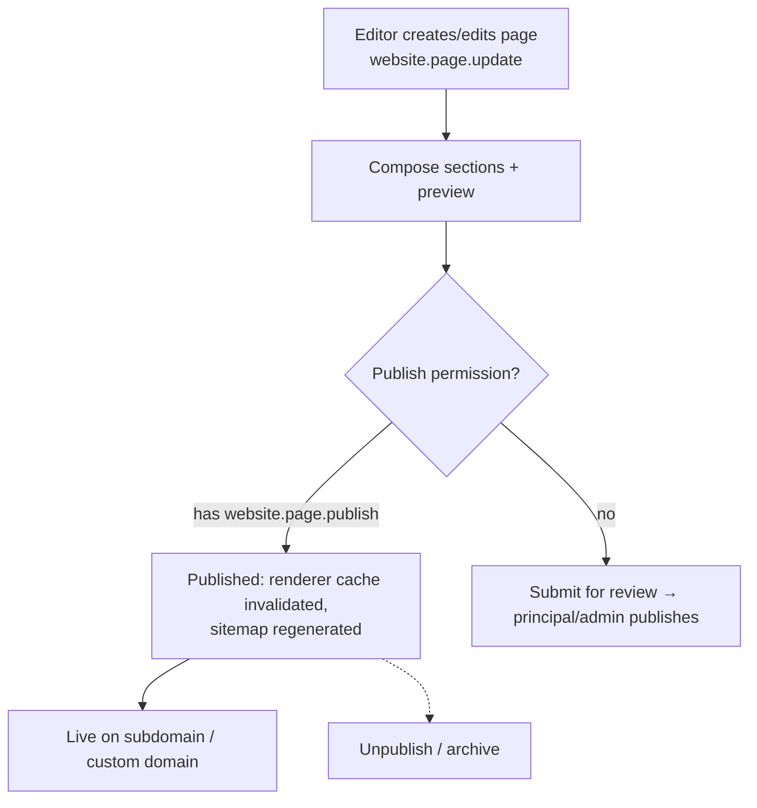
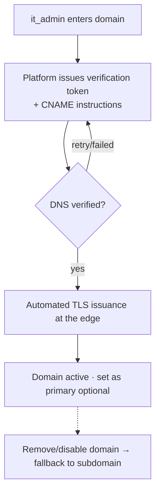

# Module: Website & CMS

> **Agent Context** — Load this block first.
> **Summary:** Gives every tenant school a dynamic public-facing website — homepage, about, principal message, departments, teachers, classes, admissions, events, news, notices, gallery, contact — managed through a CMS with dynamic sections, SEO settings, tenant branding, navigation/footer control, and custom domain binding. One theme ships initially; a theme system enables more later. Rendering/hosting architecture lives in [`website-builder.md`](../02-architecture/website-builder.md); this doc is functional.
> **Co-load with:** `../02-architecture/website-builder.md` · `../05-database/entities/website-cms.md` · `../02-architecture/multi-tenancy.md`
> **Owns entities:** `website_settings`, `themes`, `website_pages`, `page_sections`, `navigation_menus`, `news_posts`, `school_events`, `gallery_albums`, `gallery_items`, `contact_submissions`, `seo_settings`
> **Depends on modules:** admissions, communication, academics, staff-management, platform-admin

## 1. Purpose

The product is not limited to an admin dashboard (scope §11): every school operates a public website on `<slug>.<platform-domain>` or its verified custom domain. This module is the CMS behind that website — page management with dynamic sections, news/events/gallery content, an admissions page whose form feeds the admissions module, published notices from the communication module, SEO, and branding drawn from tenant settings.

The website and the admin system share tenant data across a strict security boundary: the public renderer reads only content explicitly published, via a scoped read-only machine token ([`api-architecture.md`](../02-architecture/api-architecture.md) §2.2).

## 2. Business Objective

- Make the platform a full digital presence, not just back-office software — a differentiator when selling to schools without a website.
- Drive admissions: the website is the top of the enquiry funnel; measurable via contact/admission form conversions.
- Zero-IT publishing: non-technical school staff update news, events, and pages without a developer.

## 3. Target Users

| Role | How they use this module |
| ---- | ------------------------ |
| `school_admin` | Owns website content: pages, sections, news, events, gallery, navigation |
| `it_admin` | Custom domain binding, SEO settings, theme configuration, analytics IDs |
| `principal` | Provides/approves the principal message; reviews content before publish |
| `reception` | Triages contact-form submissions; forwards admission enquiries |
| `school_owner` | Approves branding and theme decisions |
| Public visitor (no account) | Browses the website, submits contact/admission forms |

## 4. Permissions

Permissions follow the RBAC model in [`auth-and-rbac.md`](../02-architecture/auth-and-rbac.md). Permission keys use `<module>.<resource>.<action>`.

| Permission key | Description | Default roles |
| -------------- | ----------- | ------------- |
| `website.page.view` | View pages/sections in the CMS | `school_admin`, `it_admin`, `principal` |
| `website.page.create` / `website.page.update` / `website.page.delete` | Manage pages and their sections | `school_admin` |
| `website.page.publish` | Publish/unpublish pages | `school_admin`, `principal` |
| `website.news-post.create` / `update` / `delete` | Manage news posts | `school_admin` |
| `website.news-post.publish` | Publish news | `school_admin`, `principal` |
| `website.school-event.create` / `update` / `publish` | Manage website events | `school_admin` |
| `website.gallery-album.create` / `update` / `publish` / `delete` | Manage galleries and items | `school_admin` |
| `website.navigation.update` | Edit header/footer menus | `school_admin`, `it_admin` |
| `website.settings.update` | Theme config, homepage assignment, publish/maintenance toggle | `it_admin`, `school_admin` |
| `website.seo.update` | Site and per-page SEO settings | `it_admin`, `school_admin` |
| `website.custom-domain.create` / `update` / `delete` | Bind/verify/remove custom domains | `it_admin`, `school_owner` |
| `website.contact-submission.view` / `update` | Read and triage contact submissions | `reception`, `school_admin` |

`website.page.view` is the CMS **read key for all website content** (pages, themes, settings, navigation, SEO, and later news, events and galleries): this table has no separate view key for those, and every `website.*` row above is registered in `permissions.py`. `website.public-content.view` is **not** a role permission: it is the machine scope of the renderer's platform token, which will be declared in `MACHINE_SCOPES` in `core/rbac/machine.py` when the public content API ships (PR C), so no grantable `Permission` row exists for it and no role can hold it. Once PR C lands, a JWT is refused on public routes and the machine token on CMS routes.

## 5. Main Features

1. **Standard pages** — homepage, about school, principal message, departments, teachers, classes, admissions, contact (scope §11), each composed of theme-defined dynamic sections; unlimited additional custom pages.
2. **Dynamic CMS sections** — each page is an ordered list of typed sections (hero, rich text, stats, staff grid, CTA, FAQ, embedded form…) whose types the active theme declares; content is structured JSON, so themes can re-skin it later.
3. **News & events** — publishable news posts and school events with listing + detail pages; notices published by the communication module surface on the site (read-only here — cross-ref).
4. **Gallery** — albums of images/video embeds, optionally linked to events.
5. **Admissions page & forms** — admission enquiry/application form whose submissions create records in the admissions module (enquiries/applications); generic contact form stored as `contact_submissions`.
6. **Branding** — logo, colors, fonts, favicon come from tenant settings ([`multi-tenancy.md`](../02-architecture/multi-tenancy.md) §5) and are applied by the theme; no per-page branding forks.
7. **Navigation & footer** — editable header menu, footer menus, social links, contact block.
8. **SEO** — site-wide and per-content meta title/description, Open Graph image, canonical URL, robots directives, sitemap.xml and structured data emitted by the renderer.
9. **Custom domain binding** — school connects `www.myschool.tld` (CNAME + automated TLS per multi-tenancy §4); subdomain remains as fallback.
10. **Theme system** — one platform theme at launch; themes are a platform-scope catalog with declared section types and a config schema, so new themes can ship without data migration (scope §11 "WordPress-style" future).

## 6. Sub-features

- **Pages:** draft/published/archived states; publish scheduling *(recommendation)*; page duplication; slug management with redirects on rename *(recommendation)*; per-locale content for tenant languages.
- **Sections:** drag-and-drop reordering; per-section visibility toggle; live preview before publish; teacher/class/department sections can auto-populate from academics and staff-management data marked "show on website".
- **News/events:** cover images, excerpts, publish dates; events with start/end, location, all-day flag; past-event auto-archival on listings.
- **Forms:** spam protection (honeypot + rate limiting; CAPTCHA configurable *(recommendation)*); consent text configurable per tenant.
- **Custom domains:** guided DNS instructions, verification token check, TLS issuance status, primary-domain selection.
- **Maintenance mode:** replace the site with a neutral notice (also forced during tenant suspension per multi-tenancy §7).

## 7. Workflows

### 7.1 Page publish

Steps: editor composes sections against the active theme's section catalog; preview renders through the real renderer with a draft token; publishing flips status, invalidates the edge cache, and regenerates sitemap/feeds. Review gate applies only when the editor lacks the publish permission.

### 7.2 Custom domain binding

### 7.3 Website form submission

Visitor submits admissions/contact form → rate-limit + spam checks → contact forms create `contact_submissions`; admission forms create enquiry/application records **in the admissions module** (cross-ref [`admissions.md`](admissions.md)) → notification to `reception`/`admission_staff` → triage status tracked.

## 8. User Journeys

- **School admin:** onboarding creates the site pre-populated from wizard data → replaces placeholder homepage sections → uploads gallery from the annual day → publishes a news post; total time under an hour, no IT involvement.
- **it_admin:** binds `www.school.tld`, watches verification turn green, sets it primary; fills site-wide SEO defaults and the analytics ID.
- **Principal:** drafts the principal message with the AI assistant, edits tone, publishes.
- **Prospective parent (visitor):** lands on homepage → checks classes and fees info page → submits the admissions enquiry form → receives confirmation email; the enquiry appears in the admissions pipeline.

## 9. Inputs

- Page/section content (structured JSON per section type), rich text, uploaded media (via platform `files`, api-architecture §2.8).
- News posts, events, gallery uploads, navigation trees, SEO fields, theme configuration values.
- Custom domain names; DNS verification results (automated).
- Public form submissions (contact, admissions) — unauthenticated, validated, rate-limited.

## 10. Outputs

- Published website content served by the multi-tenant renderer ([`website-builder.md`](../02-architecture/website-builder.md)): pages, listings, detail pages, sitemap.xml, robots.txt, RSS for news *(recommendation)*.
- `contact_submissions` records; enquiry/application records handed to admissions.
- Events emitted: `website.page.published`, `website.contact-submission.created` (webhooks per api-architecture §2.6).

## 11. Validations

- Slugs unique per tenant per content type; reserved slugs (`admin`, `api`, `verify`…) blocked.
- A page cannot publish with zero visible sections; section content validated against the section type's schema.
- Only one homepage; deleting a published page requires unpublish first; navigation items must reference existing published targets or external URLs.
- Custom domain: valid FQDN, not already claimed by another tenant (global uniqueness), verification before activation.
- Uploaded media validated for type/size and AV-scanned per [`security.md`](../06-security/security.md); public forms: field-level validation, honeypot, per-IP rate limits.
- Published content must never expose non-public data: only staff/class records flagged "show on website" are readable by the renderer token.

## 12. Notifications

| Event | Recipients | Channels | Template ref |
| ----- | ---------- | -------- | ------------ |
| Contact form submitted | `reception`, `school_admin` | In-app, email | `website.contact-received` |
| Admission form submitted | `admission_staff`, `reception` | In-app, email | `web-admission-enquiry` (owned by admissions) |
| Custom domain verified / TLS issued | `it_admin` | In-app, email | `website.domain-active` |
| Custom domain verification failing > 24 h | `it_admin` | Email | `website.domain-failed` |

Template codes follow the locked `module.event-name` vocabulary ([`docs/AGENTS.md`](../AGENTS.md)); `web-admission-enquiry` stays owned by admissions. None of these is sent yet (see §20).

Channels and delivery behavior follow [`notifications.md`](../02-architecture/notifications.md).

## 13. Reports

- **Contact submissions** — by status/source page/date; export CSV. Visible to `reception`, `school_admin`.
- **Content inventory** — pages/posts by status, last updated, stale-content flag. Visible to `school_admin`.
- **Traffic summary** — via the configured analytics integration, embedded read-only *(recommendation)*; visible to `school_owner`, `school_admin`.
- Admission funnel conversion reporting lives in the admissions module and [`reporting-analytics.md`](reporting-analytics.md).

## 14. AI Capabilities

Cross-referenced to [`ai-features.md`](../04-ai/ai-features.md). All AI-generated content is a **draft**; the publish permission gate is the human approval point — nothing goes live without an editor publishing it.

- **`AI-WEB-01` — AI-generated website content** (scope §6): generate/rewrite section copy, about pages, principal message drafts, news posts from bullet points, in the tenant's tone and locale.
- **`AI-WEB-02` — AI SEO assistant** *(recommendation)*: draft meta titles/descriptions and Open Graph text from page content; flag missing/duplicate SEO fields.
- **`AI-WEB-03` — Image alt-text generation** *(recommendation)*: propose accessible alt text for gallery and section images; supports the accessibility requirement (scope §22).

## 15. Database Entities

Full column specs in [`../05-database/entities/website-cms.md`](../05-database/entities/website-cms.md). All tenant-scoped except `themes` (platform-scope catalog, no `tenant_id`):

- `website_settings` — one row per tenant: theme, homepage, publish/maintenance state, header/footer config.
- `themes` — **platform-scope** theme catalog with section-type and config schemas.
- `website_pages` / `page_sections` — pages and their ordered typed sections.
- `navigation_menus` — header/footer menu trees.
- `news_posts`, `school_events`, `gallery_albums`, `gallery_items` — publishable content.
- `contact_submissions` — public contact-form records.
- `seo_settings` — site-wide and per-content SEO metadata.

Referenced (not owned): `custom_domains`, `tenant_settings`, `files` ([`tenancy.md`](../05-database/entities/tenancy.md)); notices (communication), enquiries/applications (admissions).

## 16. API Requirements

Conventions per [`api-architecture.md`](../02-architecture/api-architecture.md). Two surfaces: authenticated CMS API and the read-only public content API consumed by the renderer via a scoped machine token.

- CMS, **built in PR A**: `GET/POST /api/v1/website-pages` (filters `status`, `page_type`, `search` on title and slug) · `GET/PATCH/DELETE /api/v1/website-pages/{id}` · `POST /api/v1/website-pages/{id}:publish` / `:unpublish` / `:archive` / `:preview` · `PATCH /api/v1/website-pages/{id}/page-sections` (ordered bulk replace, at most 50 sections)
- Not yet built (PR B onward): `GET/POST/PATCH /api/v1/news-posts` (+ `:publish`) · `/api/v1/school-events` · `/api/v1/gallery-albums` · `/api/v1/gallery-albums/{id}/gallery-items`
- Built in PR A: `GET/PATCH /api/v1/website-settings` · `GET /api/v1/navigation-menus` · `PATCH /api/v1/navigation-menus/{location}` (`header`, `footer_primary`, `footer_secondary`; at most 50 items, two levels, labels 1–60 characters) · `GET/PATCH /api/v1/seo-settings?target_type=&target_id=` (`site` takes no `target_id`; news, event and album targets are refused with `unsupported_target` until their resources ship) · `GET /api/v1/themes` (active themes, with their section schemas). Every route above is JWT-only; `GET`s read under `website.page.view`, writes under the keys in §4; `:preview` needs `website.page.view` and returns a URL on the tenant's own host.
- Not yet built: `GET/POST /api/v1/custom-domains` · `POST /api/v1/custom-domains/{id}:verify` · `DELETE /api/v1/custom-domains/{id}`
- Not yet built: `GET /api/v1/contact-submissions` (filters: `status`, `created_at__gte`) · `PATCH /api/v1/contact-submissions/{id}`
- Not yet built (PR C onward), public (renderer/visitor): `GET /api/v1/public/site` (resolved by domain) · `GET /api/v1/public/pages/{slug}` · `GET /api/v1/public/news-posts` · `POST /api/v1/public/contact-submissions` (rate-limited, `Idempotency-Key` supported) · `POST /api/v1/public/admission-forms` (proxies to admissions).

## 17. Integration Requirements

- **Renderer app** (Next.js multi-tenant renderer per [`tech-stack.md`](../02-architecture/tech-stack.md)) — domain-based tenant resolution, edge cache invalidation hooks; architecture in [`website-builder.md`](../02-architecture/website-builder.md).
- **Edge/DNS provider** for wildcard subdomains, CNAME verification, automated TLS.
- **Object storage/CDN** for media; **analytics** (tenant-supplied ID, e.g. GA4/Plausible) *(recommendation)*.
- Internal: admissions API (form hand-off), communication API (published notices feed).

## 18. Dependencies on Other Modules

| Module | Direction | What is shared |
| ------ | --------- | -------------- |
| admissions | outbound | Website admission form creates enquiries/applications |
| communication | inbound | Published notices/announcements surfaced on the site |
| academics | inbound | Classes/departments data for auto-populated sections |
| staff-management | inbound | Teacher profiles flagged public for the teachers page |
| school-organization | inbound | Tenant branding (logo, colors, fonts), campus contact details |
| platform-admin | inbound | Website feature flag, storage quota, custom-domain plan gating |

## 19. Open Questions / Recommendations

- Publish scheduling, slug-rename redirects, CAPTCHA, RSS, and the analytics embed are **recommendations** pending client confirmation.
- Multi-locale public content (full page translation vs. single-locale site) needs a client decision; the data model supports per-locale content.
- Theme marketplace/pricing for future themes is a platform-admin commercial decision, out of initial scope.

## 20. Implementation notes

### Built (PR A: backend foundation)

PR A of [`docs/superpowers/plans/2026-11-15-website-cms.md`](../superpowers/plans/2026-11-15-website-cms.md) ships the Django app, its models and the CMS endpoints for settings, pages, sections, navigation and SEO. Decisions are in [ADR-0038](../decisions/0038-website-content-blocks-and-schema-validated-sections.md).

| Area | State |
| ---- | ----- |
| App layout | `apps/api/apps/website_cms/`, ADR-0010 resource packages: `settings/` (site settings, themes), `pages/` (pages and sections), `navigation/`, `seo/`, each with its serializers, services and tests. Root files hold what autodiscovery needs (`apps.py`, `permissions.py`, `features.py`, `uploads.py`) and the shared pieces: `models.py`, `constants.py`, `validation.py`, `media.py`, `visibility.py`, `revalidation.py`, `tasks.py`, `preview.py`, `urls_builder.py`, `defaults.py`, `errors.py`. Feature flag `module.website` (default off); upload purpose `website.media` (four image MIME types, 10 MB, module-gated) |
| Tables | `website_settings`, `website_pages`, `page_sections`, `navigation_menus`, `seo_settings` (RLS, migration `0002`) and the platform-scope `themes`. Uniques are partial on `deleted_at IS NULL`; see [the entity doc](../05-database/entities/website-cms.md) |
| Themes | Declared in code (`themes/default.json`, code `default`, version `1.0.0`: the renderer's 12 section types plus `rich_text` and `faq`) and synced into `themes` on `post_migrate` (`sync_themes_on_migrate`, the pattern of the feature-flag sync). A theme edit therefore needs no data migration (§5.10). `themes.section_types` is stored as `{type: {label, schema}}`, not a list. `section_type` is emitted as the `SectionTypeEnum` OpenAPI enum |
| Section schemas | A constrained JSON Schema subset, checked by `Draft202012Validator`: `type`, `properties`, `required`, `items`, `enum`, `maxLength`, `minLength`, `minimum`, `maximum` (the last three mirror the renderer's zod bounds, which render nothing on a failed parse), `format: safe-url`, `$ref` to the rich-text schema, and an `x-widget` hint (`text`, `textarea`, `image`, `rich-text`, `url`) for the dashboard. A test fails if a theme uses anything else |
| Rich text and links | Rich text is a block document (`{"blocks": [...]}`: paragraph, heading levels 2 to 4, list, quote, image), validated by `schemas/rich_text.json`, so no markup can be stored. Every URL field uses the `safe-url` format: an `https:` URL or a `/`-relative path (not `//` or `/\`), checked by an explicitly supplied `FormatChecker` that knows no other format. The same function backs `social_links`, header and footer links, `canonical_url` and navigation targets. Header and footer config has no `config_schema` yet, so a link there is checked only under a `url` or `href` key; the renderer must read links from those keys only |
| File visibility | `core/files/visibility.py` holds the provider registry and `sync_file_visibility(file_ids)`: a file is `public` when any registered provider claims it as referenced by published content, else `private`. `core/` never imports the app (ADR-0013); `website_cms/visibility.py` registers the section and SEO-image providers in `ready()`. Services call it on publish, unpublish, section replace and SEO image change, over the union of old and new ids. A file another tenant owns, or one not `ready`, is refused with a 422 on `file_id`. Image values are 36 characters and rewritten as `str(UUID(value))` during validation, so stored content is always the lowercase hyphenated form the visibility pre-filter text-matches and the public-file route accepts. Providers receive the candidate ids and narrow their query to rows that mention them; they never scan every published row. `sync_file_visibility` writes with two bulk updates (claimed and not public, unclaimed and not private). Media URLs are built by `media.py` (`<name>_url`) for the public route PR C adds |
| Empty text | Optional string columns (`description`, `locale`, `default_locale`, `analytics_id`, SEO `meta_*`, `canonical_url`, `robots`) are `NOT NULL DEFAULT ''`, never NULL (Django convention, ruff `DJ001`). An empty `locale` is the default locale, so the page slug unique is a plain unique; `seo_settings` keeps `nulls_distinct=False` for its nullable `target_id`. The API returns `""` for an unset text field; blank input clears it |
| Positions | `page_sections` has a partial `unique(page, position)`, which Postgres cannot defer, so `replace_sections` writes in two passes: kept rows are parked at `+10000`, then written `0..n-1`; removed rows are soft-deleted |
| Locking | Publish, unpublish, archive, delete and `replace_sections` first re-read the page under `select_for_update()` and decide on the locked row's status, so publish's "has a visible section" check and a concurrent section write serialise, and two first writes on an empty page cannot collide on the position index. `PATCH /website-settings` locks the settings row and writes only the changed columns; a menu `PATCH` validates under the menu's row lock |
| Default site | `ensure_default_site(tenant)` creates the settings row (theme `default`, unpublished) and the eight standard pages as drafts. It runs only on the first write (`PATCH /website-settings`, first page create) and never on a `GET`: `GET /website-settings` answers an unsaved default with `exists: false`, and `GET /navigation-menus` returns empty menus. It is race-safe (savepoint create under `unique(tenant)`, re-read on `IntegrityError`) |
| Revalidation | Any publish, unpublish or settings change queues one whole-tenant invalidation on commit (`queue_revalidation`). The Celery task `website_cms.revalidate_website` POSTs `{tenant_id, tags}` signed with HMAC-SHA256 over the raw body (header `x-schoolhub-signature`) to `WEBSITE_REVALIDATE_URL`, secret `WEBSITE_REVALIDATE_SECRET`. A 5xx or network error retries with backoff (at most 5); a 4xx is logged and not retried; an empty URL is a no-op and an empty secret with a URL fails closed. Host-scoped `tenant-host:<h>` tags are sent for settings changes, but the renderer ignores them until its route learns them (PR E) |
| Preview | `POST /website-pages/{id}:preview` returns `<scheme>://<slug>.<PLATFORM_DOMAIN>/api/preview?token=...` with a signed token (`TimestampSigner`, salt `website-preview`, 600 s, payload `tenant_id:page_id`). The primary-custom-domain branch and the dev port arrive with PR C; the renderer's `/api/preview` is PR E |
| Extra 422 rules | Beyond §11: archiving or deleting the homepage or a page a menu points at is `page_in_use`; creating a second `home` page is refused; `PATCH` cannot change `page_type` or `status` (use the actions); `homepage_page_id` can be reassigned but never cleared; deleting needs the page unpublished first (`unpublish_first`); publishing with no visible section is `no_visible_sections`. Slug, reserved-slug and uniqueness failures are 422 as well. Unpublishing a navigation target is allowed: the public read drops unpublished targets (PR C). A menu `PATCH` requires only *new* page targets to be published; a page target the stored menu already holds need only still exist, so an unpublished target never blocks an unrelated edit of its menu |
| SEO structured data | `structured_data` is returned by `GET /seo-settings` but is read-only: a `PATCH` ignores it until the renderer defines a JSON-LD shape and its escaping (see [`deferred-work.md`](../deferred-work.md)) |
| Theme switch | Changing the theme validates `theme_config` against the new theme but does not re-validate existing sections. A section whose type the new theme lacks stays stored, and the renderer skips unknown types ([`website-builder.md`](../02-architecture/website-builder.md) §5); such a section stops claiming its file, so the file goes private on the next sync |
| Not yet shipped | PR B: news, events, galleries and their SEO targets, staff, department and class opt-ins. PR C: the public content API, machine-token auth, host resolution and the media redirect. PR D: custom domains. PR E onward: contact submissions and their notifications (the three template codes in §12), the renderer on the generated contract, the dashboard Website area. The deferred list is in [`deferred-work.md`](../deferred-work.md) |
| Tests | `website_cms/tests/` (registry and theme subset, validation, default site, cross-tenant RLS), per-package `tests/` for settings, pages, navigation and SEO, and `core/files/tests/test_visibility.py` |
