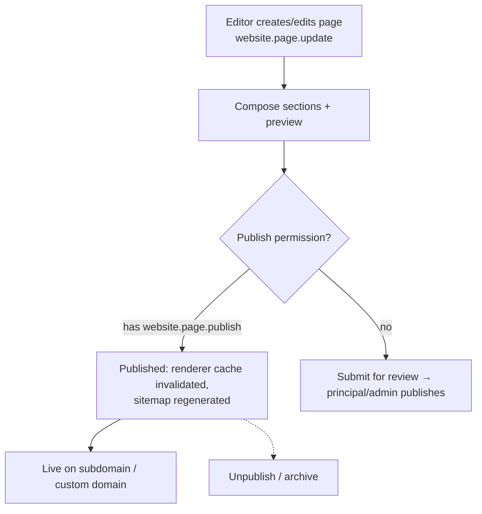
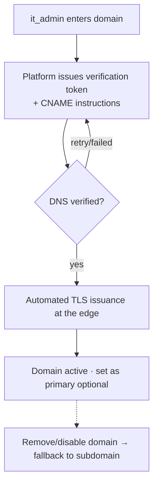

# Module: Website & CMS

> **Agent Context** — Load this block first.
> **Summary:** Gives every tenant school a dynamic public-facing website — homepage, about, principal message, departments, teachers, classes, admissions, events, news, notices, gallery, contact — managed through a CMS with dynamic sections, SEO settings, tenant branding, navigation/footer control, and custom domain binding. One theme ships initially; a theme system enables more later. Rendering/hosting architecture lives in [`website-builder.md`](../02-architecture/website-builder.md); this doc is functional.
> **Co-load with:** `../02-architecture/website-builder.md` · `../05-database/entities/website-cms.md` · `../02-architecture/multi-tenancy.md`
> **Owns entities:** `website_settings`, `themes`, `website_pages`, `page_sections`, `navigation_menus`, `news_posts`, `school_events`, `gallery_albums`, `gallery_items`, `contact_submissions`, `seo_settings`
> **Depends on modules:** admissions, communication, academics, staff-management, platform-admin

## 1. Purpose

The product is not limited to an admin dashboard (scope §11): every school operates a public website on `<slug>.<platform-domain>` or its verified custom domain. This module is the CMS behind that website — page management with dynamic sections, news/events/gallery content, an admissions page whose form feeds the admissions module, published notices from the communication module, SEO, and branding drawn from tenant settings.

The website and the admin system share tenant data across a strict security boundary: the public renderer reads only content explicitly published, via a scoped read-only machine token ([`api-architecture.md`](../02-architecture/api-architecture.md) §2.2).

## 2. Business Objective

- Make the platform a full digital presence, not just back-office software — a differentiator when selling to schools without a website.
- Drive admissions: the website is the top of the enquiry funnel; measurable via contact/admission form conversions.
- Zero-IT publishing: non-technical school staff update news, events, and pages without a developer.

## 3. Target Users

| Role | How they use this module |
| ---- | ------------------------ |
| `school_admin` | Owns website content: pages, sections, news, events, gallery, navigation |
| `it_admin` | Custom domain binding, SEO settings, theme configuration, analytics IDs |
| `principal` | Provides/approves the principal message; reviews content before publish |
| `reception` | Triages contact-form submissions; forwards admission enquiries |
| `school_owner` | Approves branding and theme decisions |
| Public visitor (no account) | Browses the website, submits contact/admission forms |

## 4. Permissions

Permissions follow the RBAC model in [`auth-and-rbac.md`](../02-architecture/auth-and-rbac.md). Permission keys use `<module>.<resource>.<action>`.

| Permission key | Description | Default roles |
| -------------- | ----------- | ------------- |
| `website.page.view` | View pages/sections in the CMS | `school_admin`, `it_admin`, `principal` |
| `website.page.create` / `website.page.update` / `website.page.delete` | Manage pages and their sections | `school_admin` |
| `website.page.publish` | Publish/unpublish pages | `school_admin`, `principal` |
| `website.news-post.create` / `update` / `delete` | Manage news posts | `school_admin` |
| `website.news-post.publish` | Publish news | `school_admin`, `principal` |
| `website.school-event.create` / `update` / `publish` | Manage website events | `school_admin` |
| `website.gallery-album.create` / `update` / `publish` / `delete` | Manage galleries and items | `school_admin` |
| `website.navigation.update` | Edit header/footer menus | `school_admin`, `it_admin` |
| `website.settings.update` | Theme config, homepage assignment, publish/maintenance toggle | `it_admin`, `school_admin` |
| `website.seo.update` | Site and per-page SEO settings | `it_admin`, `school_admin` |
| `website.custom-domain.create` / `update` / `delete` | Bind/verify/remove custom domains | `it_admin`, `school_owner` |
| `website.contact-submission.view` / `update` | Read and triage contact submissions | `reception`, `school_admin` |

`website.page.view` is the CMS **read key for all website content** (pages, themes, settings, navigation, SEO, news posts, school events and gallery albums with their items): this table has no separate view key for those, and every `website.*` row above is registered in `permissions.py`. Gallery **item** writes (add, edit, delete, reorder) use `website.gallery-album.update`: §4 has no item key, because an item has no lifecycle of its own and is only ever changed as part of editing its album. `website.public-content.view` is **not** a role permission: it is the machine scope of the renderer's platform token, which will be declared in `MACHINE_SCOPES` in `core/rbac/machine.py` when the public content API ships (PR C), so no grantable `Permission` row exists for it and no role can hold it. Once PR C lands, a JWT is refused on public routes and the machine token on CMS routes.

## 5. Main Features

1. **Standard pages** — homepage, about school, principal message, departments, teachers, classes, admissions, contact (scope §11), each composed of theme-defined dynamic sections; unlimited additional custom pages.
2. **Dynamic CMS sections** — each page is an ordered list of typed sections (hero, rich text, stats, staff grid, CTA, FAQ, embedded form…) whose types the active theme declares; content is structured JSON, so themes can re-skin it later.
3. **News & events** — publishable news posts and school events with listing + detail pages; notices published by the communication module surface on the site (read-only here — cross-ref).
4. **Gallery** — albums of images/video embeds, optionally linked to events.
5. **Admissions page & forms** — admission enquiry/application form whose submissions create records in the admissions module (enquiries/applications); generic contact form stored as `contact_submissions`.
6. **Branding** — logo, colors, fonts, favicon come from tenant settings ([`multi-tenancy.md`](../02-architecture/multi-tenancy.md) §5) and are applied by the theme; no per-page branding forks.
7. **Navigation & footer** — editable header menu, footer menus, social links, contact block.
8. **SEO** — site-wide and per-content meta title/description, Open Graph image, canonical URL, robots directives, sitemap.xml and structured data emitted by the renderer.
9. **Custom domain binding** — school connects `www.myschool.tld` (CNAME + automated TLS per multi-tenancy §4); subdomain remains as fallback.
10. **Theme system** — one platform theme at launch; themes are a platform-scope catalog with declared section types and a config schema, so new themes can ship without data migration (scope §11 "WordPress-style" future).

## 6. Sub-features

- **Pages:** draft/published/archived states; publish scheduling *(recommendation)*; page duplication; slug management with redirects on rename *(recommendation)*; per-locale content for tenant languages.
- **Sections:** drag-and-drop reordering; per-section visibility toggle; live preview before publish; teacher/class/department sections can auto-populate from academics and staff-management data marked "show on website".
- **News/events:** cover images, excerpts, publish dates; events with start/end, location, all-day flag; past-event auto-archival on listings.
- **Forms:** spam protection (honeypot + rate limiting; CAPTCHA configurable *(recommendation)*); consent text configurable per tenant.
- **Custom domains:** guided DNS instructions, verification token check, TLS issuance status, primary-domain selection. The instructions say: keep the CNAME, a direct CNAME to the platform's target (CNAME chains are not followed); the TXT record can be removed after verification, but if it is kept it must keep this domain's token. The daily re-check reads the CNAME and, when a TXT record exists, requires the token, so a new owner of the domain who publishes their own token evicts a stale holder within three daily runs. A domain becomes primary only once its HTTPS certificate is issued.
- **Maintenance mode:** replace the site with a neutral notice (also forced during tenant suspension per multi-tenancy §7).

## 7. Workflows

### 7.1 Page publish

Steps: editor composes sections against the active theme's section catalog; preview renders through the real renderer with a draft token; publishing flips status, invalidates the edge cache, and regenerates sitemap/feeds. Review gate applies only when the editor lacks the publish permission. A published page, news post, event or album (and a published album's items) can be edited only by someone holding that resource's `.publish` key; an update-only editor gets 422 `publish_required` and works on a draft instead (unpublish first). A published page also cannot be saved with zero visible sections (422 `no_visible_sections`).

### 7.2 Custom domain binding

### 7.3 Website form submission

Visitor submits admissions/contact form → rate-limit + spam checks → contact forms create `contact_submissions`; admission forms create enquiry/application records **in the admissions module** (cross-ref [`admissions.md`](admissions.md)) → notification to `reception`/`admission_staff` → triage status tracked.

## 8. User Journeys

- **School admin:** onboarding creates the site pre-populated from wizard data → replaces placeholder homepage sections → uploads gallery from the annual day → publishes a news post; total time under an hour, no IT involvement.
- **it_admin:** binds `www.school.tld`, watches verification turn green, sets it primary; fills site-wide SEO defaults and the analytics ID.
- **Principal:** drafts the principal message with the AI assistant, edits tone, publishes.
- **Prospective parent (visitor):** lands on homepage → checks classes and fees info page → submits the admissions enquiry form → receives confirmation email; the enquiry appears in the admissions pipeline.

## 9. Inputs

- Page/section content (structured JSON per section type), rich text, uploaded media (via platform `files`, api-architecture §2.8).
- News posts, events, gallery uploads, navigation trees, SEO fields, theme configuration values.
- Custom domain names; DNS verification results (automated).
- Public form submissions (contact, admissions) — unauthenticated, validated, rate-limited.

## 10. Outputs

- Published website content served by the multi-tenant renderer ([`website-builder.md`](../02-architecture/website-builder.md)): pages, listings, detail pages, sitemap.xml, robots.txt, RSS for news *(recommendation)*.
- `contact_submissions` records; enquiry/application records handed to admissions.
- Events emitted: `website.page.published`, `website.contact-submission.created` (webhooks per api-architecture §2.6).

## 11. Validations

- Slugs unique per tenant per content type; reserved slugs (`admin`, `api`, `verify`…) blocked.
- A page cannot publish with zero visible sections; section content validated against the section type's schema.
- Only one homepage; deleting a published page requires unpublish first; navigation items must reference existing published targets or external URLs.
- Custom domain: valid FQDN, not already claimed by another tenant (global uniqueness), verification before activation.
- Uploaded media validated for type/size and AV-scanned per [`security.md`](../06-security/security.md); public forms: field-level validation, honeypot, per-IP rate limits.
- Published content must never expose non-public data: only staff/class records flagged "show on website" are readable by the renderer token.

## 12. Notifications

| Event | Recipients | Channels | Template ref |
| ----- | ---------- | -------- | ------------ |
| Contact form submitted | `reception`, `school_admin` | In-app, email | `website.contact-received` |
| Admission form submitted | `admission_staff`, `reception` | In-app, email | `web-admission-enquiry` (owned by admissions) |
| Custom domain verified / TLS issued | `it_admin` | In-app, email | `website.domain-active` |
| Custom domain verification failing > 24 h | `it_admin` | Email | `website.domain-failed` |

Template codes follow the locked `module.event-name` vocabulary ([`docs/AGENTS.md`](../AGENTS.md)); `web-admission-enquiry` stays owned by admissions. All three triggers are registered in `website_cms/notifications.py`; `website.contact-received` is sent when a submission is stored (queued on commit), the two domain triggers are sent by the custom-domain flow (PR D). `notify()` always adds the in-app channel, so `website.domain-failed` is email by default with an in-app floor.

Channels and delivery behavior follow [`notifications.md`](../02-architecture/notifications.md).

## 13. Reports

- **Contact submissions** — by status/source page/date; export CSV. Visible to `reception`, `school_admin`.
- **Content inventory** — pages/posts by status, last updated, stale-content flag. Visible to `school_admin`.
- **Traffic summary** — via the configured analytics integration, embedded read-only *(recommendation)*; visible to `school_owner`, `school_admin`.
- Admission funnel conversion reporting lives in the admissions module and [`reporting-analytics.md`](reporting-analytics.md).

## 14. AI Capabilities

Cross-referenced to [`ai-features.md`](../04-ai/ai-features.md). All AI-generated content is a **draft**; the publish permission gate is the human approval point — nothing goes live without an editor publishing it.

- **`AI-WEB-01` — AI-generated website content** (scope §6): generate/rewrite section copy, about pages, principal message drafts, news posts from bullet points, in the tenant's tone and locale.
- **`AI-WEB-02` — AI SEO assistant** *(recommendation)*: draft meta titles/descriptions and Open Graph text from page content; flag missing/duplicate SEO fields.
- **`AI-WEB-03` — Image alt-text generation** *(recommendation)*: propose accessible alt text for gallery and section images; supports the accessibility requirement (scope §22).

## 15. Database Entities

Full column specs in [`../05-database/entities/website-cms.md`](../05-database/entities/website-cms.md). All tenant-scoped except `themes` (platform-scope catalog, no `tenant_id`):

- `website_settings` — one row per tenant: theme, homepage, publish/maintenance state, header/footer config.
- `themes` — **platform-scope** theme catalog with section-type and config schemas.
- `website_pages` / `page_sections` — pages and their ordered typed sections.
- `navigation_menus` — header/footer menu trees.
- `news_posts`, `school_events`, `gallery_albums`, `gallery_items` — publishable content.
- `contact_submissions` — public contact-form records.
- `seo_settings` — site-wide and per-content SEO metadata.
- `custom_domains` (tenant-scoped, RLS) and `custom_domain_routes` (platform scope, active domains only) — owned here, documented in [`tenancy.md`](../05-database/entities/tenancy.md); platform-admin §15 records the move.

Referenced (not owned): `tenant_settings`, `files` ([`tenancy.md`](../05-database/entities/tenancy.md)); notices (communication), enquiries/applications (admissions).

## 16. API Requirements

Conventions per [`api-architecture.md`](../02-architecture/api-architecture.md). Two surfaces: authenticated CMS API and the read-only public content API consumed by the renderer via a scoped machine token.

- CMS, **built in PR A**: `GET/POST /api/v1/website-pages` (filters `status`, `page_type`, `search` on title and slug) · `GET/PATCH/DELETE /api/v1/website-pages/{id}` · `POST /api/v1/website-pages/{id}:publish` / `:unpublish` / `:archive` / `:preview` · `PATCH /api/v1/website-pages/{id}/page-sections` (ordered bulk replace, at most 50 sections)
- CMS, **built in PR B** (reads under `website.page.view`, writes under the keys in §4; all JWT-only; list routes use page-number pagination with a total order ending in `id`):
  - `GET/POST /api/v1/news-posts` · `GET/PATCH/DELETE /api/v1/news-posts/{id}` · `POST …:publish` / `:unpublish` / `:archive` (all three need `website.news-post.publish`; create and edit use `.create` and `.update`; delete uses `.delete` and needs the post unpublished first).
  - `GET/POST /api/v1/school-events` · `GET/PATCH /api/v1/school-events/{id}` · `POST …:publish` / `:unpublish` / `:archive`. There is no DELETE, because §4 has no `website.school-event.delete` key: archive instead (the transitions use `website.school-event.publish`).
  - `GET/POST /api/v1/gallery-albums` · `GET/PATCH/DELETE /api/v1/gallery-albums/{id}` · `POST …:publish` / `:unpublish` (an album needs at least one item to publish, else 422 `empty_album`; delete needs it unpublished first and uses `website.gallery-album.delete`; there is no `:archive` route, which answers 404).
  - `GET/POST /api/v1/gallery-albums/{id}/gallery-items` · `PATCH/DELETE …/gallery-items/{item_id}` · `PATCH …/gallery-items:reorder` with `{ids: [...]}` listing every item of the album exactly once (the response is the ordered list of items). Item writes use `website.gallery-album.update`.
  - Slugs are one lowercase segment, 120 characters at most, unique per tenant among live rows. News `body` and event `description` are rich-text block documents; `video_embed` items need an `https` URL on `EMBED_HOSTS` (YouTube, Vimeo).
- Built in PR A: `GET/PATCH /api/v1/website-settings` · `GET /api/v1/navigation-menus` · `PATCH /api/v1/navigation-menus/{location}` (`header`, `footer_primary`, `footer_secondary`; at most 50 items, two levels, labels 1–60 characters) · `GET/PATCH /api/v1/seo-settings?target_type=&target_id=` (`site` takes no `target_id`; the target of any other type must be a live row of the tenant) · `GET /api/v1/themes` (active themes, with their section schemas). Every route above is JWT-only; `GET`s read under `website.page.view`, writes under the keys in §4; `:preview` needs `website.page.view` and returns a URL on the tenant's own host.
- Built in PR D: `GET/POST /api/v1/custom-domains` · `PATCH /api/v1/custom-domains/{id}` (writes only `is_primary`) · `POST /api/v1/custom-domains/{id}:verify` · `DELETE /api/v1/custom-domains/{id}`. The list reads under `AnyOf(website.custom-domain.create, .update)` (§4 has no view key); `POST` needs `.create`, `PATCH` and `:verify` need `.update`, `DELETE` needs `.delete`. Every row carries `dns_records`: the TXT record `_schoolhub-verify.<domain>` holding the token (`keep_after_verification: false`) and a direct CNAME to `WEBSITE_CNAME_TARGET` (`keep_after_verification: true`; CNAME chains are not followed). The dashboard renders the copy: keep the CNAME; the TXT record can be removed after verification, and if kept it must keep the token. Each row also carries `last_error_code` (`CustomDomainErrorCodeEnum`: `txt_missing`, `txt_mismatch`, `cname_missing`, `cname_mismatch`, `lookup_timeout`, `lookup_failed`, `domain_taken`, `target_unconfigured`; `null` when the last check passed, since the schema settings cannot express a blank enum member) beside the prose `last_error`. 422 reasons: `invalid_domain`, `platform_domain`, `duplicate_domain`, `domain_limit` (at most 5 live domains), `not_active` (primary needs an active domain), `tls_not_issued` (primary needs an issued certificate), `not_verifiable`. Input longer than `DOMAIN_INPUT_MAX_LENGTH` (317) is a 400 before any mapping. A domain another school holds answers `:verify` with 409 and `meta.reason` `domain_taken`. All JWT-only.
- Built in PR B: `GET /api/v1/contact-submissions` (filters: `status`, `created_at__gte`, `created_at__lte`, `created_at__lt` (exclusive, for a day range), `search`; page-number pagination) · `GET /api/v1/contact-submissions/{id}` · `PATCH /api/v1/contact-submissions/{id}` (writes only `status`: `new`, `read`, `responded`, `spam`; sets `handled_by` to the caller). `source_page_id` is null for a message sent with no page, and `handled_by_id` is null until someone triages it; the contract types both as nullable. Reads use `website.contact-submission.view`, the `PATCH` uses `.update`. The stored `ip` is never returned.
- **Public content API, built in PR C** (all under `/api/v1/public/`, `GET` unless stated; decisions in [ADR-0039](../decisions/0039-public-content-api.md)).
  - **Machine routes.** Every read below sends `Authorization: Bearer <machine token>` (the renderer's `WEBSITE_MACHINE_TOKENS`, scope `website.public-content.view`) and `?host=` (a school's subdomain or an active custom domain; the API resolves the school, the caller never asserts a tenant id). A staff JWT is refused with 401, and a machine token is refused with 401 on every CMS route. A missing or wrong token is 401, a write method is 405, and the rate is 1200/min per normalised host (429). A `tenant_id` parameter is ignored. Every read is a 404, the same one for each cause, when the host is unknown or its school is deleted, provisioning or deprovisioned, `module.website` is off, or the site is unpublished or in maintenance. `tenants/by-host` is the exception and reports instead.
  - **Cache headers.** Besides the file redirect, only `pages` and `site` set any: they always send `Vary: X-Preview-Token` and add `Cache-Control: no-store` when a preview token was used.

  | Route | Returns | Notes |
  | ----- | ------- | ----- |
  | `tenants/by-host?host=` | `PublicTenant`: `id`, `slug`, `name`, `status`, `website_status` (`live`, `maintenance`, `unpublished`), `branding` (`PublicBranding`), `locale` `{default_locale, enabled_locales, timezone, direction}`, `contact`, `custom_domain`, `enabled_modules` | 200 for a `live` or `suspended` school; 404 for an unknown host, a deleted tenant, provisioning or deprovisioned. Module off reports `unpublished`. For a school that is suspended, or whose site is not live, `contact`, `custom_domain` and `enabled_modules` are withheld (`null`, `null`, `[]`) |
  | `site?host=` | `PublicSite`: `theme` `{code, version, config}`, `navigation` `{header, footer_primary, footer_secondary}` of `{label, href, children}`, `header_config`, `footer_config`, `social_links`, `seo` | 404 unless live, or a valid preview token for this school (see below) |
  | `pages?host=&slug=` | `PublicPage`: `id`, `slug`, `path`, `title`, `page_type`, `status`, `is_homepage`, `published_at`, `updated_at`, `sections` (`{id, type, position, props}`), `seo` | An empty, missing or `/` slug is the homepage. 404 for an unpublished, archived or deleted page, and for `slug=home` |
  | `sitemap?host=` | A bare list of `PublicSitemapEntry` `{path, updated_at}` | Published, indexable pages (the homepage as `/`), news posts, events and albums |
  | `news-posts?host=&page_size=` · `news-posts/{slug}?host=` | `PublicNewsPost` list (newest first) · `PublicNewsPostDetail` | `page_size` is 1 to 50, default 50. A draft or archived post is 404 |
  | `school-events?host=&scope=&page_size=` · `school-events/{slug}?host=` | `PublicSchoolEvent` list · `PublicSchoolEventDetail` | `scope` is `upcoming` (the default, also the fallback for an unknown value) or `past`. A draft or archived event is 404 |
  | `gallery-albums?host=&page_size=` · `gallery-albums/{slug}?host=` · `gallery-items?host=&page_size=` | `PublicGalleryAlbum` list (with `item_count`) · `PublicGalleryAlbumDetail` (items, at most 100, plus `item_count`) · `PublicGalleryImage` list of the latest images across published albums | Albums order by `published_at` descending, nulls last |
  | `teachers` · `departments` · `classes` · `notices` `?host=` | `PublicTeacher`, `PublicDepartment`, `PublicClass`, `PublicNotice` lists | Opted-in records only (§20 "PR B: opt-in flags and `public.py`"); notices are published, unexpired and carry a plain-text body |
  | `files/{tenant_id}/{file_id}` | 302 to a presigned link | Anonymous (no token). 404 for every miss. `Cache-Control: public, max-age=300` |
  | `POST contact-submissions` | 201 `{status: "received"}` | Anonymous, see below |

  - **Preview.** `X-Preview-Token` (the signed token of `POST …/website-pages/{id}:preview`) is read from that header only; a query parameter is ignored. A bad, expired or other school's token is 404. With a token, `pages` reads that one page in any status (the `slug`, when sent, must match it; without one the token's page is returned) and `site` skips the "live" check. The operational-school and `module.website` checks still apply.
  - **Contact `POST`.** No machine token. Headers: `X-Tenant-Slug` (required), `Origin` (when present, its host must resolve to the same school, https only unless `DEBUG`), `Content-Type: application/json` (else 415) and an optional `Idempotency-Key` of at most 255 characters (longer is 422). The slug and `Origin` are checked before the body is read. The body is capped at 32 KB (413, declared or actual) and must be a JSON object (400). A filled honeypot `company_website` returns 201 and stores nothing. Rule failures are 422 keyed by field, an unknown slug, a foreign `Origin` or a site that is not live is 404, and throttles are 5/min per client IP and 200/hour per school (429). A retry with the same key and body replays the first response; the same key with another body is 422 `idempotency_key_reused`.
  - **CORS.** The allowlist adds a school's own origins (its subdomain and active custom domains) on `POST /api/v1/public/contact-submissions` only (the one route a browser calls); `Origin` hosts of suspended or unknown schools get no CORS headers.
  - Not built: `POST /api/v1/public/admission-forms` (waits for the admissions module; see [`deferred-work.md`](../deferred-work.md)).

## 17. Integration Requirements

- **Renderer app** (Next.js multi-tenant renderer per [`tech-stack.md`](../02-architecture/tech-stack.md)) — domain-based tenant resolution, edge cache invalidation hooks; architecture in [`website-builder.md`](../02-architecture/website-builder.md).
- **Edge/DNS provider** for wildcard subdomains, CNAME verification, automated TLS.
- **Object storage/CDN** for media; **analytics** (tenant-supplied ID, e.g. GA4/Plausible) *(recommendation)*.
- Internal: admissions API (form hand-off), communication API (published notices feed).

## 18. Dependencies on Other Modules

| Module | Direction | What is shared |
| ------ | --------- | -------------- |
| admissions | outbound | Website admission form creates enquiries/applications |
| communication | inbound | Published notices/announcements surfaced on the site |
| academics | inbound | Classes/departments data for auto-populated sections |
| staff-management | inbound | Teacher profiles flagged public for the teachers page |
| school-organization | inbound | Tenant branding (logo, colors, fonts), campus contact details |
| platform-admin | inbound | Website feature flag, storage quota, custom-domain plan gating |

## 19. Open Questions / Recommendations

- Publish scheduling, slug-rename redirects, CAPTCHA, RSS, and the analytics embed are **recommendations** pending client confirmation.
- Multi-locale public content (full page translation vs. single-locale site) needs a client decision; the data model supports per-locale content.
- Theme marketplace/pricing for future themes is a platform-admin commercial decision, out of initial scope.

## 20. Implementation notes

### Built (PR A: backend foundation)

PR A of [`docs/superpowers/plans/2026-11-15-website-cms.md`](../superpowers/plans/2026-11-15-website-cms.md) ships the Django app, its models and the CMS endpoints for settings, pages, sections, navigation and SEO. Decisions are in [ADR-0038](../decisions/0038-website-content-blocks-and-schema-validated-sections.md).

| Area | State |
| ---- | ----- |
| App layout | `apps/api/apps/website_cms/`, ADR-0010 resource packages: `settings/` (site settings, themes), `pages/` (pages and sections), `navigation/`, `seo/`, `news_posts/`, `school_events/`, `gallery/` (albums and items), each with its serializers, services and tests. Root files hold what autodiscovery needs (`apps.py`, `permissions.py`, `features.py`, `uploads.py`) and the shared pieces: `models.py`, `constants.py`, `validation.py`, `content.py` (slug, row-lock and audit helpers the content services share), `media.py`, `visibility.py`, `revalidation.py`, `tasks.py`, `preview.py`, `urls_builder.py`, `defaults.py`, `errors.py`. Feature flag `module.website` (default off); upload purpose `website.media` (four image MIME types, 10 MB, module-gated) |
| Tables | `website_settings`, `website_pages`, `page_sections`, `navigation_menus`, `seo_settings` (RLS, migration `0002`) and the platform-scope `themes`. Uniques are partial on `deleted_at IS NULL`; see [the entity doc](../05-database/entities/website-cms.md) |
| Themes | Declared in code (`themes/default.json`, code `default`, version `1.0.0`: the renderer's 12 section types plus `rich_text` and `faq`) and synced into `themes` on `post_migrate` (`sync_themes_on_migrate`, the pattern of the feature-flag sync). A theme edit therefore needs no data migration (§5.10). `themes.section_types` is stored as `{type: {label, schema}}`, not a list. `section_type` is emitted as the `SectionTypeEnum` OpenAPI enum |
| Section schemas | A constrained JSON Schema subset, checked by `Draft202012Validator`: `type`, `properties`, `required`, `items`, `enum`, `maxLength`, `minLength`, `minimum`, `maximum` (the last three mirror the renderer's zod bounds, which render nothing on a failed parse), `format: safe-url`, `$ref` to the rich-text schema, and an `x-widget` hint (`text`, `textarea`, `image`, `rich-text`, `url`) for the dashboard. A test fails if a theme uses anything else |
| Rich text and links | Rich text is a block document (`{"blocks": [...]}`: paragraph, heading levels 2 to 4, list, quote, image), validated by `schemas/rich_text.json`, so no markup can be stored. Every URL field uses the `safe-url` format: an `https:` URL or a `/`-relative path (not `//` or `/\`), checked by an explicitly supplied `FormatChecker` that knows no other format. The same function backs `social_links`, header and footer links, `canonical_url` and navigation targets. Header and footer config has no `config_schema` yet, so a link there is checked only under a `url` or `href` key; the renderer must read links from those keys only |
| File visibility | `core/files/visibility.py` holds the provider registry and `sync_file_visibility(file_ids)`: a file is `public` when any registered provider claims it as referenced by published content, else `private`. `core/` never imports the app (ADR-0013); `website_cms/visibility.py` registers the section and SEO-image providers in `ready()`. Services call it on publish, unpublish, section replace and SEO image change, over the union of old and new ids. A file another tenant owns, or one not `ready`, is refused with a 422 on `file_id`. Image values are 36 characters and rewritten as `str(UUID(value))` during validation, so stored content is always the lowercase hyphenated form the visibility pre-filter text-matches and the public-file route accepts. Providers receive the candidate ids and narrow their query to rows that mention them; they never scan every published row. `sync_file_visibility` writes with two bulk updates (claimed and not public, unclaimed and not private). Media URLs are built by `media.py` (`<name>_url`) for the anonymous `GET /api/v1/public/files/{tenant_id}/{file_id}` (`public/file_views.py`): a 302 to a presigned link with `Cache-Control: public, max-age=300`, served only for a `ready`, `public`, live file of an operational school, with one identical 404 for every other case; throttled 120/min per (IP, file) |
| Empty text | Optional string columns (`description`, `locale`, `default_locale`, `analytics_id`, SEO `meta_*`, `canonical_url`, `robots`) are `NOT NULL DEFAULT ''`, never NULL (Django convention, ruff `DJ001`). An empty `locale` is the default locale, so the page slug unique is a plain unique; `seo_settings` keeps `nulls_distinct=False` for its nullable `target_id`. The API returns `""` for an unset text field; blank input clears it |
| Positions | `page_sections` has a partial `unique(page, position)`, which Postgres cannot defer, so `replace_sections` writes in two passes: kept rows are parked at `+10000`, then written `0..n-1`; removed rows are soft-deleted |
| Locking | Publish, unpublish, archive, delete and `replace_sections` first re-read the page under `select_for_update()` and decide on the locked row's status, so publish's "has a visible section" check and a concurrent section write serialise, and two first writes on an empty page cannot collide on the position index. `PATCH /website-settings` locks the settings row and writes only the changed columns; a menu `PATCH` validates under the menu's row lock |
| Default site | `ensure_default_site(tenant)` creates the settings row (theme `default`, unpublished) and the eight standard pages as drafts. It runs only on the first write (`PATCH /website-settings`, first page create) and never on a `GET`: `GET /website-settings` answers an unsaved default with `exists: false`, and `GET /navigation-menus` returns empty menus. It is race-safe (savepoint create under `unique(tenant)`, re-read on `IntegrityError`) |
| Revalidation | Any publish, unpublish or settings change queues one whole-tenant invalidation on commit (`queue_revalidation`). The Celery task `website_cms.revalidate_website` POSTs `{tenant_id, tags}` signed with HMAC-SHA256 over the raw body (header `x-schoolhub-signature`) to `WEBSITE_REVALIDATE_URL`, secret `WEBSITE_REVALIDATE_SECRET`. A 5xx or network error retries with backoff (at most 5); a 4xx is logged and not retried; an empty URL is a no-op and an empty secret with a URL fails closed. Host-scoped `tenant-host:<h>` tags (one per host of the school: subdomain and active custom domains) are sent for settings, module-flag and domain changes; the renderer ignores them until its route learns them (PR E) |
| Preview | `POST /website-pages/{id}:preview` returns `<scheme>://<slug>.<PLATFORM_DOMAIN>/api/preview?token=...` with a signed token (`TimestampSigner`, salt `website-preview`, 600 s, payload `tenant_id:page_id`). The token is also accepted by the public API (`X-Preview-Token`, §16). The URL uses the primary active custom domain when one exists, else the subdomain, and adds the dev port from `WEBSITE_URL_PORT`; the renderer's `/api/preview` is PR E |
| Extra 422 rules | Beyond §11: archiving or deleting the homepage or a page a menu points at is `page_in_use`; creating a second `home` page is refused; `PATCH` cannot change `page_type` or `status` (use the actions); `homepage_page_id` can be reassigned but never cleared; deleting needs the page unpublished first (`unpublish_first`); publishing with no visible section is `no_visible_sections`. Slug, reserved-slug and uniqueness failures are 422 as well. Unpublishing a navigation target is allowed: the public read drops unpublished targets. A menu `PATCH` requires only *new* page targets to be published; a page target the stored menu already holds need only still exist, so an unpublished target never blocks an unrelated edit of its menu |
| SEO structured data | `structured_data` is returned by `GET /seo-settings` but is read-only: a `PATCH` ignores it until the renderer defines a JSON-LD shape and its escaping (see [`deferred-work.md`](../deferred-work.md)) |
| Theme switch | Changing the theme validates `theme_config` against the new theme but does not re-validate existing sections. A section whose type the new theme lacks stays stored, and the renderer skips unknown types ([`website-builder.md`](../02-architecture/website-builder.md) §5); such a section stops claiming its file, so the file goes private on the next sync |
| News, events and gallery | Tables `news_posts`, `school_events`, `gallery_albums`, `gallery_items` (migrations `0003` and `0004`, RLS). Each lifecycle write locks the row first and decides on its committed status; every lifecycle change, delete, item delete and content or cover edit of a published row recomputes file visibility over the old and new ids (covers, rich-text images, album items, SEO images), and queues a revalidation. Item and album visibility providers pre-filter on the candidate ids, never scanning every published row. Items are appended at `max(position)+1` under the album lock; `gallery-items:reorder` writes two passes (park at `+10000`, then `0..n-1`) and requires every item exactly once. Item edits switching `media_type` clear the unused field. Extra 422 rules: `end_before_start`, `file_required`, `embed_required`, `invalid_url`, `embed_host_not_allowed`, `invalid_event`, `empty_album`, `unpublish_first`, `invalid_item_ids`. SEO targets for news, events and albums are live rows of the tenant |
| Contact submissions | Table `contact_submissions` (migrations `0005` and `0006`, RLS); `created_by` is NULL and there is no author. `create_contact_submission(tenant, data, ip, source_page)` takes the client IP as a parameter (the public `POST` derives it with `client_ip`, honouring `NUM_PROXIES`) and queues the `website.contact-received` task on commit, which notifies the tenant's `reception` and `school_admin` holders. `PATCH` locks the row before writing |
| PR B: lifecycle | News posts and albums follow draft, published, draft (unpublish) and are deleted only while unpublished (`unpublish_first`), as pages are. Events archive instead of delete (no DELETE route, no §4 key). Albums have no archive action. `published_at` on a news post is read-only: set on publish, cleared on unpublish and archive, so the display date is not editable. Deleting an album soft-deletes its items. Deleting the last item of a published album is allowed: the album stays published but empty, and the renderer shows an empty album; only *publishing* needs an item |
| PR B: published-row edit gate | `content.assert_may_edit(status, user, publish_key)` runs under the row lock in every content write on a `published` row (page `PATCH` and sections replace, news, event and album `PATCH`, gallery item create, update, delete and reorder) and needs the resource's `.publish` key (`effective_permission_keys`), else 422 `publish_required` with a bare detail. Drafts and archived rows are unaffected. Replacing a published page's sections with none visible is 422 `no_visible_sections`. `PATCH /seo-settings` is not gated here: it has its own `website.seo.update` key, held by site admins rather than content editors. |
| PR B: rich text and embeds | News `body` and event `description` are rich-text block documents (§20 "Rich text and links"); omitting them stores `{"blocks": []}` (`constants.empty_rich_text()`, the column default), a valid empty document that also publishes. `video_embed` items accept only an absolute `https` URL whose lowercased hostname is in `EMBED_HOSTS` (YouTube, Vimeo) and is at most `EMBED_URL_MAX_LENGTH` (500) characters, declared once and used by the column and the check; longer or unparseable URLs are 422 `invalid_url`, never a 500. The check covers the host only (not userinfo, port or redirect paths), so the renderer's iframe must still sandbox the embed |
| PR B: contact submissions | `create_contact_submission` validates in the **service** (name, email or phone, email format and length, phone pattern, subject, message, and a published live `source_page` of the tenant) as field-keyed 422s, with the limits declared once in `constants.py`. A DB `CheckConstraint` (`email <> '' OR phone <> ''`) backs the rule, so the public `POST` cannot bypass either; its serializer checks only shape and reuses the service. The notify task `website_cms.notify_contact_received` re-enters `tenant_atomic` (the RLS binding is gone after commit) and is idempotent: it skips when a `Notification` with the event key and the submission as source already exists, so a redelivered task does not notify twice. Recipients are the tenant's active, non-deleted users holding a live (not revoked) `INBOX_STAFF` role (`reception`, `school_admin`), once each; a school with none is a quiet no-op. The service collapses whitespace and newlines in the single-line fields (`name`, `subject`, `phone`) and requires a digit in a phone number, and the notification's subject is cut to fit the 200-character title and email subject. The triage audit row records only `status` and `handled_by_id`, not the visitor's details. The staff API never serialises `ip`. All three notification templates are registered; only `website.contact-received` is emitted until PR D |
| PR B: opt-in flags and `public.py` | `show_on_website` (default `false`) is a column on `Staff`, `Department` and `Class` (`communication` already had it on announcements and notices), editable through each module's existing write keys. website_cms reads other modules only through a read-only `public.py` in the owning app: `staff_management.public_teachers`, `school_organization.public_departments`, `public_classes`, `primary_campus_contact`, `communication.public_notices`. Each is called inside a bound tenant, returns frozen dataclasses and runs a constant number of queries; the import-boundary test forbids another app's views, viewsets, urls, reports and tasks, and `public.py` imports nothing from website_cms. "Employed" means `active` or `on_leave`; the flag, not `staff_type`, gates the teachers list; notices ignore `audience_type` (the flag is the explicit opt-in); an address uses a fixed set of known keys only, so internal keys never reach the site. `public_notices` takes the school's local date as `today`; public lists end their ordering in `id`. A staff **photo provider** (`staff_management/visibility.py`) registers with `core/files/visibility.py`, so a listed person's photo, and only a file with the `staff.photo` purpose, is public while the flag is set and the person is employed. The staff services re-sync on create (when flagged), on a photo or flag change, on exit and on delete, and the staff `PATCH` keeps its `updated_by` and audit row |
| PR D: custom domains | Package `custom_domains/` (services, adapters, viewset). **Entry:** the name is mapped with UTS #46 (IDNA 2008, non-transitional, the `idna` package: what browsers send in `Host`, so `straße.example` is `xn--strae-oqa.example`, not the `ss` form IDNA 2003 gives), then passed through `core.tenancy.hosts.normalise_host`; it needs two labels, a non-numeric last label, at most 253 characters, and must not be `PLATFORM_DOMAIN` or under it. **Verification** (`:verify`, the beat) checks TXT `_schoolhub-verify.<domain>` = token and a CNAME to `WEBSITE_CNAME_TARGET`, each query with a 3 s lifetime, behind `DnsVerifier` (`WEBSITE_DNS_VERIFIER`: `dnspython`; `fake` in dev and tests passes exactly `*.test` and keeps no state, so the live lane can drive it; production refuses `fake` and requires `WEBSITE_CNAME_TARGET`; building the resolver is inside the error handling, so a host with no resolver configuration fails the check rather than the request). **No DNS in a transaction** (ADR-0034): `:verify` is `non_atomic_requests`; it moves the claim to `verifying` in one short transaction, looks DNS up with nothing open, then writes the result in another with a conditional `UPDATE ... WHERE status IN (<expected>) AND deleted_at IS NULL`. Zero rows means the user changed or deleted it mid-check, and the result is discarded (L49). **Activation** sets `active` and `verified_at` and inserts the route in one savepoint, relying on the route's unique `domain`: an `IntegrityError` rolls both back, then stores `failed` with the reason from the claim's original status (so `failure_notified_at` survives and the failure is notified once) and answers 409 `domain_taken` (never check-then-write). A route held by a soft-deleted school blocks nobody: on the `IntegrityError` that route is deleted in one statement (`DELETE ... WHERE` the holder is soft-deleted, so a school restored mid-flight keeps its route) and the insert retried once, still decided by the database. An inconclusive lookup on `:verify` or in the 15-minute sweep never fails a claim or notifies: the claim keeps its earlier status and records `last_error_code` (`lookup_timeout`, `lookup_failed`). Then `website.domain-active` goes to the school's `it_admin` holders (it says HTTPS is pending while `tls_status` is `pending`), a revalidation is queued with every host tag of the tenant and the domain's, and after commit the `EdgeCertificateProvisioner` (`WEBSITE_EDGE_PROVISIONER`, v1 `null`) is asked for a certificate. A failed check stores `failed`, `last_error` and `last_error_code`. **Primary:** only an `active` domain whose `tls_status` is `issued`, one per tenant; setting one clears the other. Until an edge provider ships no domain can be primary, so links stay on the subdomain. Every write moving a domain off `active` clears `is_primary` in the same `UPDATE`. **Delete** soft-deletes the claim and drops only its own route (filtered by `custom_domain_id` and `tenant_id`, so a pending claim on another school's active domain never touches that school's route); the site falls back to its subdomain. Every domain write in a school takes the `CUSTOM_DOMAINS` advisory lock, so the limit of 5, the primary flag and activation serialise. **Beat:** `website_cms.reverify_custom_domains` every 15 minutes (a tick expires after 14 minutes) re-checks `pending_dns`, `verifying` and `failed` claims added in the last 72 h, skipping a `verifying` claim moved there in the last 60 s (`VERIFY_IN_FLIGHT_SECONDS`: a user's `:verify` owns it; a `pending_dns` claim keeps its status and records the reason) and skipping a school that is not operational or has `module.website` off and sends `website.domain-failed` once a claim is over 24 h old (`failure_notified_at`). `website_cms.recheck_active_custom_domains` runs daily over every live school holding a route (read from the platform-scope route table), whatever its status or module flag. It requires the direct CNAME and, when a `_schoolhub-verify` TXT record exists, this claim's token: a missing TXT passes (schools often delete it after go-live), another token fails. Only definite failures count: a timeout, no answering resolver, no resolver configuration or an unset target is inconclusive, logged and not counted, so a resolver outage cannot lapse every school's domain. Three consecutive definite failures (`consecutive_failures`) turn an active domain `failed`, drop its route, notify and revalidate (website-builder §1's lapsed verification). Both sweep with `for_each_tenant(..., atomic=False)` on the `bulk` queue. **Changing `WEBSITE_CNAME_TARGET`:** every active domain's CNAME names the old target, so the old name must keep resolving to the edge until each school has repointed; otherwise every domain lapses after three days. `disabled` exists in the enum but no route sets it in v1 |
| ADR-0039 | Machine clients, host-resolved tenancy, the media redirect, custom-domain ownership and the `public.py` convention are recorded in [ADR-0039](../decisions/0039-public-content-api.md) |
| Not yet shipped | PR E onward: the renderer on the generated contract, the dashboard Website area. The deferred list is in [`deferred-work.md`](../deferred-work.md) |
| Tests | `website_cms/tests/` (registry and theme subset, validation, default site, cross-tenant RLS), per-package `tests/` for settings, pages, navigation, SEO, news posts, school events, gallery and contact submissions (each with its cross-tenant 404 tests), the `public.py` tests in the three owning apps, and `core/files/tests/test_visibility.py` |

### Built (PR C: public content API)

PR C adds machine auth, host resolution and the routes in §16. The rulings the contract rests on:

- **Machine auth and host.** `core/rbac/machine.py` holds `MachineTokenAuthentication`, `HasMachineScope` and `MachineClientThrottle`, set per view. `website_cms/hosts.py::resolve_host` matches exactly one label under `PLATFORM_DOMAIN` by slug (the apex, deeper names and `RESERVED_SUBDOMAIN_LABELS` resolve to nothing), else an active `custom_domain_routes` row of a live tenant. The host is lowercased, stripped of a port and trailing dot, and IDNA-encoded before any query.
- **Custom-domain tables.** `custom_domains` (RLS) and the platform-scope `custom_domain_routes` exist from PR C (migrations `0007` and `0008`); the route's tenant is tied to its domain's tenant by a composite foreign key in the database. PR D writes both.
- **Preview bypasses "live"**, for pages and for `site`, so a school can preview before its first publish. It does not bypass the operational-school or `module.website` checks.
- **`by-host` withholds** `contact`, `custom_domain` and `enabled_modules` for a school that is not `live` or whose site is not live.
- **The homepage answers at `/` only.** `home` is a reserved slug, a lookup by slug excludes the `home` page type, and the sitemap emits `/`. The renderer sends an empty slug for `/`. A pre-existing non-home page whose slug is `home` is still served at `/home` (deferred).
- **Branding is a whitelist.** `PublicBranding` emits exactly eleven keys; each value must match a pattern (hex, `rgb()`, `hsl()` or `oklch()` colours, a font list, a safe URL, a CSS length) or it is `null`, so tenant branding cannot inject CSS.
- **Navigation drops** an unpublished, archived or deleted page target together with its children.
- **All-day events** are compared by the school's local day (`Tenant.local_date`), so an all-day event stays `upcoming` until its local day ends; timed events compare `coalesce(ends_at, starts_at)` with now.
- **Albums** hold at most 100 items (`GALLERY_ALBUM_ITEMS_MAX`; adding one more is a 422 `too_many_items`), and the public detail returns all of them (`PUBLIC_ALBUM_ITEMS_MAX` is the same constant) with an `item_count`.
- **An unpublished file stays reachable** for up to about 65 minutes through a link already issued: the 302 is cached 300 s and the presigned link lives 3600 s. Revoking a file does not recall a link a visitor holds.
- **`NUM_PROXIES` is required in production** (and as the required `num_proxies` variable in the production and staging Terraform; operators set the real hop count). Per-IP throttles (`public_form`, `public_file`, the auth throttles) and the stored contact and audit IPs depend on it: a wrong count lets a client rotate `X-Forwarded-For` to escape a limit or records a proxy's address. `core.api.client_ip.client_ip` is the one derivation.
- **Idempotency.** The renderer must send a random `Idempotency-Key` per submission: the key is scoped to the school and endpoint, so a guessable key lets a later visitor replay an earlier visitor's response.
- **CORS receiver.** `website_cms/cors.py` allows only the contact route and answers from `resolve_host`, caches each host's answer for 60 s, hashes the host in the cache key and fails closed on any database or cache error. `CORS_ALLOW_CREDENTIALS` is global, so an allowed tenant origin also receives `Access-Control-Allow-Credentials`; the route is anonymous and bearer-less, so that carries no authority.
- **Flag signal.** A tenant override of `module.website` queues revalidation of every host tag; a change of the flag's platform default does not (deferred).

### Built (dashboard) - PR F: Website shell and Pages

PR F ships the staff dashboard's Website area: the shell, the content inventory, the shared editors and the Pages screen. News, events, gallery, settings, navigation, SEO, domains and the contact inbox follow in PRs G and H. Code is in `apps/dashboard/src/features/website/` and `apps/dashboard/src/services/modules/website/`.

| Area | State |
| ---- | ----- |
| Routes | `/website` (the landing and content inventory), `/website/pages` (the directory) and `/website/pages/{pageId}` (the editor), under one tab-bar layout. |
| Menu gating | The "Website" sidebar group is gated on `module: "website"`, like every other module, and its children come from `WEBSITE_SECTIONS`. Sections ship with their screens: only Overview and Pages exist, both on `website.page.view`; PRs G and H add the rest, so there are no dead links. The client has no source for the module flag, so the group is not hidden when the flag is off: the screens show the API's own 403 `module_disabled` reason instead. |
| Pages directory | The list's search, status, type, sort, page, page size and hidden columns live in the URL ([ADR-0024](../decisions/0024-list-state-in-the-url.md)). Create and edit-details are a dialog: Home is never offered as a type and its address is fixed at `/`. Delete is offered only where the API could allow it (not the home page, not while published); a refusal such as `page_in_use` or `unpublish_first` is shown translated. |
| Page editor | One form holds every section; only the selected one is rendered. Add comes from the active theme's section types, reorder is drag (pointer and keyboard) or move up/down buttons, and Save is one `PATCH .../page-sections`. Every section is checked against its own theme schema before sending, an invalid unselected section holds Save and is selected, and a 422 JSON path (`sections.0.items.1.answer`) lands under the input it names. A section type the theme no longer has is shown as unsupported, kept untouched and removable. A viewer without `website.page.update` gets the editor read-only. |
| Schema-driven section forms | `SchemaFields` renders a theme section's JSON Schema subset (text, textarea, URL, image, rich text, select, number, boolean, nested object, lists) and `schemaToZod` builds the matching check, including `minimum`, `maximum` and `minLength`. URL fields apply the server's safe-URL rule. An unknown keyword or widget is ignored. |
| Rich text | `RichTextBlocksField` edits the block document (paragraph, heading, list, quote, image) with one form input per block, drag or button reordering, and no `dangerouslySetInnerHTML`. An empty document is `{"blocks": []}`. |
| Image upload | `ImageFileField` uploads through the files API with the `website.media` purpose and holds a local preview. Every host wraps its form in `UploadTrackerProvider`: Save is disabled while an upload runs, and a submit that gets through still awaits the tracker, so an upload is never dropped. While an upload or save runs the editor locks reordering, add and remove, and selecting another section, and rich-text blocks and list items hold their drag, move and remove; a late upload is written to its field's current path. "No image" omits the key from the payload (the server's `minLength` refuses `""`). |
| Publish gating | `PublishActions` shows Publish, Unpublish and Archive only with the resource's `.publish` key. In the editor Publish is held while the saved page has no visible section or the sections are unsaved, with the reason beside it; Archive is not offered on the home page. A published page is edited only with `website.page.publish` (the API answers `publish_required`): an editor without it sees the page read-only with that reason, and a publisher sees "Saving updates the live site". A published page keeps a visible section: Save is held, with the reason, while none is. A server refusal is shown through `reasonText`, so a reason with a `website.reasons.*` key is translated and any other keeps the server's sentence. |
| Preview | Preview opens a blank tab inside the click (so popup blockers allow it), then replaces its location with the URL `:preview` returns; the tab is closed and the reason toasted on a refusal. A browser that returns no tab gets a "Allow pop-ups" toast. The preview shows the last saved version, and a dirty editor says so. |
| Content inventory | The landing counts pages, news, events and albums by status (one `page_size=1` read per status) and lists the oldest published items per kind. An item is stale when it is published and its `updated_at` is older than 180 days (`STALE_AFTER_DAYS`); drafts are already counted by status and archived rows are not live content. A viewer without `website.page.view` is routed to the first section they can open. |
| Services | One folder per CMS resource under `services/modules/website/` (settings, themes, pages, navigation, SEO, news, events, gallery, contact submissions; custom domains arrive in PR H), with paths in `services/website-endpoints.ts`. |
| Known limits | The CMS API returns file ids only, so a saved image shows "on file" and the editor has no image preview. There is no unsaved-changes warning on leaving the editor beyond the "unsaved" hint and the held Publish. Keyboard reordering of sections is covered by the mocked e2e (`website-pages.spec.ts`: Space, ArrowDown, Space, then the saved order); keyboard dragging of rich-text blocks and list items has no e2e yet, and Jest drives only their move buttons. Two people saving the same page's sections at once: the last save wins (no optimistic concurrency). See [`deferred-work.md`](../deferred-work.md) "PR F follow-ups". |
| Tests | Jest in `features/website/**/__tests__/` and `services/modules/website/**/__tests__/` (menu gating per key, 422 path mapping, publish gating, preview, read-only viewer); mocked `e2e/tests/dashboard/website-pages.spec.ts` (create, add, move, save, publish, delete refusal, preview). |

### Built (dashboard): PR G

PR G adds the News, Events and Gallery screens to the dashboard Website area, stacked on the Pages screens. The code is in `apps/dashboard/src/features/website/{news,events,gallery,shared}/`; the screen pattern is the one in `schoolhub-dashboard-screen`.

| Area | State |
| ---- | ----- |
| Routes and menu | `/website/news`, `/website/events`, `/website/gallery` and `/website/gallery/[albumId]` (the id is checked as a UUID; the page is keyed by album). `website-sections.ts` is the one list that drives the tabs, the landing and the sidebar children: News, Events and Gallery use the labels `nav.news`, `nav.events` and `nav.gallery` and are gated on `website.page.view`, so they appear for whoever sees Pages. Each action inside a screen checks its own key (`website.<resource>.create`, `update`, `delete`, `publish`) and the control is hidden without it; the API stays the enforcement (invariant 3) |
| Directory | One shared directory for the three resources (`use-content-directory.ts`, `content-directory-card.tsx`). Search, status filter and sort live in the URL ([ADR-0024](../decisions/0024-list-state-in-the-url.md)); no sort param means the server's own order. The pages directory keeps its own table, since it also filters by page type and has a different default sort |
| Lifecycle per resource | News posts: draft, published and archived (Unpublish returns a post to draft), with Delete only while not published. Events: the same lifecycle, with Archive and no Delete (there is no DELETE route). Albums: draft and published only, through Publish and Unpublish (no archive, and the albums' status filter offers only those two), with Delete while not published; publishing an empty album is refused (`empty_album`). Lifecycle buttons come from the shared `PublishActions`, and each refusal is shown in the viewer's language (below). A published post, event or album (an album's items included) is read-only for a viewer without its kind's `.publish` key, as the server enforces (`publish_required`): no Edit, no item controls, and the translated notice (`canEditContent`, `content-permissions.ts`); a save refused with `publish_required` shows the same sentence |
| Rich text | News body and event description use `RichTextBlocksField`, the block editor from the Pages work. A server 422 inside the document (`blocks.2.text`) is moved under `body.` or `description.` and shown beside that block; one past the end lands on the editor itself. Detail sheets render the blocks as plain elements (`rich-text-view.tsx`), never `dangerouslySetInnerHTML`, and name an unknown block type instead of hiding it |
| Cover images | News, events and albums take a cover through `ImageFileField` (upload, then the file id), inside an `UploadTrackerProvider` so Save is held while a file is uploading. No cover is an omitted key on create and `null` on edit, which clears it. The API returns only file ids, so there is no thumbnail (see `deferred-work.md`) |
| Events: dates | An "All day" switch swaps `date` inputs for `datetime-local`; switching keeps each value's day. An all-day event's days are sent as local midnight; `ends_at` is `null` only when no end is given. A client check refuses an end before the start, and the server's `end_before_start` shows under Ends. **Limit:** every wall-clock value, and an all-day event's day, is read and shown in the browser's time zone, because the dashboard does not yet know the school's zone (`lib/date-time-input.ts`); an event entered from another zone shifts by the difference. Tracked in `deferred-work.md` |
| Gallery: items | The album page lists its items in a grid. Reorder is drag and drop (`@dnd-kit/sortable`, pointer and keyboard sensors, translated announcements) or the Move earlier and Move later buttons; each reorder sends the whole id order (`PATCH …/gallery-items:reorder`), shows the new order at once and is replaced by the server's answer, and a refusal restores the previous order with its reason (`invalid_item_ids`). Moves are held while the list is fetching or a reorder or upload is running |
| Gallery: uploads and video | Multi-upload sends files one after another in pick order with progress (`Services.files.uploadFile(file, "website.media")`, then `createGalleryItem`); a failure is listed by file name with its own reason and the rest still land. The batch finishes even if the person navigates away, then invalidates the website queries; a failure in a batch left behind is reported in a toast naming the files. Upload photos and Add video are held during a reorder. Add video takes a link, caption and description; the dashboard checks only that the link is present, `https://` and at most 500 characters, and leaves the YouTube and Vimeo allow-list to the server so the two cannot drift (`embed_host_not_allowed`, `invalid_url` show under the link). Item writes use `website.gallery-album.update` |
| Alt text | The server accepts an empty `alt_text` (`item_services.py::_validate_item`); the dashboard requires a description when a photo's edit is saved. A photo added by upload starts without one (a filename is a poor description) and its tile shows "Needs a description" until one is added. The rule is therefore enforced only here; a server 422 is deferred |
| Refusal messages | One helper for every website screen: `shared/reason-message.ts` (`reasonText`, `withReasonText`) turns the API's `"<reason>: <sentence>"` detail into `website.reasons.<reason>` in the viewer's language, and an unknown reason keeps the server's own sentence. An optional `scope` tries `website.reasons.<scope>.<reason>` first; content uses scope `content` for `slug_taken` and `invalid_slug` (a news, event or album address is one segment, unique within its kind, unlike a page path) and for `publish_required` (worded for any record, not a page). Upload failures go through `shared/use-upload-error-text.ts`, which maps the failed step to `website.imageField.steps.*` and keeps the server's reason when the create was refused |
| Layering | The news, event, album and gallery-item form schemas live beside their forms in `features/website/{news,events,gallery}/`, not in their service module's `*.schema.ts` as ADR-0019 has it, because they compose feature-level pieces (the rich-text and content-field schemas in `features/website/shared/`); each `*.schema.ts` says so. A controller ruling for PR G |
| Shared scaffolding | `CONTENT_STATUS_LABEL_KEY` (status label map, used by the badge and the directory filter), `DeleteContentDialog` (the pages dialog is a thin wrapper over it), `ContentDetailSheet`, the title and address fields (on create the address follows the title until edited; `slugify` drops accents), and an edit dialog that waits for the record before mounting its form |
| Tests | Jest for each screen, `reason-message`, `content-helpers` and `lib/date-time-input`; mocked Playwright `e2e/tests/dashboard/website-content.spec.ts` on the stub in `e2e/src/mocks/domains/website-content.ts` (typed from the generated schema, 422s in the server's `violation` shape). No live-lane journey yet: an assertion that needs the real database stays with the backend tests |
| Not yet shipped | Shipped in PR H (below): site settings, navigation, SEO, domains and the contact inbox. The follow-ups from this PR are in [`deferred-work.md`](../deferred-work.md) under "Dashboard news, events and gallery screens (PR G)" |

### Built (dashboard): PR H

PR H adds the site-wide screens to the dashboard Website area, stacked on PR G and on the custom domains API (PR D). The code is in `apps/dashboard/src/features/website/{settings,navigation,seo,domains,inbox}/`.

| Area | State |
| ---- | ----- |
| Routes and menu | `/website/settings`, `/website/navigation`, `/website/seo`, `/website/domains` and `/website/inbox`. `website-sections.ts` gates each section on its own key (decision 12a): Navigation on `website.navigation.update`, Settings on `website.settings.update`, SEO on `website.seo.update`, Domains on either `website.custom-domain.create` or `.update` (the keys the list reads under; §4 has no view key) and Contact inbox on `website.contact-submission.view`. The group shows when any section is visible, so `reception` sees only the inbox and `school_owner` only Domains (`menu-config.test.ts`). The settings, navigation and SEO reads need `website.page.view`, which every seeded role offered them holds; `WebsiteReadGate` (`shared/website-read-gate.tsx`) mounts those screens only with it, and a custom role holding just an update key sees a translated explanation instead of a 403 |
| Site settings | A status card (a Live, Maintenance or Offline badge) whose Published and Maintenance mode switches never flip directly: each opens a confirm and only then sends that one field. The home page is shown, linking to its editor, not chosen. The form holds the theme (choosing another resets `theme_config`), the theme's own settings through `SchemaFields`, social links (https or a site path) and the analytics id; a 422 at `theme_config.*` lands under its input. Before the first save (`exists: false`) the button reads "Create the website". `header_config` and `footer_config` have no editor |
| Navigation | One tab per menu (header, footer, footer second row), each mounted while hidden so unsaved edits survive a look at another, with its own Save. Links reorder by drag (pointer and keyboard, translated announcements) or move buttons; a link nests under the one above and a sub-link moves back out, two levels deep, at most 50 links. Removing a link with sub-links is confirmed. The page picker reads every published page; a stored target that is no longer published is marked and kept until another page is chosen. The server's single `invalid_target` reason is worded by the link's type |
| SEO | An "SEO" action (with `website.seo.update`) in the page, news, event and album editors opens `SeoDialog`; a tab would unmount the page editor's unsaved sections, and the news and event editors are themselves dialogs. `/website/seo` shows the site's row inline. Title, description, share image (uploaded through `ImageFileField`) and canonical link (https or a site path); `structured_data` has no input |
| Custom domains | One card per domain: status, HTTPS and Primary badges; what the last DNS check found (`last_error_code` in the viewer's language, the server's `last_error` as the fallback); and the records to add, each name and value with a copy button. The note under each record follows `keep_after_verification`: keep the CNAME; the TXT can be removed after verification, and if kept must keep its value; a CNAME must point straight at the target, as chains aren't followed. Check DNS shows for a pending, checking or failed domain; a failed check is a 200 the card reads, and an inconclusive one keeps the status. **No domain can be primary until its certificate is issued**: Make primary stays disabled with the reason while the domain isn't active or its TLS is `pending`, which in v1 (null edge provisioner) is always. Remove is confirmed. Adding a domain checks only that one was entered, then shows its DNS records; the server decides validity, and every 422 (`invalid_domain`, `platform_domain`, `duplicate_domain`, `domain_limit`, `not_active`, `tls_not_issued`, `not_verifiable`) and the 409 `domain_taken` show in the viewer's language (`website.reasons.domains.*`). A 409 is also stored as the claim's `last_error_code`, so the card matches the two by `meta.reason` and says it once. Add is held at five domains |
| Contact inbox | A directory of the website's contact messages, newest first, with search, status and a received-date range in the URL (ADR-0024); the local days go to the API as instants: `from`'s midnight to `created_at__gte` and the midnight after `to` to `created_at__lt` (`localDateToIso`, `nextLocalDayToIso`). A new message's sender is bold. A sender opens the message in a sheet (email and phone as links, the message as sent); opening changes nothing. With `website.contact-submission.update`, Mark read, Mark responded and Mark as spam save the status, and a refusal shows in the sheet. The stored IP is never returned |
| Tests | Jest for each screen (`site-settings`, `navigation-editor`, `navigation-model`, `seo-form`, `custom-domains`, `contact-inbox`), the services and `menu-config`; mocked Playwright `e2e/tests/dashboard/website-site.spec.ts` on `e2e/src/mocks/domains/website-site.ts` (typed from the generated schema, each role holding exactly its seeded keys), including a mouse drag of a sub-link that must not move its parent |
| Known limits | Some settings 422s carry no reason prefix, so an Urdu viewer sees the server's English. The domain limit is declared in three places. There is no control to unset the primary domain. See [`deferred-work.md`](../deferred-work.md) "PR H follow-ups" |
